# Asmoday 实现规格 · Agent 执行版 v1.0

> **本文档与 `设计文档.md`（v4.2.2 定稿）的关系**
> - `设计文档.md` = **决策层**：定义"为什么这么选"、红线、锁定依赖。人类评审用，agent 可读但不足以执行。
> - **本文档** = **规格层**：定义"具体做什么、怎么验收"。agent 执行用，人类走查用。
> - 冲突时以 `设计文档.md` 的红线为准；规格层的任何内容不得违反红线。若规格层与红线冲突，视为规格层 bug，须提 issue 修正规格而非绕过红线。

---

## 0. 文档定位与使用约定

### 0.1 读者

- **Agent**：按"模块规格"逐块实现，按"验收用例"自检，按"交互稿"还原 UI。
- **Human Reviewer**：按"验收用例"走查，按"DoD"判定通过，按"红线执行点"守门。

### 0.2 一次 agent 会话的输入范围

**一个会话 = 一个模块的一个里程碑切片。** 会话开头喂给 agent 的上下文必须**只包含**：

1. 本文档的 **§1 全局契约**（必读，一次）；
2. 本文档的 **§3.X 对应模块规格**（该模块全文）；
3. 涉及的 `设计文档.md` 红线条目（按模块末尾"依赖红线"清单摘录）；
4. 该模块的交互稿截图（若有）；
5. 前序里程碑已交付的**代码**（而不是它的文档）。

**禁止**：一次会话喂整份 `设计文档.md` 或整份本文档。上下文过大会导致 agent 平均用力。

### 0.3 三条不可协商的执行纪律

1. **UI 先静态后接口**：任何模块先交付带假数据的静态页，通过视觉走查后再接 API。
2. **用例先于实现**：agent 先输出该模块的 Given-When-Then 用例清单（可以是文档草稿），reviewer 确认后才写代码。
3. **一次交付必须能端到端跑通**：不允许"骨架 + TODO"式交付。任一交付物必须能从 UI 点击走到后端再走回来。

### 0.4 术语表

| 术语 | 含义 |
|---|---|
| **envelope** | 统一响应包裹结构，见 §1.1 |
| **code** | 错误码枚举值，如 `E_BUSY`，见 §1.3 |
| **i18n key** | 前端 i18n 词条键，如 `error.E_BUSY.title` |
| **DoD** | Definition of Done，模块完成定义 |
| **GWT** | Given-When-Then 验收用例格式 |
| **REAUTH** | ~~敏感操作二次验证~~ **v4.4.1 已移除**（历史词条，见 §3.9 备注） |

---

## 1. 全局契约（所有模块共享，agent 首个会话必须先落地）

### 1.1 API Envelope

**成功响应**：

```json
{
  "ok": true,
  "data": { ... },
  "trace_id": "01HXYZ..."
}
```

**失败响应**（HTTP 状态码同时反映错误类别）：

```json
{
  "ok": false,
  "code": "E_BUSY",
  "message": "Path is busy",
  "trace_id": "01HXYZ...",
  "details": { "path": "a/b/c.txt" }
}
```

规则：

| 场景 | HTTP | `ok` | 说明 |
|---|---|---|---|
| 读取成功 | 200 | true | `data` 必填 |
| 创建成功 | 200 | true | 返回新建对象，**不用 201** |
| 更新/删除成功 | 200 | true | `data: null` 或返回新状态 |
| 无内容 | 200 | true | 统一 200，**不用 204**（简化前端拦截器） |
| 业务错误 | 4xx/5xx | false | `code` 必填，`message` 纯英文 |
| 参数校验 | 400 | false | `code: E_VALIDATION`，`details` 带字段名 |

- `trace_id` 由后端日志中间件生成，与 `data/logs/` 中记录一致，前端可展示给用户用于报障。
- 前端统一拦截器：`ok:false` → 按 `code` 查 i18n，缺失则显示 `message` + trace_id。

### 1.2 分页契约

所有列表接口（文件、相册、时间线、影视、音乐、分享、令牌、会话）统一：

**请求**：

```
?cursor=<opaque>&limit=<int 1..200, default 100>
```

**响应 `data`**：

```json
{
  "items": [ ... ],
  "next_cursor": "eyJ..." | null,
  "truncated": false
}
```

- `cursor` 是 **base64url(JSON)** 的不透明串，前端**禁止解码**。
- 排序键为 `(name, path)` / `(mtime, path)` / `(size, path)`，序列化进 cursor。
- 切换排序时前端**必须清空列表并丢弃旧 cursor**。
- `truncated: true` 表示后端因扫描上限（10000 项）截断，前端展示"仅显示前 10000 项"提示条。

### 1.3 错误码 → i18n → UI 动作映射表

> agent 拿到这张表可**直接生成** `web/src/lib/errors.ts` 与 `web/src/locales/{zh-CN,en-US}/error.json`。表格中 `actions` 是**按钮文案的 i18n key**，`retry` 表示是否允许"重试"按钮。

| code | HTTP | title (zh / en) | body (zh / en) | actions | retry |
|---|---|---|---|---|---|
| `E_UNAUTHORIZED` | 401 | 未登录 / Not signed in | 请重新登录 / Please sign in again | `action.signIn` | 否（跳登录） |
| `E_FORBIDDEN` | 403 | 无权限 / Forbidden | 当前账户无权执行此操作 / Your account cannot perform this action | `action.close` | 否 |
| `E_READONLY` | 403 | 只读挂载点 / Read-only mount | 该挂载点不允许写入 / This mount is read-only | `action.close` | 否 |
| `E_PASSWORD_CHANGE_REQUIRED` | 403 | 需先修改密码 / Password change required | 首次登录或重置后必须修改密码 / You must change your password | `action.goChangePassword` | 否 |
| `E_NOT_FOUND` | 404 | 资源不存在 / Not found | 目标已被删除或路径错误 / Target missing or invalid path | `action.refresh`, `action.close` | 是（刷新） |
| `E_GONE` | 410 | 分享已失效 / Share expired | 该分享已被删除 / This share has been removed | `action.backHome` | 否 |
| `E_CONFLICT` | 409 | 已存在同名项 / Name exists | 目标位置已有同名文件或文件夹 / An item with the same name exists | `action.rename`, `action.skip`, `action.cancel` | 否 |
| `E_DIR_CONFLICT` | 409 | 目录冲突 / Directory conflict | 目标目录已存在，不能合并覆盖 / Target directory exists; merge is not allowed | `action.rename`, `action.skip`, `action.cancel` | 否 |
| `E_CONFLICT_RETRY_EXHAUSTED` | 409 | 自动命名失败 / Auto-name failed | 已尝试 999 次仍冲突 / Rename attempts exhausted | `action.manualRename`, `action.cancel` | 否 |
| `E_TOO_MANY` | 413 | 选中项过多 / Too many items | 单次操作最多 100 项，请分批 / Max 100 items per operation | `action.close` | 否 |
| `E_TOO_LARGE` | 413 | 数据量过大 / Payload too large | 递归总量超过 2GB，请使用终端 / Exceeds 2GB; use terminal | `action.openTerminalHere`, `action.close` | 否 |
| `E_NO_SPACE` | 507 | 空间不足 / No space | 目标磁盘空间不足 / Not enough disk space | `action.close` | 否 |
| `E_PATH_TRAVERSAL` | 400 | 路径非法 / Invalid path | 路径包含非法字符或越界 / Path traversal detected | `action.close` | 否 |
| `E_SYMLINK_ESCAPE` | 403 | 链接越界 / Symlink escape | 目标链接指向挂载点外 / Symlink points outside mount | `action.close` | 否 |
| `E_BUSY` | 409 | 操作被占用 / Busy | 该路径正在被其他操作使用 / Path is in use by another operation | `action.ignoreAndContinue`, `action.viewDetails`, `action.cancel` | **禁用重试** |
| `E_SOURCE_DELETE_FAILED` | 500 | 源文件删除失败 / Source deletion failed | 复制成功但源未删除，请手动清理 / Copy succeeded but source remains | `action.copyPath`, `action.openTerminalHere`, `action.close` | 否 |
| `E_TOKEN_EXPIRED` | 403 | 令牌已过期 / Token expired | 请重新发起此操作 / Please restart the operation | `action.restart` | 否 |
| `E_TOKEN_MISMATCH` | 403 | 令牌不匹配 / Token mismatch | 操作上下文已变化 / Operation context changed | `action.restart` | 否 |
| `E_NAME_MISMATCH` | 400 | 确认名不符 / Name mismatch | 输入的确认名与目标不一致 / Confirmation name does not match | `action.close` | 否（重输） |
| `E_NOT_TEXT` | 415 | 非文本文件 / Not a text file | 该文件不是可编辑的文本 / Not an editable text file | `action.close` | 否 |
| `E_ENCODING` | 415/422 | 编码问题 / Encoding error | 无法识别或无法按原编码写回 / Cannot detect or write back encoding | `action.pickEncoding`, `action.cancel` | 否 |
| `E_TOO_MANY_REQUESTS` | 429 | 请求过于频繁 / Rate limited | 请稍后再试 / Please try again later | `action.close` | 是（倒计时） |
| `E_VALIDATION` | 400 | 参数无效 / Invalid parameter | 请检查输入 / Please check your input | `action.close` | 否 |
| `E_UNSUPPORTED_PREVIEW` | 400 | 无法预览 / Preview unavailable | 该类型不支持预览 / Preview not supported | `action.download`, `action.close` | 否 |
| `E_INTERNAL` | 500 | 内部错误 / Internal error | 请稍后再试，或参考 trace_id / Try again or report trace_id | `action.copyTraceId`, `action.close` | 是 |

**i18n 词条命名**：

```
error.E_BUSY.title
error.E_BUSY.body
error.E_BUSY.action.ignoreAndContinue
error.E_BUSY.action.viewDetails
error.E_BUSY.action.cancel
```

`action.*` 是全局动作词条，多个 code 复用。

### 1.4 请求头与 CSRF / 认证约定

| 请求类型 | 认证方式 | CSRF 校验 |
|---|---|---|
| 浏览器 SPA 读写 | Cookie `asmoday_session` | 写操作要求 `Origin` 或 `Referer` 至少一个与 Host 同源，**两者均缺失直接 403 `E_FORBIDDEN`** |
| Bearer Token | `Authorization: Bearer asm_...` | 豁免 Origin 校验 |
| WebDAV | Basic Auth（`token_name:asm_xxx`，或管理员账号 + 登录密码直连，v4.4.0） | 不适用 |
| 公开分享 | 分享 Cookie / URL token | 分享写操作（如 verify）按分享池限流 |

### 1.5 前端 store 与 composable 约定

| store / composable | 职责 | 关键约束 |
|---|---|---|
| `stores/auth.ts` | 当前用户与登录态 | ~~`verified_at` 派生状态、REAUTH 弹窗~~ **v4.4.1 已移除** |
| `stores/player.ts` | 全局音频播放条单实例 | 列表循环**禁止**生成 `<audio>`；仅此 store 持有一个 |
| `stores/lightbox.ts` | 全局图片灯箱单实例 | 同上，仅一个 |
| `stores/terminal.ts` | 终端会话池 | 单实例容器 |
| `stores/share.ts` | 公开分享页状态 | 不缓存认证信息到 localStorage |
| `composables/useReauth.ts` | 包裹任意写操作：请求前检查 `verified_at`，过期则弹 Modal 并重放 | 重放**只一次**，避免死循环 |
| `composables/usePagedList.ts` | 通用游标分页 | 排序切换自动清空 |
| `composables/useUpload.ts` | 上传池（默认并发 3） | 支持取消、重试、进度事件 |
| `composables/useBackClose.ts` | 浮层接管系统返回键（v4.4.4） | 一层浮层=一条同 URL 历史；`close()` 被取消必须重新武装；浮层不进 URL |
| `composables/useImageZoom.ts` | 灯箱图片缩放/平移/滑动（v4.4.6） | 变换 = `translate3d` + `scale`；锚点用容器中心换算，禁用 `getBoundingClientRect()` 当参照 |
| `lib/errors.ts` | envelope 拦截、code → i18n key 映射 | 未知 code 兜底 `message` + trace_id 复制按钮 |
| `lib/base.ts` | `base_url` 前缀拼接/剥离 | 路由、Cookie Path、WS URL、静态资源、分享链接统一 |

### 1.6 设计 token（agent 生成组件时强制引用）

```css
/* 间距：4 的倍数 */
--space-1: 4px; --space-2: 8px; --space-3: 12px;
--space-4: 16px; --space-6: 24px; --space-8: 32px;

/* 圆角 */
--radius-sm: 6px; --radius-md: 10px; --radius-lg: 14px;

/* 控件高度 */
--control-h: 40px;
--control-h-sm: 32px;

/* 阅读型内容宽度 */
--content-read: 1024px;    /* max-w-5xl */
```

**阅读型页面**（设置、分享落地、README 预览）居中 `--content-read`；**工作台型页面**（文件列表、终端、画廊、影视）`width: 100%`，禁止限制最大宽度。设置页源码模式同帧移除居中限制。

### 1.7 红色红线的执行点清单

> 每条红线必须落到**至少一处代码断言或 CI 检查**，否则视为规格层缺失。

| 红线（摘自设计文档） | 执行点 | 验收方式 |
|---|---|---|
| 不内置转码 | `core/ffmpeg.rs` 仅调用外部二进制，`Cargo.toml` 无 `ffmpeg-sys` / `libav*` | `cargo tree` grep |
| 不依赖 CDN | `build.rs` 校验 `dist/` 存在且 `web/index.html` 无外链 | 构建期断言 |
| 不提供关闭认证开关 | 配置 schema 无 `auth.enabled` 字段；`toml_edit` 拒绝未知字段 | schema 单测 |
| 无回收站 | `files_mutate.rs` 无 `trash` 分支 | 代码 grep |
| 批量阈值 | `files_mutate.rs` 入口校验选中数 > 100 或递归字节 > 2GB | GWT §3.5 |
| 目录 overwrite 拒绝 | `E_DIR_CONFLICT` 分支存在 | GWT §3.5 |
| 无 ACME | 配置无 ACME 字段 | schema 单测 |
| iframe 受限 | 前端 `iframe` 仅出现在 PDF 预览组件 | ESLint 自定义规则 |
| 依赖锁定 | `Cargo.lock` + `pnpm-lock.yaml` 入库；`package.json` 无 `latest` / `^*` 用于 Video.js | CI `pnpm audit` + 人工 review |
| i18n 强制 | ESLint 规则 `no-hardcoded-text` 覆盖 `web/src/**/*.vue` | CI lint |
| 原子落盘 | `fs_ops.rs` 使用 `.asmoday-part.*` + `renameat2`（或平台等价） | 单测 + GWT |
| canonicalize 父目录 | `fs.rs` 唯一入口，检查无裸 `canonicalize(path)` | 代码 grep |
| 媒体单实例 | `stores/player.ts` / `stores/lightbox.ts` 唯一实例 | 组件测试 |
| ThumbHash 入 SQLite | `thumb_metadata` 表唯一存储 | 代码 grep |
| EOL 原样写回 | `text_codec.rs` 单测覆盖 LF/CRLF/BOM 组合 | 单测 |
| `toml_edit` AST | `api/config.rs` 无 `toml::to_string` | 代码 grep |
| 环境变量不污染宿主机 | `core/terminal.rs` 用 `CommandBuilder.envs` 临时注入 | 单测 |
| 终端登录模式 | `core/terminal.rs` 强制追加 `-l`/`-i`/`-NoExit` | 单测 |

---

## 2. 里程碑与 DoD

### 2.1 里程碑划分

| 里程碑 | 范围 | 交付标准 | 依赖 |
|---|---|---|---|
| **M1 骨架** | 全局契约（§1）+ 初始化登录 + 会话 + 文件列表只读 + raw 下载 | 能从浏览器登录、看到目录、点开图片/视频/文本、下载 | 无 |
| **M2 核心** | 上传 + 变更操作（重命名/移动/复制/删除）+ 缩略图 + 分享 | M1 基础上能做完整文件管理，能分享单文件/文件夹 | M1 |
| **M3 增强** | 媒体画廊 + 影视 + 音乐 + 终端 + WebDAV + 配置可视化 | 三项增强能力端到端可用 | M2 |
| **M4 打磨** | i18n 全量 + 空/加载/错误态 + 移动端 + 二次验证交互 + 设置页 + 生态推荐 | 走查清单全部通过 | M3 |

**严禁跳里程碑**。M2 未 DoD 前不允许进入 M3。

### 2.2 里程碑 DoD（所有模块通用）

每个模块的 DoD 必须包含：

1. **功能**：该模块所有 GWT 用例通过（人工或自动化）；
2. **交互**：三态完整——正常 / 空 / 错误；四态完整——正常 / 加载 / 空 / 错误 / 无权限（权限相关的加一态）；
3. **i18n**：所有用户可见文案来自 `vue-i18n`，无硬编码；
4. **响应**：桌面 1024 宽、移动 375 宽均可操作，无横向滚动；
5. **错误**：该模块涉及的 code 全部有 i18n 词条，UI 有对应动作；
6. **Demo**：录屏 1–3 分钟，覆盖 happy path + 一个错误 path；
7. **文档**：模块 README 更新（输入、状态机、验收用例清单）。

---

## 3. 模块规格

> 每个模块采用固定模板：`范围 / 状态机 / 交互稿 / API 契约 / 错误映射 / GWT 验收 / 依赖红线 / DoD 增量`。
> **模块编号与里程碑对应**：M1（3.1–3.4）、M2（3.5–3.9）、M3（3.10–3.15）、M4（3.16–3.17）。

---

### 3.1 初始化与登录（M1）

#### 范围
- 首次启动自动建 admin + 一次性随机密码打印控制台（stdout，不进日志文件）。
- 登录页只有密码框（无用户名，v4.9.32 起；无初始化页，v4.9.34 起），支持可选 TOTP。
- 用一次性密码登录（`must_change_password=1`）后弹强制改密对话框，设新密码后进入。

#### 状态机

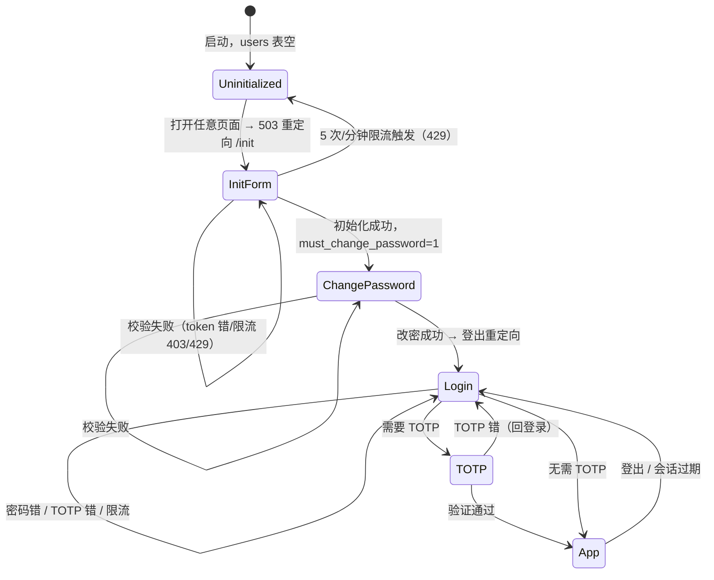

#### 交互稿（移动端 375 优先）

```
┌──────────────────────────────┐
│                              │
│         [ Asmoday ]          │ ← 产品名（i18n: app.name）
│                              │
│    初始化 / Initialize       │ ← h1
│                              │
│  ┌────────────────────────┐  │
│  │ 初始化令牌            │  │ ← 输入，placeholder: 控制台打印的令牌
│  └────────────────────────┘  │
│  ┌────────────────────────┐  │
│  │ 用户名                │  │
│  └────────────────────────┘  │
│  ┌────────────────────────┐  │
│  │ 密码                  │  │ ← 密码可见切换按钮
│  └────────────────────────┘  │
│  ┌────────────────────────┐  │
│  │ 确认密码              │  │
│  └────────────────────────┘  │
│                              │
│  ┌────────────────────────┐  │
│  │     初始化            │  │ ← 主按钮 h-40，loading 态显示 spinner
│  └────────────────────────┘  │
│                              │
│  [查看帮助]                  │ ← 底部次按钮 → 打开 /help#init
└──────────────────────────────┘
```

错误展示：**行内**（输入框下方红色小字），不用 toast。限流 429 → 底部提示条 `"请求过于频繁，请在 {seconds}s 后重试"` 倒计时。

登录页永远是普通登录页：只有密码框（TOTP 可选展开），**没有初始化形态**（v4.9.34）。首次部署用控制台打印的一次性密码登录，登录后 App.vue 弹「设置新密码」对话框完成建权。单用户模型（v4.9.28）下网页端不出现用户名——`/api/auth/login` 的 `username` 可省略，后端按唯一账号解析。

#### API 契约

（v4.9.34：v4.9.33 的 `POST /api/auth/setup` 删除，初始化走「一次性密码登录 → 改密」既有链路；无 `/api/auth/init`、无 `X-Setup-Token`。）

```http
GET  /api/auth/status        // 公开
{ initialized, authenticated, username, must_change_password, totp_enabled, version }
```

```http
POST /api/auth/login
{ "password": "string", "username": "string?", "totp": "string?" }

200 { ok:true, data: {
  user: { id, username, is_totp_enabled },
  must_change_password: 0 | 1,
  needs_reauth: false
}}
// Set-Cookie: asmoday_session=...; HttpOnly; SameSite=Lax; Path=<base_url>;
401 E_UNAUTHORIZED   （密码错，无具体原因以避免用户名枚举）
429 E_TOO_MANY_REQUESTS
403 E_PASSWORD_CHANGE_REQUIRED  （登录成功但需改密时也返回此 code，前端据 data 判定）
```

```http
POST /api/auth/logout
200 { ok:true, data: null }
```

```http
POST /api/auth/password
{ "current": "string?", "next": "string" }
// current 可省略的场景：会话 must_change_password=1（一次性密码刚登录，身份已验过，v4.9.33）
// 正式密码会话必须带 current，错则 400 PASSWORD_WRONG

200 { ok:true, data: null }
400 E_VALIDATION               // 弱密码（长度、复杂度）
401 E_REAUTH_FAILED            // 旧密码错（正式会话）
```

#### 错误映射
见 §1.3；本模块涉及 `E_FORBIDDEN`、`E_UNAUTHORIZED`、`E_PASSWORD_CHANGE_REQUIRED`、`E_TOO_MANY_REQUESTS`、`E_VALIDATION`、`E_REAUTH_FAILED`。

#### GWT 验收

```gwt
GWT-AUTH-01 Given 全新数据目录首次启动  When 进程起来  Then 控制台打印一次性密码（stdout，不进日志文件），库里 admin 的 must_change_password=1（v4.9.34）
GWT-AUTH-02 Given 待初始化实例  When 打开站点  Then 登录页只有 1 个输入框且无用户名（无初始化页；未开 2FA 时是密码框、也没有切换入口）；一次性密码登录成功后弹「设置新密码」对话框（v4.9.34 / v4.9.48）
GWT-AUTH-03 Given 待初始化实例  When 登录页输入错误密码  Then 401 并计入 IP 防爆破池；换成正式密码后旧一次性密码登录 401（v4.9.34）
GWT-AUTH-04 Given 用 `--init` / `--reset-password` 发放的一次性密码登录成功（must_change_password=1）  When 访问业务 API  Then 403 E_PASSWORD_CHANGE_REQUIRED，前端弹强制改密对话框（只有新密码 + 确认，无需再填一次性密码，v4.9.33）
GWT-AUTH-18 Given 首启打印了一次性密码但没人登录（must_change_password=1），进程被关掉  When 再次启动  Then 控制台**重新打印一个一次性密码**并在横幅里注明「上一个已作废」；旧密码登录 401、新密码登录 200；库里仍只有一行账号、`must_change_password=1`、既有会话不被清掉（v4.9.44）
GWT-AUTH-05 Given 登录页  When 密码 / 动态码错误  Then 行内统一提示「密码或动态验证码不正确」，不区分是哪一种、不泄露账号是否存在（v4.9.48）
GWT-AUTH-06 Given 账号已开 2FA  When 打开登录页  Then 默认是**密码框**，框下方有一行「使用动态验证码登录」；点它同一个框变成动态码样式（明文、居中、字距拉开、占位 000000、`autocomplete=one-time-code`），标签变「动态验证码」并提示恢复码这条出路，入口变「使用密码登录」；再点回密码框且切换会清空已填内容。动态码模式下填 6 位码（输满自动提交）或恢复码都能进站，填密码进不去；密码模式下密码能进站（v4.9.48）
GWT-AUTH-07 Given 已登录  When 密码重置成功（CLI --reset-password）  Then 前端下一个请求返回 401 E_UNAUTHORIZED → 跳登录
GWT-AUTH-08 Given 会话已过期（30 天绝对上限）  When 用户点击任意页面  Then 401 跳登录，返回后回到原路径
GWT-AUTH-09 Given 任意实例  When POST /api/auth/setup  Then 404（端点已随 v4.9.34 删除，初始化只走登录 + 改密链路）
GWT-AUTH-10 Given 初始化完成  When 检查 data/logs/asmoday.log 与访问日志  Then 无一次性密码明文（只打 stdout）、无初始化令牌
GWT-AUTH-11 Given 可信反代 + 客户端伪造 X-Forwarded-For 最左值  When 客户端连发登录失败  Then 防爆破池按「最右不可信地址」计数，伪造值换不动桶
GWT-AUTH-12 Given 全新数据目录首次启动  When 看控制台  Then 一次性密码出现在 `====` 边框的 `ASMODAY - ADMINISTRATOR CREDENTIAL` 横幅里、单独成行（TTY 下反显高亮），下面一行 `Open: http://localhost:4242`（绑 `0.0.0.0` / `::` 时再加一行 `LAN:  http://<本机局域网 IP>:4242`）；整段只有 ASCII，重定向到文件时无转义码（v4.9.42 / v4.9.45）
GWT-AUTH-13 Given 任意启动  When 看启动日志  Then 有 `local:   http://localhost:<port><base_url>`；host 配 `0.0.0.0` / `::` 时**多一行** `network: http://<默认路由网卡 IP>:<port>`（该地址从另一台设备 curl 得 200），只监听回环时不出 network 行；绑具体 IP 时 `local` 就是该 IP；默认监听 `127.0.0.1`，`netstat` 里没有 `0.0.0.0:<port>`（v4.9.42 / v4.9.45）
GWT-AUTH-26 Given `host = "auto"` 或 `ASMODAY_HOST=auto`  When 启动  Then 先试 `[::]:<port>` 双栈（有 IPv6 的环境里 `netstat` 看到 `:::<port>` 且 v4 可连），环境给不了 IPv6 时自动降到 `0.0.0.0` 并打一条全英文 WARN（只含 `ErrorKind`），服务照常起来；启动日志与 `local:` / `network:` 两行用的是**实际**绑上的地址（v4.9.53）
GWT-AUTH-27 Given `host` 写成 `::` 但端口已被别的进程占用（或权限不足）  When 启动  Then 直接失败并保留 `failed to bind [::]:<port>: address already in use (os error 10048)` + Hint，**不得**降级去绑 `0.0.0.0`（否则真正原因被藏起来）；`host` 写成 `localhost` 这类主机名时一次性报 `invalid listen address "localhost": expected an IP literal … or "auto"` 并退出，不进入 DNS 解析（v4.9.53）
GWT-AUTH-14 Given 端口已被占用  When 再启动一个实例  Then 控制台全英文：`failed to bind …: address already in use (os error 10048)` + `Hint: the port is already taken…`，不出现系统本地化的中文（v4.9.42）
GWT-AUTH-15 Given 在 Windows Terminal / iTerm2 / VS Code 终端里首次启动  When 看密码横幅的 `Open:` / `LAN:` 行与启动日志的 `local:` / `network:` 行  Then URL 是 OSC 8 超链接（Ctrl/⌘+点击直接打开浏览器），显示文本仍是纯 URL；`data/logs/asmoday.log` 与 JSON 通道里**没有** `\x1b]8;;` 残留（v4.9.43）
GWT-AUTH-16 Given 输出被重定向（`> out.log`、管道、CI 采集）  When 启动  Then 横幅与日志都不含任何转义码；文件日志为纯 UTF-8 正文（v4.9.43）
GWT-AUTH-17 Given 启动完成  When 看 `data/logs/asmoday.log` 的 DEBUG 行  Then 有 `console: tty=<bool> vt=<bool> color=<bool> hyperlink=<bool> (TERM=… TERM_PROGRAM=…)`，可据此判断「没链接」是被主动关掉还是终端不支持（v4.9.43）
GWT-AUTH-19 Given Windows 双击 exe（经典 conhost，无 `WT_SESSION` / `TERM_PROGRAM`）且数据库里还没有正式密码  When 启动  Then 横幅照样打印（含 `Open:` / `LAN:`）并多一行 `(this classic console cannot open links; copy the address above, or start with --open)`，但**不会**自己拉起浏览器——日志里没有 `opened the default browser`，也不会有浏览器窗口 / UAC 或 Edge 的「提权实例」弹窗（v4.9.49）
GWT-AUTH-20 Given 任意实例  When 带 `--open`（或 `ASMODAY_OPEN=1`）启动  Then 监听成功后延迟 400ms 用默认浏览器打开 `local` 地址，日志有 `opened the default browser: …`；Windows 走 `explorer.exe <url>` 交回登录用户 shell（浏览器为普通权限，不随本进程提权），`explorer` 不可用时才退到 shell 的 `start` 内建；**不带该参数时任何情况下都不开**（v4.9.49）
GWT-AUTH-21 Given Linux 服务器 / 无图形会话  When 不带 `--open` 启动  Then 不尝试拉起浏览器；带 `--open` 且 `xdg-open` 不存在时只 WARN（`could not open a browser …; open … manually`），服务照常起（v4.9.45 / v4.9.49）
GWT-AUTH-22 Given 任意实例（未登录）  When GET /api/auth/status  Then 回设备级 `totp_enabled`（只说明本机账号开没开 2FA，不含密钥）：没开时登录页没有任何「动态验证码 / 恢复码」字样、也没有切换入口；开了才出现切换入口，**框始终只有 1 个**（v4.9.46 / v4.9.48）
GWT-AUTH-23 Given 2FA 账号  When POST /api/auth/login  Then `{password}` 与 `{totp}` 各自 200（前者密码模式，后者动态码 / 恢复码模式）；`{password,totp}` 是严格双因子（缺一或码错 401）；两字段都空 401 AUTH_INVALID；用过的恢复码 401；未开 2FA 的账号 `{totp}` 一律 401（v4.9.48）
GWT-AUTH-24 Given 已设正式密码的账号  When 登录 / 改密 / 关 2FA / WebDAV 时把密码写成「首尾带空格或全角空格」  Then 一律按 trim 后的值校验并通过（`{password: "  Secret#2026 "}` → 200）；纯空白 → 401 `AUTH_INVALID`；改密时 `next` 的首尾空白不进入哈希（事后用不带空格的密码能登）；登录页密码框失焦 / 按回车时首尾空白自动消失（v4.9.50）
GWT-AUTH-25 Given 任意账号（或创建分享）  When 把密码 / 口令设成含空格、中文、全角符号、超过 128 位或纯数字  Then 写入侧 400 + 稳定 code：`PASSWORD_SPACE` / `PASSWORD_CHARSET` / `PASSWORD_TOO_LONG` / `PASSWORD_ALL_DIGITS`（过短为 `PASSWORD_TOO_SHORT`）；被拒的改密不影响原密码、也不清会话；网页密码框与分享口令框在输入、粘贴、输入法落定时把非可见 ASCII 直接滤掉（`ab cSecret#2026密码！` → `abcSecret#2026`）（v4.9.51）
GWT-USER-01 Given 全新安装（无任何账号）  When 启动  Then 创建唯一账号 admin + 打印一次性密码；用户拿它登录后在强制改密弹窗换正式密码，网页端全程无用户名（v4.9.34）
GWT-USER-02 Given 已登录  When 访问 /api/users 或设置页  Then 端点 404（已随多用户模型删除），设置页无「用户管理」Tab（v4.9.28）
GWT-USER-03 Given 存量库有多个账号（含 2 个 admin）  When 迁移 v20 跑完  Then 只留「启用中 id 最小的账号」（无启停列时取 id 最小），其余账号从 users 表物理删除，其 sessions / favorites / play_history / shares / access_tokens 一并删掉（含 user_id 为 NULL 的遗留令牌）；再次启动幂等（v4.9.30）
GWT-USER-04 Given 库已完成 v20 收口  When 检查表结构  Then users 无 role / is_active / permissions / mount_scope，sessions / shares / access_tokens 无 user_id，favorites / play_history 主键为 (mount_id, file_path)；库里只有一行账号，登录即该账号（v4.9.30）
GWT-USER-08 Given 升级删除了多余账号  When 检查数据目录  Then `<data>/terminal_history/u<id>`（id ≠ 保留账号）目录被移除，其余非 `u<数字>` 目录不受影响；日志同时打印删除的账号数与行数（v4.9.29）
GWT-USER-05 Given 唯一账号已登录  When 调用任意写接口（mkdir/上传/改名/移动/删除/分享/终端）  Then 全部放行；唯一的限制来自挂载点自身的 readonly（v4.9.28）
GWT-USER-06 Given 唯一账号已登录  When GET /api/files/mounts  Then 返回配置里的全部挂载点（不再有 scope 过滤），文件/媒体/缩略图/搜索路径解析同口径（v4.9.28）
GWT-USER-07 Given 配置、系统维护、备份等管理端点  When 未登录  Then 401 AUTH_REQUIRED；登录后放行（AdminUser 提取器保留名字，语义已等价于「已登录」）（v4.9.28）
GWT-DL-08 Given 单用户模型  When 任意 aria2 客户端用 `token:<secret>` 调 addUri/addTorrent  Then 任务进入唯一队列，所有任务都归设备主人；不存在 per-user 参数或隔离（v4.9.28）

#### aria2 兼容下载引擎（GWT-DL，v4.9.26）

GWT-DL-01 Given 任意 aria2 客户端  When `getVersion`  Then `enabledFeatures` 含 Asmoday / Multi-Connection / Resumable；BT 会话就绪时追加 BitTorrent（否则客户端自动隐藏磁力/种子入口）（v4.9.27 更新）
GWT-DL-02 Given 错误 RPC 密钥  When 调用任意方法  Then `{"code":1,"message":"Unauthorized"}`；正确密钥（token:<secret>，首项）正常返回
GWT-DL-03 Given AriaNg 的批量轮询  When `system.multicall` 内层 params **不含** token  Then 两个子调用都成功（鉴权只在 multicall 层做一次），结果形如 `[[...],[...]]`
GWT-DL-04 Given 支持 Range 的源站  When `addUri` 后 `tellStatus`  Then `connections > 1`（按 segments 均分并发），`tellStatus` 的 totalLength/completedLength/downloadSpeed/connections/dir/files/errorCode/errorMessage 全部存在
GWT-DL-05 Given 下载中 `pause`  Then 状态 paused、已下载字节保留、`.aria2` 控制文件生成、任务出现在 `tellWaiting`（paused 属 waiting 族）；`unpause` 后从断点续传且最终字节与源 sha256 一致
GWT-DL-06 Given `dir` 落在「允许的保存目录」之外  When `addUri`  Then JSON-RPC fault（拒绝，不夹到根里）；`out` 含路径分隔符或 `..` 同样拒绝（v4.9.37 起白名单 = 挂载点子路径）
GWT-DL-07 Given `[download].enable=false`  When 任意客户端访问 `/jsonrpc`  Then 404（协议面完全不存在）
GWT-DL-08 Given 已登录  When 打开侧边栏「下载引擎」  Then URL 为 `/downloads`，页头标题也是「下载引擎」，显示下载/上传速度、进行中与队列计数、BT 监听端口；分栏为进行中 / 等待中 / 已完成（v4.9.31，v4.9.38 改名）
GWT-DL-09 Given `/downloads`  When 新建下载填一行或多行链接  Then 每行各建一个任务并切到「进行中」；`GET /api/downloads` 的 `tasks.active[].name` 为落盘文件名、`kind=http`，进度字段随轮询增长（v4.9.31）
GWT-DL-10 Given 下载中点暂停  Then 该任务只出现在 `waiting`（`status=paused`），**不再同时出现在 `stopped`**；点继续回到 active（v4.9.31 修正）
GWT-DL-11 Given 已完成/已失败的任务  When 点移除  Then 任务从 `stopped` 列表彻底消失（走 removeDownloadResult，不留 `removed` 行）；`DELETE /api/downloads/stopped` 一次清空（v4.9.31）
GWT-DL-12 Given 页内「引擎设置」视图  Then 三张卡：`引擎参数`（segments / max_concurrent / BT 端口，标「需重启」）、`允许的保存目录`（`挂载点名 / 子路径`，标「即时生效」）、`RPC 接入`（地址与密钥可复制，密钥默认掩码）；宽屏左参数、右目录+RPC 两列，窄屏单列。保存参数走 `POST /api/config`：库里的值立刻变，但引擎仍是旧快照，重启后才反映；保存目录例外（v4.9.37 起热生效）
GWT-DL-13 Given `[download].enable=false`  When 打开 `/downloads`  Then 显示「下载引擎未启用」提示且新建按钮禁用，`GET /api/downloads` 返回 `{enabled:false}`（v4.9.31）
GWT-DL-14 Given RPC 密钥  When 检查存储  Then 位于数据库 `settings.download_rpc_secret`，`data/` 下不存在 `download_rpc_secret` 文件；启动日志与 `asmoday.log` 都不含明文，只有前端下载页能看（显隐 / 复制）（v4.9.36）
GWT-DL-15 Given 引擎设置里的「刷新密钥」  When 第一次点击  Then 按钮文案变「确认刷新？」且 3 秒内不执行；再点一次才发起 `POST /api/downloads/secret`，返回新密钥、toast 提示、页面就地显示新值；`engine.rpc_secret` 随之改变（v4.9.36）
GWT-DL-16 Given 刚刷新过密钥  When 旧 `token:<old>` 调 `/jsonrpc`  Then `{"code":1,"message":"Unauthorized"}`；新 token 正常返回；进程重启后 `engine` 仍回显新密钥（写库已生效，无需重启）（v4.9.36）
GWT-DL-17 Given 存量 `config.toml` 里写了 `[download].rpc_secret`  When 数据库尚无密钥时启动  Then 用它作为初始值导入并 WARN；数据库已有值时该配置被忽略（不覆盖），前端刷新是唯一修改入口（v4.9.36）
GWT-DL-18 Given 「引擎设置 → 允许的保存目录」卡  Then 列出 `挂载点名 / 子路径`（根目录只显示名字），页面任何位置都不出现服务器绝对路径；新增行只能从挂载点下拉选择 + 填子路径，只读挂载点不在选项里、掉线挂载点显示「（离线）」且禁用（v4.9.37）
GWT-DL-19 Given 保存目录里加 `dl2`  When 点「保存目录」  Then `POST /api/downloads/roots` 写 `settings.download_roots` 并热替换，列表立即出现、toast 提示「立即生效」，无需重启；`media/dl2` 目录被自动创建，`GET /api/downloads/engine` 的 `roots[].label` 立刻包含它（v4.9.37）
GWT-DL-20 Given 保存目录填 `../escape` / 盘符 / UNC  When 保存  Then 400 并指出原因；未知 mount_id 或只读挂载点逐条跳过并回 `warnings`，全部失效时 400（v4.9.37）
GWT-DL-21 Given 数据库里已有 `download_roots`  When 重启进程  Then `engine.roots` 与重启前一致；Given 库里没有值但 `config.toml` 的 `[download].roots` 有绝对路径  Then 能映射到挂载点的导入为子路径、映射不上的 WARN 丢弃，一个都没剩下时取第一个在线可写挂载点 + `downloads`（v4.9.37）
GWT-DL-22 Given 点页头「引擎设置」  Then **以页内视图切换，不出现遮挡层**（DOM 里没有 `.fixed.inset-0` 弹窗），右侧按钮变「返回下载列表」；点它回到任务列表、滚动回顶部且分段数字、轮询照常（v4.9.38 / v4.9.40）
GWT-DL-23 Given 在设置视图改了参数没保存  When 点「返回下载列表」  Then 先弹确认而不是直接丢弃（见 GWT-DL-28）；「保存目录」在无改动时禁用，加/删行后提示「目录有改动，记得保存」（v4.9.40）
GWT-DL-24 Given 「引擎设置 → BitTorrent Tracker」  Then 通栏一张卡：多行输入框（一行一个）、「填入常用列表」「清空」「保存 Tracker」三个按钮，标题旁标「对新任务生效」；BT 关闭时输入框与按钮禁用并提示先启用（v4.9.39）
GWT-DL-25 Given 保存 Tracker  `udp://a.example:1337/announce` + `ftp://nope/x` + `udp://`  Then 只留合法项，`rejected` 逐条显示「已丢弃 …」；写 `settings.download_trackers` 并热替换，`POST` 后立刻 `GET /api/downloads/engine` 就返回新列表；重启进程仍是新值（v4.9.39）
GWT-DL-26 Given 实例里有 Tracker 列表  When 添加一个不含 `tr=` 的 magnet 或 `.torrent`  Then 该任务的 announce 列表含这些地址（`.torrent` 走 `AddTorrentOptions::trackers`，magnet 走 URI 追加 `&tr=`，重复项不重复追加）；添加前已在跑的任务不受影响，`tellStatus.bittorrent.announceList` 仍是旧的（v4.9.39）
GWT-DL-27 Given aria2 客户端  When `aria2.getGlobalOption`  Then 返回 `bt-tracker`（逗号分隔，与页面同一份）；`aria2.changeGlobalOption {"bt-tracker":"…"}` 返回 OK 且真的写库 + 换内存，随后 `getGlobalOption` 与页面都反映新值；不支持的键（如 `max-overall-download-limit`）也回 OK，但日志逐条 WARN（v4.9.39）
GWT-DL-28 Given 引擎设置里改了参数 / 保存目录 / Tracker 任一项没保存  Then 页头出现「有未保存改动」徽标；点「返回下载列表」弹确认层并逐条列出会丢的东西（引擎参数 / 允许的保存目录 / BitTorrent Tracker 各自只在脏时列出）；「继续编辑」关掉确认、仍在设置视图且草稿不丢；「放弃改动并返回」才回任务列表，再进设置三块草稿都回到已保存值、徽标消失（v4.9.40）
GWT-DL-29 Given 有未保存改动  When 点侧边栏或浏览器后退离开 `/downloads`  Then 同样弹确认；取消则 URL 仍在 `/downloads`，确认放弃才真正跳转且草稿回滚。放弃目录改动时 `GET /api/downloads/engine` 的 `roots` 条数不变（没有偷偷写库）（v4.9.40）
GWT-DL-30 Given 设置页滚到最底部  Then 底部还有一颗「返回下载列表」，点击走同一套未保存确认；390 宽无横向溢出，底部按钮可见（v4.9.40）
GWT-DL-31 Given 在引擎设置视图  When 按系统返回键 / 浏览器后退（不是点按钮）  Then **先回到下载任务列表**，URL 仍停在 `/downloads`，不出现「直接退回聚合主页」；有未保存改动时先弹确认，选「继续编辑」后视图与草稿都不变、再按一次仍能拦住；切到任务视图后再按返回才真的离开本页（v4.9.41）
GWT-DL-32 Given Aria2 Explorer 形态的 addUri：`referer` 作为**独立选项**发、`header` 是 `"Name: value"` 数组  When 下载需要登录态的直链  Then 探测请求与**每一个分段请求**都带 `Referer` 与 `Cookie`（桩站缺任一头即 403）；`getOption` 回 `referer` 与 `header` 数组（含 `Cookie:` / `User-Agent:` 两行）；`header` 里显式写 `Referer:` 时以它为准；`header` 写成换行分隔的单串（AriaNg 设置里的形态）同样生效（v4.9.52）
GWT-DL-33 Given 目标站点 `HEAD` 返 405/403 并 302 跳到另一个源  When 下同一个文件  Then 任务仍 `complete` 且落盘字节一致；重定向每一跳都重发同一份头与 `Range`（reqwest 自动跟随会删 `Cookie`，实测会被桩站 403）；`pause="true"` 加完停在 `paused`，`changeOption` 补 `header` / `referer` 后 `unpause` 能下完；`split` 等价于 `max-connection-per-server`；`header` 里名字非法的行被丢弃且任务照跑（不得因 panic 静默消失）；`dir` 越界时错误消息列出允许的根（v4.9.52）

#### BitTorrent（GWT-BT，v4.9.27）

GWT-BT-01 Given `[download].enable_bt=true`  When `addUri(["magnet:?xt=urn:btih:…"])`  Then 返回 16 位 GID，任务进 active；`tellStatus` 的 infoHash 为 40 位 hex，元信息解析后 files 逐条列出（index/path/length/completedLength/selected）
GWT-BT-02 Given base64 编码的 .torrent  When `addTorrent`  Then 与 addUri 同一条引擎路径；`select-file="1,3-5"` 只下载选中文件，未选中的文件 completedLength 恒 0
GWT-BT-03 Given 本地做种端 + 直连 peer  When 完整下载  Then 落盘字节与种子逐字节一致，任务转 complete，`onBtDownloadComplete` 与 `onDownloadComplete` 两条通知都发出（`cargo test bt::tests::local_seeder` 覆盖）
GWT-BT-04 Given BT 任务下载中  When `pause` / `unpause`  Then 状态在 paused / active 间切换且已完成字节不回退；`remove` 后任务转 removed 但**已下载文件保留**（delete_files=false）
GWT-BT-05 Given `[download].enable_bt=false`  When `addUri` 磁力链或 `addTorrent`  Then JSON-RPC fault 明确拒绝（不创建永远 waiting 的假任务），`enabledFeatures` 不含 BitTorrent
GWT-BT-06 Given BT 会话启动失败（端口被占等）  When 进程启动  Then 只降级为 HTTP-only 并记 WARN，整个服务与 `/jsonrpc` 照常可用
GWT-BT-07 Given 多文件种子  When 落盘  Then 文件在 `dir/<种子名>/…` 下（与 aria2 同构），且路径仍在「允许的保存目录」白名单内（v4.9.37）
```

#### 依赖红线
- 红线 4（不提供关闭认证开关）
- 红线 6（无回收站，与登录无关但本模块不应引入"重置到默认"按钮）
- §3.2 会话（依赖本模块完成）

#### DoD 增量
- 初始化令牌在控制台打印（截图附在 demo 里）
- 5 次/分钟限流在测试中显式验证
- 改密页与登录页共享表单组件（避免两套样式）

---

### 3.2 会话与二次验证（M1）

> **⚠️ v4.4.1 变更**：二次验证（REAUTH）整体移除——`verified_at` 闸门、`/api/auth/reauth`、`/api/auth/verify` 与前端弹窗都不存在了，敏感操作随登录会话直接放行。本节以下内容仅作历史设计记录。

#### 范围
- 自研 `sessions` 表：滑动续期 7 天 + 绝对上限 30 天。
- ~~`verified_at`：敏感操作（终端、令牌增删、配置写、DB 备份下载）要求 5 分钟内。~~（已移除）
- CSRF：Cookie 认证写操作要求 Origin/Referer 至少一个同源。

#### 状态机

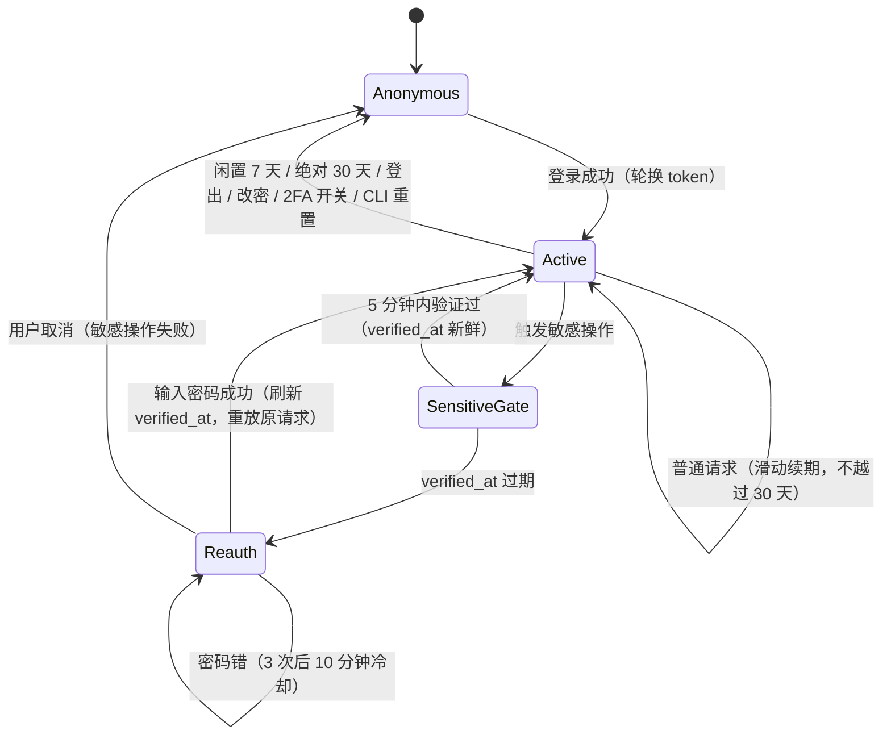

#### 交互稿（REAUTH 弹窗）

```
┌──────────────────────────────────────┐
│  需要验证身份 / Re-authentication    │ ← title
│  ──────────────────────────────────  │
│  此操作需要重新输入密码。            │ ← body
│                                      │
│  ┌────────────────────────────────┐  │
│  │ 密码                          │  │
│  └────────────────────────────────┘  │
│                                      │
│  [取消]                   [验证]     │
└──────────────────────────────────────┘
```

- 弹窗**阻塞**当前操作，取消则原操作中断（不重放）。
- 验证成功后**自动重放原请求且只重放一次**，不再弹窗。
- 密码错 3 次后弹窗内改为 `"尝试次数过多，请 10 分钟后再试或重新登录"`，按钮只剩 `[取消]`。

#### API 契约

```http
GET /api/auth/me
200 { ok:true, data: {
  user: { id, username, is_totp_enabled, must_change_password },
  session: { created_at, expires_at, verified_at, abs_expires_at },
  permissions: { is_admin, is_readonly }
}}
401 E_UNAUTHORIZED
```

```http
POST /api/auth/reauth
{ "password": "string" }
200 { ok:true, data: { verified_at: <unix ms> } }
401 E_REAUTH_FAILED
429 E_TOO_MANY_REQUESTS
```

#### 错误映射
`E_UNAUTHORIZED`、`E_REAUTH_REQUIRED`、`E_REAUTH_FAILED`、`E_TOO_MANY_REQUESTS`。

#### GWT 验收

```gwt
GWT-SESSION-01 Given 活跃会话  When 发送任意读请求  Then 不轮换 token，只更新 expires_at（7 天内滑动）
GWT-SESSION-02 Given 会话 createdAt=29 天前  When 请求  Then 续期不越过 createdAt+30d（响应 expires_at 等于绝对上限）
GWT-SESSION-03 Given 会话已闲置 8 天  When 请求  Then 401
GWT-SESSION-04 Given verified_at=6 分钟前  When 调用 POST /api/config  Then 403 E_REAUTH_REQUIRED
GWT-SESSION-05 Given E_REAUTH_REQUIRED  When 前端弹出 Modal 输入正确密码  Then 后端返回 200 且原请求自动重放（仅一次）
GWT-SESSION-06 Given REAUTH 弹窗  When 连续 3 次密码错  Then 弹窗关闭且 10 分钟内再触发写操作直接 401
GWT-SESSION-07 Given 浏览器发写请求  When Origin 与 Referer 都缺失  Then 403 E_FORBIDDEN
GWT-SESSION-08 Given 写请求带 Bearer Token  When Origin 缺失  Then 放行
GWT-SESSION-09 Given 用户在 A 设备改密  When B 设备发起任意请求  Then 401（全部 session 行已删）
GWT-SESSION-10 Given WebSocket /api/terminal/ws  When Origin 与 Host 不同源  Then 拒绝握手（403）
GWT-SESSION-11 Given 拖走 data/*.db 文件  When 检索 sessions 表  Then 只见 token 的 SHA-256 摘要，无可直接使用的会话凭据
```

#### 依赖红线
- 红线 4（认证不可关闭）
- 红线 13（canonicalize 父目录在 path_guard 里，但本模块不涉及）

#### DoD 增量
- 会话续期在测试中显式验证 7 天滑动 + 30 天绝对上限两个边界
- REAUTH 弹窗在设置页、终端、令牌、备份四个入口均复现
- `useReauth.ts` 单测覆盖"重放一次"逻辑

---

### 3.3 文件列表与导航（M1）

#### 范围
- 挂载点卡片 → 目录列表 → 面包屑导航。
- 网格 / 列表双视图，偏好写 localStorage。
- 稳定排序 + 游标分页，切换排序清空列表。
- 隐藏垃圾文件（`desktop.ini`、`.DS_Store` 等）由后端过滤，前端不再判断。

#### 状态机

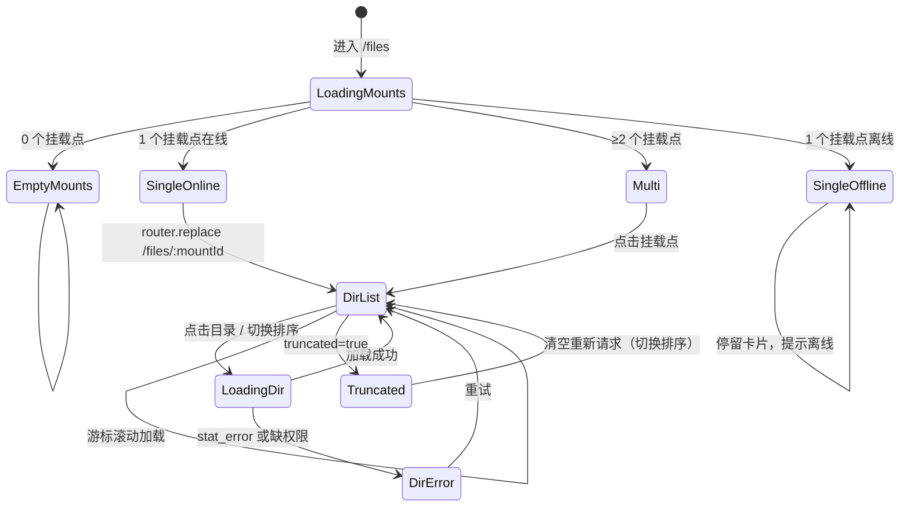

#### 交互稿（网格视图 / 桌面）

```
┌─ 顶栏 ────────────────────────────────────────────────┐
│ [🏠] / media / photos / 2026/                    [👤] │ ← 面包屑 + 用户菜单
├─ 工具栏 ──────────────────────────────────────────────┤
│  [⬆ 上传] [新建] [视图▾] [排序▾] [筛选▾]   [刷新]   │
│  已选 0 项                                            │
├───────────────────────────────────────────────────────┤
│  ┌──────┐ ┌──────┐ ┌──────┐ ┌──────┐ ┌──────┐       │
│  │ [缩略]│ │ [缩略]│ │ [缩略]│ │ [缩略]│ │ [图标]│     │
│  │ a.jpg │ │ b.png │ │ c.mp4 │ │ d.pdf │ │ folder│     │
│  └──────┘ └──────┘ └──────┘ └──────┘ └──────┘       │
│  ...                                                  │
│                                                       │
│                    [加载更多…]                         │
└───────────────────────────────────────────────────────┘
```

**空状态**：

```
┌───────────────────────────────────────┐
│                                       │
│            [空文件夹图标]              │
│         此目录为空                     │ ← i18n: files.empty.title
│         拖拽文件到此处上传              │ ← i18n: files.empty.hint
│                                       │
│         [上传文件]                     │
│                                       │
└───────────────────────────────────────┘
```

**截断态**（页脚提示条，黄色）：

```
⚠ 仅显示前 10000 项。请通过终端或缩小范围查看。
```

**列表视图**（表格）：

```
名称▾ | 大小 | 修改时间▾ | 类型
📁 folder1  |  -   | 2026-10-01 12:00 | 文件夹
📄 a.jpg    | 2.3MB| 2026-10-28 09:31 | JPEG
```

列头点击切换排序，方向用 ▲▼ 标记，**同一时间只有一列有排序箭头**。切换排序 → 清空 items + 丢弃 cursor + 重新请求。

#### API 契约

```http
GET /api/files/mounts
200 { ok:true, data: { items: [{
  id, name, canonical_root, is_readonly, is_online, follow_symlinks
}], next_cursor: null }}
```

```http
GET /api/files/list?mount_id=&path=&cursor=&limit=100&show_hidden=false&sort=name|mtime|size&order=asc|desc
200 { ok:true, data: {
  items: [{
    name, path, is_dir, is_symlink, target_is_dir?,
    size, mtime, type,
    thumb_hash?,        // 若有缩略图
    stat_error?: string // 逐项容错
  }],
  next_cursor: "…" | null,
  truncated: bool,
  sort_applied: { field, order }
}}
400 E_PATH_TRAVERSAL / E_VALIDATION
403 E_READONLY（仅列出时可读，只读不影响列表）
404 E_NOT_FOUND
```

```http
GET /api/files/raw?mount_id=&path=
// 支持 Range, HEAD, ETag, Last-Modified
200 / 206 / 304
404 E_NOT_FOUND
416 直接返回（Range 越界，不加 envelope，标准 HTTP 语义）
```

```http
GET /api/files/thumb?mount_id=&path=
200  （image/webp 或 image/jpeg 二进制，不包裹 envelope）
404  （缩略图未生成，前端回占位）
```

#### 错误映射
`E_PATH_TRAVERSAL`、`E_VALIDATION`、`E_NOT_FOUND`、`E_READONLY`（重命名等写操作时）。

#### GWT 验收

```gwt
GWT-LIST-01 Given 0 个挂载点  When 进入 /files  Then 显示空状态卡片，无路由跳转
GWT-LIST-02 Given 1 个挂载点且在线  When 进入 /files  Then router.replace 到 /files/:mountId/，直接进目录列表
GWT-LIST-03 Given 1 个挂载点但离线  When 进入 /files  Then 停留卡片，显示"离线"标记与"重试"按钮
GWT-LIST-04 Given 目录列表  When 切换排序字段  Then 清空 items，丢弃 cursor，从头请求
GWT-LIST-05 Given 列表滚动到底  When 有 next_cursor  Then 自动请求下一页并追加
GWT-LIST-06 Given 列表 10000 项  When 请求第一页  Then 返回 truncated=true，前端展示截断提示
GWT-LIST-07 Given 目录含 desktop.ini  When 请求列表  Then 该文件不出现
GWT-LIST-08 Given 目录含 .git/config 且 show_hidden=false  When 请求  Then .git 不出现
GWT-LIST-09 Given 目录含 .git/config 且 show_hidden=true  When 请求  Then .git 出现
GWT-LIST-10 Given 单个文件 stat 失败（权限/消失）  When 请求列表  Then 该项 stat_error 被设置，其他项正常
GWT-LIST-11 Given 只读挂载点  When 用户右键  Then "重命名/移动/复制/删除"项置灰 + tooltip "只读挂载点"
GWT-LIST-12 Given 面包屑  When 挂载点数量 ≥2  Then 展示 [🏠] / 挂载点 / 目录…
GWT-LIST-13 Given 面包屑  When 挂载点数量 =1  Then 展示 [🏠 挂载点] / 目录…
GWT-LIST-14 Given 网络盘挂载点  When 10 秒内连续请求 /api/files/mounts  Then 只有第一次真正 canonicalize + is_dir，其余命中缓存；配置改动后 revision +1 立即刷新（v4.9.21）
GWT-LIST-15 Given 挂载点离线（SMB 掉线）  When 打开缩略图 / 播放 Range / 播放进度  Then 不再每个请求都重扫挂载点，响应时间不随「挂载点数量 × 超时」累加（v4.9.22）
GWT-LIST-16 Given 同一目录同时存在 `A.txt` 与 `a.txt`（Linux/macOS）  When 按名称翻页  Then 两条都能被翻到，不出现「列表少一条」（游标键 = 小写名 + 原名，v4.9.22）
```

#### 依赖红线
- 红线 5（无回收站，删除为物理删）
- 红线 13（canonicalize 父目录）
- §4.1 视图与过滤（后端硬编码垃圾名单）

#### DoD 增量
- 空状态、加载骨架、stat_error 单项标记三种态视觉走查通过
- 网格/列表视图切换在移动端 375 宽可操作
- 隐藏文件开关不影响垃圾文件过滤（垃圾永远不可见）

---

### 3.4 文本编辑与预览（M1）

#### 范围
- 文本/代码用 CodeMirror 6 编辑，保存时原样写回 EOL 与 BOM。
- Markdown 默认渲染（`marked` + `DOMPurify`），可切换源码。
- PDF 用 `<iframe src=raw_url>`。
- CSV 超 5MB 或 1000 行截断。
- Office/CAD/压缩包只提示下载。

#### 状态机

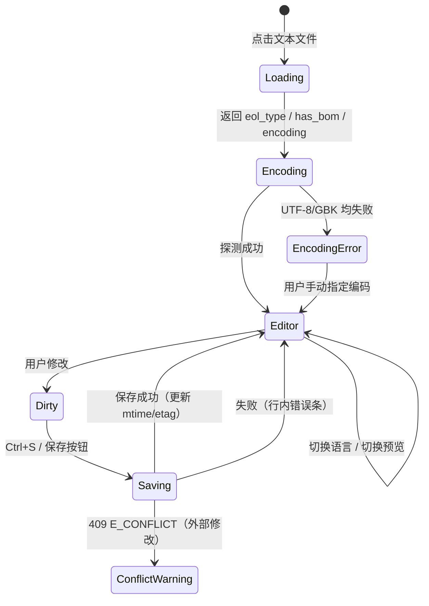

#### 交互稿

```
┌─ 顶栏（铺满整个浏览器，v4.4.5）────────────────────────────┐
│ [×]  a.txt ●          [− 14px +]  [TOML▾]  [保存 Ctrl+S] │
├─ 路径行 ──────────────────────────────────────────────────┤
│ 📁 asmoday › sub › a.txt                                  │
├───────────────────────────────────────────────────────────┤
│  1  # 标题                                                │
│  2                                                        │
│  3  正文...                                               │
│  ...                                                      │
├─ 状态栏 ──────────────────────────────────────────────────┤
│ UTF-8 · LF  |  BOM  |  [只读挂载点]                       │
└───────────────────────────────────────────────────────────┘
```

- 编辑器**整屏接管**（`Teleport` 到 `body` + `fixed inset-0`），侧边栏与顶栏让位；
  用 `Teleport` 而不是就地 `fixed`，因为 `#app-scroll` 祖先在路由过渡期带 `transform`。
- 列表不卸载：关掉编辑器直接回到原目录与滚动位置，不重新拉列表。
- 字号步进器 `− 14px +`（中间那格点一下回默认），值存 `asmoday.editor.fontSize`；
  窄屏隐藏该控件，默认 13px。改字号只重配 CodeMirror 的字号 compartment，不重建实例
  （撤销栈、光标、滚动位置都保住）。
- 未保存关闭一律弹站内三选一：`[取消] [保存更改] [放弃修改]`，**不使用原生 `confirm`**。
  `closeEditor()` 返回 `Promise<boolean>`，调用方 `await` 后再决定是否继续换目录 / 开预览。
- 滚动只在编辑器内部；软键盘遮挡高度补成根容器的 `padding-bottom`，底栏与光标行不被压住。
- 保存失败用**顶部黄色提示条**（不是 toast），可关闭，带"重试"。
- 冲突（`E_CONFLICT`，外部修改）→ Modal 三选一：`[覆盖保存] [另存为副本] [放弃返回]`。

#### API 契约

```http
GET /api/files/text?mount_id=&path=
200 { ok:true, data: {
  content: "string",
  encoding: "utf-8" | "gbk" | "other",
  eol_type: "lf" | "crlf",
  has_bom: bool,
  size: int,
  mtime: int,
  etag: "string"
}}
415 E_NOT_TEXT
415/422 E_ENCODING
```

```http
POST /api/files/text
{ mount_id, path, content, eol_type, has_bom, etag_expected }
200 { ok:true, data: { mtime, etag } }
409 E_CONFLICT          // etag 不匹配（外部修改）
415 E_NOT_TEXT
415/422 E_ENCODING
```

#### 错误映射
`E_NOT_TEXT`、`E_ENCODING`、`E_CONFLICT`。

#### GWT 验收

```gwt
GWT-TEXT-01 Given LF 结尾文件  When 保存  Then 文件仍为 LF
GWT-TEXT-02 Given CRLF 结尾文件  When 保存  Then 文件仍为 CRLF
GWT-TEXT-03 Given UTF-8 BOM 文件  When 打开并保存  Then BOM 保留
GWT-TEXT-04 Given GBK 文件  When 打开  Then 以 GBK 解码展示，保存时按 GBK 写回
GWT-TEXT-05 Given 语言识别为 python  When 打开  Then 语法高亮生效
GWT-TEXT-06 Given 未知扩展名  When 打开  Then 纯文本模式，语言下拉可手动选
GWT-TEXT-07 Given Markdown 文件  When 打开  Then 默认预览模式，顶部可切源码
GWT-TEXT-08 Given 用户已修改文件  When 外部同时修改并保存  Then 用户保存时 409，弹 Modal 三选一
GWT-TEXT-09 Given 二进制文件  When 打开  Then 415 E_NOT_TEXT，UI 提示"无法编辑"
GWT-TEXT-10 Given CSV 6MB  When 打开  Then 提示"超过 5MB 已截断"
GWT-TEXT-11 Given CSV 2000 行  When 打开  Then 提示"超过 1000 行已截断"
GWT-TEXT-12 Given 有未保存修改  When 按系统返回/浏览器后退  Then 弹未保存确认；选取消则留在编辑器且不改变 URL
GWT-TEXT-13 Given 编辑器已打开  When 点侧边栏切走或刷新  Then 有未保存修改必须先确认（`onBeforeRouteLeave` 弹三选一 + `beforeunload`）
GWT-TEXT-14 Given 有未保存修改  When 点顶栏 × 并选「保存更改」  Then 先落盘再关闭，落盘失败则留在编辑器并显示错误条
GWT-TEXT-15 Given 编辑器已打开  When 观察布局  Then 编辑器矩阵等于视口（1440×900 下无侧边栏 / 顶栏残留），列表在下面保持挂载
```

#### 依赖红线
- 红线 16（EOL 原样写回）
- 红线 9（iframe 仅本地 PDF 允许）

#### DoD 增量
- EOL/BOM 组合矩阵单测通过（LF/CRLF × BOM/无BOM）
- 编辑器滚动不泄漏到外层
- Markdown 渲染器 `DOMPurify` 过滤 XSS（用例覆盖 `<script>` 注入）

---

### 3.5 文件变更操作：重命名 / 移动 / 复制 / 删除（M2）

#### 范围
- 单次 copy/move：选中数 > 100 **或** 递归字节 > 2GB（任一超限拒绝）。同挂载点 move 用原子 `rename`，不统计字节。
- 跨挂载点：`.asmoday-part.*` 临时文件 + 大小比对 + 原子改名 + 删源。
- 目录 overwrite 拒绝（`E_DIR_CONFLICT`），只接受 rename/skip。
- 删除：物理硬删；单目录需 `confirm_name`，批量需 `delete-token`。
- per-path 内存锁，冲突立即 `E_BUSY`。
- 软链接：`follow_symlinks` 决定逃逸策略；复制链接本身不跟随；删除只删链接本身。

#### 状态机（跨挂载点移动）

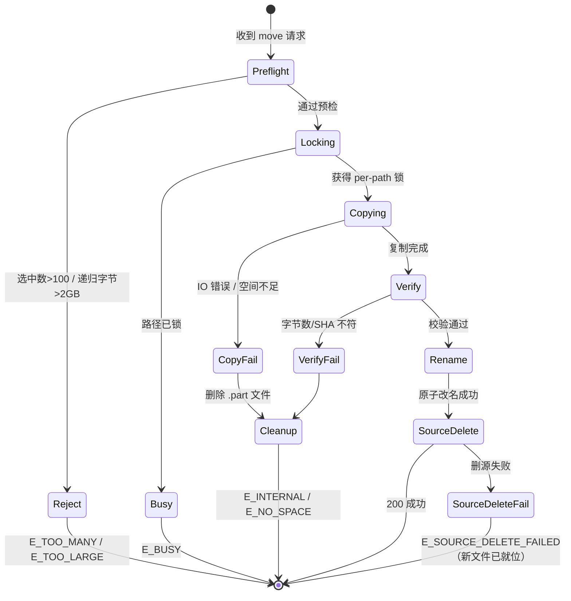

#### 交互稿（批量结果弹窗）

```
┌──────────────────────────────────────────────┐
│  操作结果 / Operation result                 │
│  ────────────────────────────────────────    │
│  成功 8 项，失败 2 项                        │
│                                              │
│  ✗ vacation/2024/a.jpg                       │
│    E_BUSY · 该路径正在被其他操作使用         │
│    [忽略并继续] [查看详情]                    │
│                                              │
│  ✗ b.txt                                     │
│    E_CONFLICT · 目标已存在同名项             │
│    [重命名] [跳过] [取消]                    │
│                                              │
│  ────────────────────────────────────────    │
│  [复制全部错误]                [关闭]        │
└──────────────────────────────────────────────┘
```

- 失败项**优先展示 `error_code` 翻译**，`message` 放在详情折叠区（供报障）。
- `E_BUSY` / `E_CONFLICT` **不出现"重试"按钮**（红线 18.7 精神），只出现"忽略并继续 / 重命名 / 跳过"。

#### API 契约

```http
POST /api/files/rename
{ mount_id, path, new_name }
200 { ok:true, data: { path: "新路径" } }
409 E_CONFLICT
400 E_VALIDATION
403 E_READONLY
```

```http
POST /api/files/move
{ mount_id, paths[], dest_mount_id, dest_path, on_conflict: "rename"|"skip" }
200 { ok:true, data: {
  results: [{
    src: "string",
    ok: bool,
    code?: "E_*",
    dest?: "string"
  }],
  summary: { ok_count, fail_count }
}}
413 E_TOO_MANY / E_TOO_LARGE   // 预检失败（整批拒绝）
409 E_BUSY                     // 任一锁冲突（整批拒绝）
```

```http
POST /api/files/copy    // 同上
```

```http
POST /api/files/delete-token
{ mount_id, paths[] }
200 { ok:true, data: { token: "string", expires_in: 60 } }
```

```http
POST /api/files/delete
{ mount_id, paths[], confirm_name? | confirm_token? }
200 { ok:true, data: {
  results: [{ src, ok, code? }],
  summary
}}
400 E_NAME_MISMATCH
403 E_TOKEN_EXPIRED / E_TOKEN_MISMATCH
```

#### 错误映射
`E_TOO_MANY`、`E_TOO_LARGE`、`E_BUSY`、`E_CONFLICT`、`E_DIR_CONFLICT`、`E_SOURCE_DELETE_FAILED`、`E_NO_SPACE`、`E_NAME_MISMATCH`、`E_TOKEN_EXPIRED`、`E_TOKEN_MISMATCH`、`E_CONFLICT_RETRY_EXHAUSTED`、`E_VALIDATION`、`E_READONLY`、`E_SYMLINK_ESCAPE`。

#### GWT 验收

```gwt
GWT-MUT-01 Given 选中 100 项  When move  Then 允许
GWT-MUT-02 Given 选中 101 项  When move  Then 413 E_TOO_MANY（整批拒绝）
GWT-MUT-03 Given 同挂载点 move 一个 5GB 目录  When move  Then 允许（rename 不统计字节）
GWT-MUT-04 Given 跨挂载点 move 递归 3GB  When move  Then 413 E_TOO_LARGE
GWT-MUT-05 Given 跨挂载点 move 500MB  When 中途断开  Then 下次启动清理 .asmoday-part 文件
GWT-MUT-06 Given 跨挂载点 move 目标已存在同名目录  When on_conflict=rename  Then 自动改名 基础名 (1).扩展名
GWT-MUT-07 Given 跨挂载点 move 目标已存在同名目录  When 自动命名 999 次冲突  Then 409 E_CONFLICT_RETRY_EXHAUSTED
GWT-MUT-08 Given 目标已存在同名文件  When on_conflict=overwrite 且类型为目录  Then 409 E_DIR_CONFLICT
GWT-MUT-09 Given 复制成功但删源失败  When 完成  Then 500 E_SOURCE_DELETE_FAILED，新文件保留，UI 提示手动清理
GWT-MUT-10 Given 同一路径被 A 操作锁住  When B 操作 move  Then 立即 409 E_BUSY，不排队
GWT-MUT-11 Given 删除 1 个目录  When 弹 confirm_name 输入的与目录名不一致  Then 400 E_NAME_MISMATCH
GWT-MUT-12 Given 批量删除 20 项  When 无 delete-token  Then 400 E_VALIDATION
GWT-MUT-13 Given 批量删除 20 项  When delete-token 60s 后使用  Then 403 E_TOKEN_EXPIRED
GWT-MUT-14 Given 复制软链接  When 执行  Then 复制链接本身，不跟随
GWT-MUT-15 Given follow_symlinks=false 且链接指向挂载点外  When 复制  Then 403 E_SYMLINK_ESCAPE
GWT-MUT-16 Given 删除软链接  When 执行  Then 只删链接，不递归删目标
GWT-MUT-17 Given 删除文件  When 成功  Then 级联删除 favorites / play_history 中相关记录
GWT-MUT-18 Given 删除已分享的文件  When 分享访问  Then 410 E_GONE（tombstone 30 天）
GWT-MUT-19 Given 软链接指向挂载点外且 follow_symlinks=true  When 上传到该链接  Then 成功且返回路径以链接路径为前缀（不替换成真实路径）
GWT-MUT-20 Given 直接请求挂载点外绝对路径  When follow_symlinks=true  Then 依然 403（放开的只有链接解析）
```

#### 依赖红线
- 红线 6（阈值）
- 红线 7（目录 overwrite 拒绝）
- 红线 12（原子落盘）
- 红线 13（canonicalize 父目录）
- §4.5 变更操作

#### DoD 增量
- 跨挂载点 `.part` 清理在启动时验证
- 批量结果弹窗在 4 种 code 下视觉走查通过
- 软链接逃逸策略在 `follow_symlinks` 两种取值下各验证一遍

---

### 3.6 上传（M2）

#### 范围
- 流式落盘，单文件上限 `upload_max_size_mb`，上传前检查剩余空间。
- 同名冲突沿用 `on_conflict`（rename / skip / 拒绝 overwrite 目录）。
- 并发池默认 3。
- 支持取消、重试、进度事件。

#### 状态机

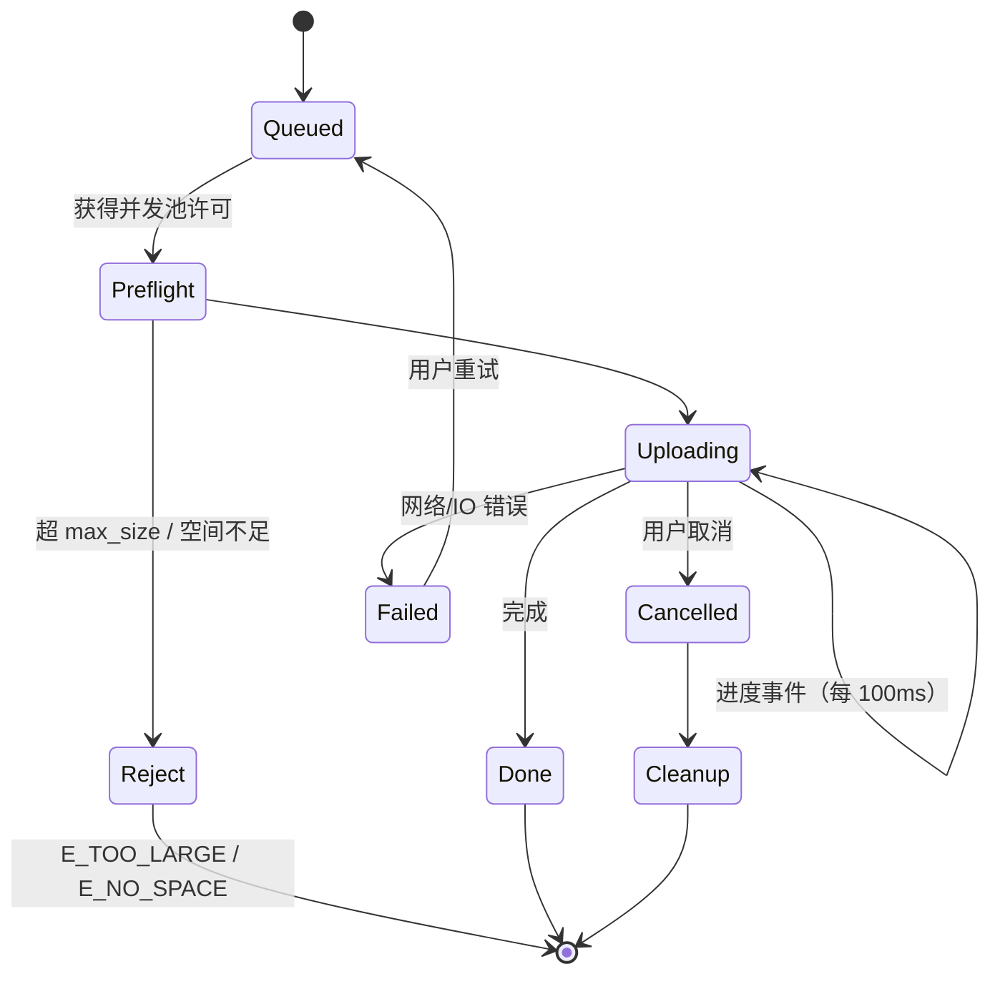

#### 交互稿（上传面板，右下角浮层）

```
┌─ 上传队列（3）───────────────────┐
│ a.jpg           ────●─── 68%     │
│   [取消]                          │
│ b.mp4           ──●───── 32%     │
│   [取消]                          │
│ c.png           ✓ 完成            │
│                                  │
│ 全部上传完成（2/3）              │
└──────────────────────────────────┘
```

- 面板**悬浮在右下角**（移动端全宽底部）。
- 失败项有 `[重试]` 与 `[移除]`。
- 全部完成后 5 秒自动收起，用户可展开。

#### API 契约

```http
POST /api/files/upload
Content-Type: multipart/form-data
fields: mount_id, path, file, on_conflict

200 { ok:true, data: { path, size, mtime } }
413 E_TOO_LARGE
507 E_NO_SPACE
409 E_CONFLICT / E_DIR_CONFLICT
```

> 上传进度用 `fetch` 无法拿到，需用 `XMLHttpRequest.upload.onprogress` 或 `fetch` + `ReadableStream`。**agent 需用 XHR**，禁止用 Axios 默认（Axios 在部分浏览器仍走 XHR，但显式指定更稳）。

#### GWT 验收

```gwt
GWT-UP-01 Given 上传 4 个文件  When 池并发上限 3  Then 第 4 个排队
GWT-UP-02 Given 上传中途取消  When 取消  Then 服务端清理 .part，队列移除
GWT-UP-03 Given 目标磁盘剩余 100MB  When 上传 500MB  Then 前置检查拒绝 507 E_NO_SPACE，不上传
GWT-UP-04 Given 目标已存在同名文件  When on_conflict=rename  Then 自动改名保存
GWT-UP-05 Given 目标已存在同名目录  When on_conflict=rename  Then 自动改名保存
GWT-UP-06 Given 上传进度  When 浏览器网络中断  Then 3 秒内标记失败，提供重试
GWT-UP-07 Given 全部上传完成  When 5 秒  Then 面板自动收起
```

#### 依赖红线
- 红线 6（单文件大小上限）
- 红线 12（原子落盘）

#### DoD 增量
- 进度事件在桌面 Chrome + 移动 Safari 各验证一遍
- 取消后服务端无残留 `.part`

---

### 3.7 缩略图（M2）

#### 范围
- 并发上限 2，拿不到许可 1.5s 内回占位图。
- `mtime` 距今 <1 分钟且 ≥4MiB 跳过生成。
- 优先 WebP，降级 JPEG。
- FFmpeg 路径热重载 + 探活；未配置 404。
- 缓存键 `mount_id + path + mtime + size` 哈希，按「最久未访问」淘汰（命中即刷 mtime 续期）。
- 外部删除由索引扫描回收缓存；读不动的目录（离线 / 无权限）视为未知，不重写也不清除。
- ThumbHash 存 `thumb_metadata` 表。

#### 状态机

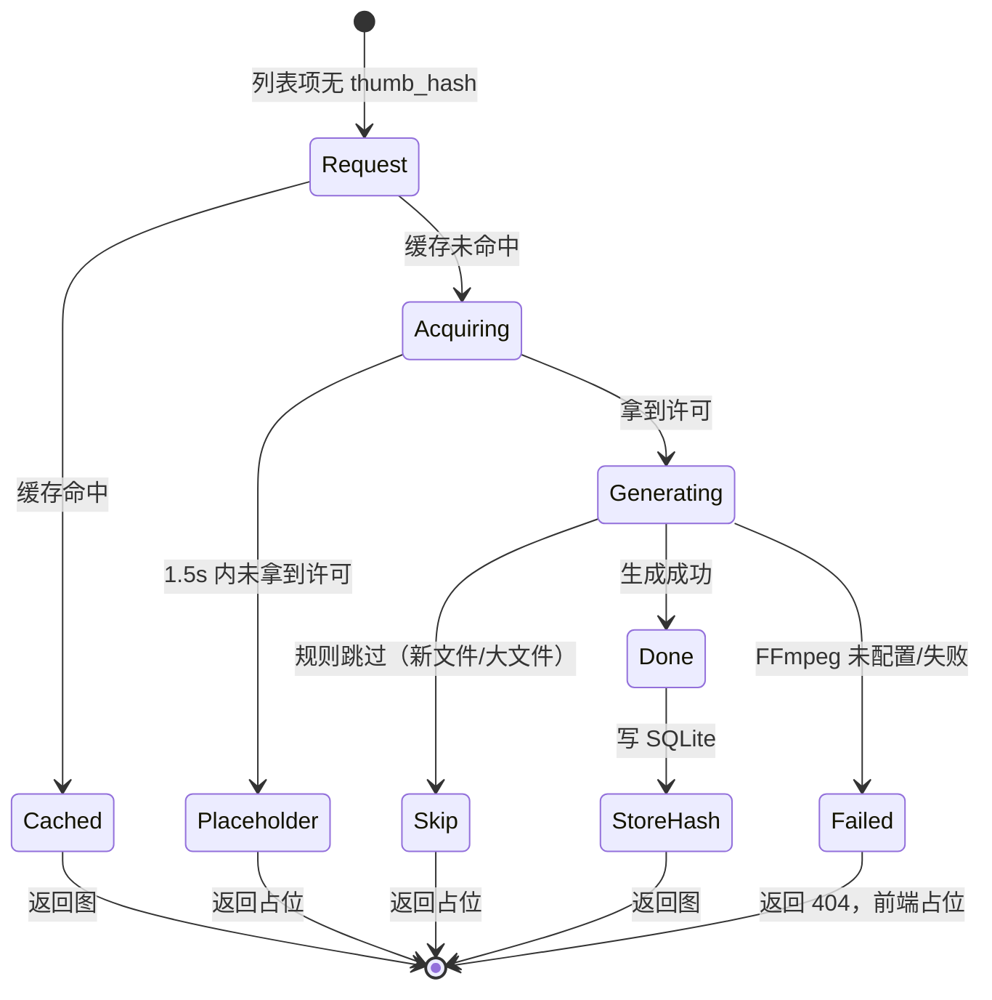

#### 交互稿（占位图视觉）

```
┌──────┐
│ 🖼   │  ← 灰度图标 + 文件名首字母
│  A   │     opacity 0.5
└──────┘
```

- 占位与真图**尺寸一致**（避免布局跳动）。
- 真图加载完成后 `opacity: 0 → 1` 淡入 150ms。

#### API 契约

```http
GET /api/files/thumb?mount_id=&path=
200 (image/webp | image/jpeg)
404 (未生成，前端占位)
```

列表接口返回 `thumb_hash`（若有），前端可用 ThumbHash 直接渲染模糊占位，再替换为真图。

#### GWT 验收

```gwt
GWT-THUMB-01 Given 4 个文件同时请求缩略图  When 并发上限 2  Then 后 2 个 1.5s 内返回占位
GWT-THUMB-02 Given mtime 30s 前且 size 5MiB  When 请求缩略图  Then 跳过生成，返回占位
GWT-THUMB-03 Given FFmpeg 未配置  When 请求视频缩略图  Then 404，前端占位
GWT-THUMB-04 Given 已生成过缩略图  When 再次请求  Then 直接命中缓存，不重新生成
GWT-THUMB-05 Given ThumbHash 存在  When 列表渲染  Then 先显示 ThumbHash 模糊，加载后替换
GWT-THUMB-06 Given 缩略图缓存超 LRU 上限  When 请求  Then 最久未访问的条目被淘汰
GWT-THUMB-07 Given 某缩略图天天被打开  When 闲置天数超过 thumb_cache_max_age_days  Then 命中时已续期，不被淘汰
GWT-THUMB-08 Given 源文件被应用外删除  When 下一轮索引扫描  Then 其缓存单元整目录回收
GWT-THUMB-09 Given 挂载点离线（readdir 失败）  When 扫描  Then 该子树索引与缓存原样保留
GWT-THUMB-10 Given 同一内容指纹解码失败过  When 30 分钟内再次请求  Then 直接回占位图，不再重试
GWT-THUMB-11 Given 超大尺寸图片（>16384 边）  When 生成缩略图  Then image 分支拒绝，交 ffmpeg 解码期降采样
GWT-THUMB-12 Given FFmpeg 卡死  When 超过探测 5s / 截帧 15s / 编码 10s  Then 进程被 kill，信号量按时释放
GWT-THUMB-13 Given 全量重建进行中  When 手动清理 / janitor 到点 / 清空缓存  Then 409 already_running，互斥位保证清理不撞正在 rename 的生成（v4.9.20）
GWT-THUMB-14 Given 全量重建进行中  When POST /api/system/thumbnails/rebuild/stop  Then 扫描与生成循环按检查点退出，状态归零，互斥位释放（v4.9.20）
GWT-THUMB-15 Given 更换挂载点  When 下一轮索引扫描 retain_roots  Then 旧根条目的缩略图缓存单元与 ThumbHash 行一并回收，不再挤占 LRU（v4.9.20）
```

#### 安全审查落地（2026-11-04）
- `DELETE /api/files/raw` 与 mutate 版删除同口径：只读拦截 + per-path 锁；
- 请求体上限拆分：JSON/配置/登录类路由 2 MiB，上传/tus/编辑保存/代理/WebDAV 仍按 `upload_max_size_mb`；
- `panic = "unwind"` + 最外层 `CatchPanicLayer` + panic hook：单连接 500，不再全进程崩溃；
- 配置写盘串行化（全局锁 + 随机临时名 + rename 前自校验 + fsync）；
- FFmpeg 全链路带超时（探测 5s / 截帧 15s / 编码 10s），`status()` 死锁坑改 `wait_with_output`。

#### 依赖红线
- 红线 1（不内置转码，只调用外部 FFmpeg）
- 红线 15（ThumbHash 存 SQLite）

---

### 3.8 分享（M2）

#### 范围
- `allow_download=false`：不生成 `attachment` 链接，`raw?download=1` 返回 `E_FORBIDDEN`。
- 分享密码（可选）、过期时间（可选）。
- tombstone：`deleted_at` 超 30 天启动清理。
- 分享访客 API **不返回物理路径字段**。

#### 状态机

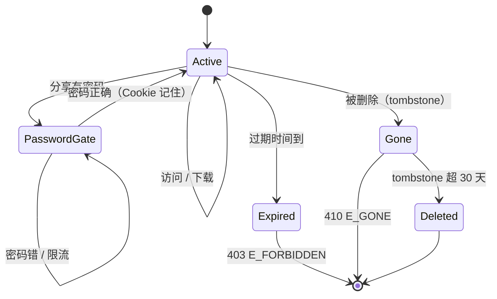

#### 交互稿（公开分享页）

```
┌─ 分享：vacation/2024 ────────────────────────┐
│                                              │
│  ┌──────┐ ┌──────┐ ┌──────┐                 │
│  │[缩略]│ │[缩略]│ │[缩略]│                 │
│  │a.jpg │ │b.jpg │ │c.jpg │                 │
│  └──────┘ └──────┘ └──────┘                 │
│                                              │
│  [Asmoday · 分享]                    [登出]  │ ← 页脚
└──────────────────────────────────────────────┘
```

- `allow_download=false` 时：**不显示下载按钮**，图片禁用右键，视频/音频隐藏原生下载控件。
- 无密码：直接进。有密码：先展示密码表单，验证成功 Set-Cookie（分享会话），再显示内容。

#### API 契约

```http
POST /api/shares
{ mount_id, path, password?, allow_download, expires_at? }
200 { ok:true, data: { token, url, allow_download, expires_at } }
```

```http
GET /api/public/share/{token}
200 { ok:true, data: {
  is_folder, name, size, type,
  allow_download, needs_password, expires_at
}}
403 E_FORBIDDEN（已过期）
410 E_GONE
```

```http
POST /api/public/share/{token}/verify
{ password? }
200 { ok:true, data: null }  // Set-Cookie 分享会话
401 E_UNAUTHORIZED
429 E_TOO_MANY_REQUESTS
```

```http
GET /api/public/share/{token}/list?cursor=
200 { ok:true, data: { items: [{ name, size, is_dir, is_previewable }], next_cursor } }
```

```http
GET /api/public/share/{token}/raw?path=&download=0|1
200/206
403 E_FORBIDDEN（allow_download=false 且 download=1）
```

#### GWT 验收

```gwt
GWT-SHARE-01 Given allow_download=false 分享单图片  When 访客访问  Then 显示图片，无下载按钮
GWT-SHARE-02 Given allow_download=false 分享单图片  When 访客请求 raw?download=1  Then 403 E_FORBIDDEN
GWT-SHARE-03 Given allow_download=false 分享文件夹含压缩包  When 访客打开  Then 列表返回该文件但置灰，点击提示"不支持预览"
GWT-SHARE-04 Given allow_download=false 分享不支持预览的单文件  When 创建分享  Then 400 E_UNSUPPORTED_PREVIEW
GWT-SHARE-05 Given 分享有密码  When 首次访问  Then 显示密码表单
GWT-SHARE-06 Given 分享密码  When 密码错 5 次/分钟  Then 429
GWT-SHARE-07 Given 分享已过期  When 访问  Then 403 E_FORBIDDEN
GWT-SHARE-08 Given 分享被删除  When 访问  Then 410 E_GONE
GWT-SHARE-09 Given 分享被删除超 30 天  When 启动  Then 该行被物理删除
GWT-SHARE-10 Given 分享访问  When 请求任意接口  Then 响应中无物理路径字段
```

#### 依赖红线
- 红线 5（无回收站，tombstone 仅服务分享）
- §11 分享

---

### 3.9 二次验证（REAUTH）与终端、令牌、配置、备份的交互（M2）

> **⚠️ v4.4.1 变更**：本节所述的 REAUTH 交互已整体移除，四个入口均随登录会话直接放行，不再弹窗。以下仅作历史设计记录。

> 本章节是横切关注点，与 §3.2 会话共用同一 `useReauth.ts`，验证以下 4 个入口均正确触发：

| 入口 | 触发条件 | 验证后行为 |
|---|---|---|
| 终端 WebSocket 建立 | `verified_at` 超 5 分钟 | 重放 WS 握手 |
| 令牌增删 | `POST/DELETE /api/auth/tokens` | 重放原请求 |
| 配置写入 | `POST /api/config` | 重放原请求 |
| 备份下载 | `GET /api/system/backup` | 重放原请求 |

#### GWT 验收

```gwt
GWT-REAUTH-01 Given verified_at=6 分钟前  When 点击终端  Then REAUTH Modal，验证成功后 WS 握手成功
GWT-REAUTH-02 Given verified_at=6 分钟前  When 创建令牌  Then REAUTH Modal，验证成功后令牌创建成功
GWT-REAUTH-03 Given verified_at=6 分钟前  When 保存配置  Then REAUTH Modal，验证成功后配置写入成功
GWT-REAUTH-04 Given verified_at=6 分钟前  When 下载备份  Then REAUTH Modal，验证成功后下载开始
```

---

### 3.10 媒体画廊：照片（M3）

#### 范围
- 双视图：相册（卡片网格）+ 时间线（按年月分组吸顶）。
- 相册：只数第一层，封面取该目录最新图片缩略图。
- 时间线：穿透所有子目录，按时间倒序。
- 点击触发全局 `MediaLightbox`（单实例）。

#### 状态机

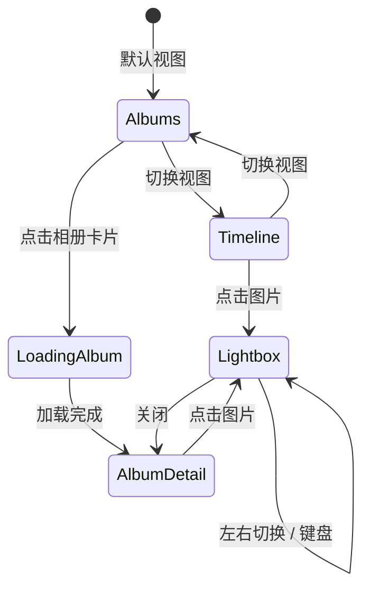

#### 交互稿（时间线）

```
┌─ 2026 年 10 月 ────────── 吸顶 ─┐
│ ┌────┐ ┌────┐ ┌────┐ ┌────┐ │
│ │[缩]│ │[缩]│ │[缩]│ │[缩]│ │
│ └────┘ └────┘ └────┘ └────┘ │
├─ 2026 年 9 月 ─────────── 吸顶 ─┤
│ ┌────┐ ┌────┐                │
│ │[缩]│ │[缩]│                │
└──────────────────────────────┘
```

- 相册卡片：封面 + 目录名 + 图片数量。
- 空状态：`"尚未发现照片"` + 引导链接到设置页配置挂载点。

#### API 契约

```http
GET /api/media/photos/albums?mount_id=&cursor=
200 { ok:true, data: {
  items: [{ path, name, count, cover_thumb_hash?, cover_mtime }],
  next_cursor
}}
```

```http
GET /api/media/photos/timeline?mount_id=&cursor=
200 { ok:true, data: {
  items: [{ path, name, mtime, thumb_hash? }],
  next_cursor
}}
```

#### GWT 验收

```gwt
GWT-PHOTO-01 Given 挂载点含 3 个一级目录  When 进入相册  Then 只显示含图片的目录卡片，无图目录剔除
GWT-PHOTO-02 Given 目录内图片  When 进入相册  Then count 只数第一层
GWT-PHOTO-03 Given 时间线  When 滚动  Then 年月标题吸顶，穿透所有子目录
GWT-PHOTO-04 Given 灯箱打开  When 点击左右箭头  Then 在同目录同类型数组内切换
GWT-PHOTO-05 Given 灯箱  When 键盘 ← →  Then 同上
GWT-PHOTO-06 Given 灯箱  When 关闭  Then 遮罩消失，页面滚动恢复
GWT-PHOTO-07 Given 灯箱打开  When 闲置 2.6 秒  Then 顶栏与缩略图条隐去，鼠标一动立即回来
GWT-PHOTO-08 Given 灯箱图片  When 滚轮放大到 200%  Then 光标下那一点不动；拖动可平移；双击回到 100%
GWT-PHOTO-09 Given 手机灯箱  When 左滑  Then 下一张；When 下滑  Then 关闭灯箱（位移跟手，未到阈值回弹）
GWT-PHOTO-10 Given 灯箱视频  When 按 →  Then 快进 5 秒且不切条目；视频铺满视口且只有顶栏一个关闭按钮
GWT-PHOTO-11 Given 灯箱打开  When 点击左右箭头或缩放胶囊  Then 正常生效且灯箱不关（onTap 按 closest('button, a') 豁免 stage 内控件）
GWT-PHOTO-12 Given 图片模式  When 看底部  Then 缩放胶囊常驻显示百分比，未放大淡显、放大变亮，点击复位
GWT-PHOTO-13 Given 快速连按翻页  When 旧图 load 晚到  Then 不污染新图 ready，无空白闪帧；打底图与原图均已预载
GWT-PHOTO-14 Given 打开预览小图  When 打底图与原始图交替  Then 可见图尺寸全程不变（不得先大后小；两层同为 size-full+object-contain，缩略图 URL 带 r 与 v）
GWT-PHOTO-15 Given 灯箱  When 连点两次左右箭头  Then 正常翻两页且缩放仍是 100%（dblclick 在控件上不触发缩放）
GWT-PHOTO-16 Given 灯箱  When 长按 +/−  Then 只放大一档；When 长按 ←/→  Then 每次 ≥110ms 才翻一张
GWT-PHOTO-17 Given 深链进 /cinema 再点侧边栏「图片库」  Then 相册清单必须出现（切分区要补拉，不能停在「没有找到含图片的文件夹」）
GWT-PHOTO-18 Given 相册清单接口 500 / 断网  Then 显示错误 + 「重新扫描」，不得显示成空相册；点重试后恢复
GWT-PHOTO-19 Given 索引里有图（counts.image>0）但相册清单为空  Then 文案是「相册清单没有加载出来」并给重扫入口
GWT-PHOTO-20 Given 慢网 >180ms  Then 骨架形状与真实卡片一致（4:3 + 两行字 / 方格 / 16:9），内容到达时无跳版，且刷新时不清空旧数据
GWT-PHOTO-21 Given prefers-reduced-motion  Then 骨架不动画（只留静态底块）
GWT-THUMB-01 Given 缩略图 URL 带 v=<mtime>  When 服务端指纹与 mtime 一致  Then 回 immutable 长缓存；不带 v 则 private, no-cache + ETag，条件请求回 304
GWT-THUMB-02 Given 320×213 的原图  When 请求 w=960  Then 返回仍是 320×213（绝不放大），缓存文件名前缀是 v5-<长度>-<mtime>
GWT-THUMB-03 Given 源文件被改  When 再次请求缩略图  Then 指纹变、落新文件名、旧指纹文件被 prune_stale 删掉（目录不随时间增长）
GWT-THUMB-04 Given 200×150 的原图  When 依次请求 w=160 / 320 / 400  Then 落 **2 个**文件（160 与 200 两档；320/400 都归并到长边 200），同档之间 ETag 与字节完全一致
GWT-THUMB-05 Given 单元目录里同时存在 v3-… 与 v4-… 两组指纹  When 跑一次清理  Then 旧组被删、最新组保留（按组回收，不整单元删）
GWT-THUMB-06 Given 单元目录里有 1 小时前的 .tmp-*.webp 与刚写的 .tmp-*.webp  When 清理  Then 只删前者（正在写的不能动）
GWT-THUMB-07 Given 同一张图分别以 C:/Photos/A.JPG 与 c:/photos/a.jpg 请求（Windows）  Then 落在同一个缓存单元目录
GWT-THUMB-08 Given 索引里有一张 200×150 的图  When 预生成跑完  Then 缓存文件宽度是 **200** 而不是 400；随后浏览请求 w=400 直接命中该文件，不新落 400 档
GWT-THUMB-09 Given 预生成正在运行  When 请求全量重建  Then 返回 `already_running`（反向同理）；任务结束后两者都能单独启动，互斥位不残留
GWT-DL-01 Given 任意文件  When 请求 raw?download=1  Then Content-Disposition 为 attachment 且含 filename*=UTF-8''…，类型 octet-stream + nosniff
GWT-DL-02 Given 文本文件  When 请求 raw（不带 download）  Then Content-Type 带 charset=utf-8（不得让浏览器按 GBK 猜成乱码）
GWT-DL-03 Given 目录  When 请求 archive  Then 返回合法 zip（PK\x03\x04 开头，目录条目以 / 结尾），Windows 资源管理器可直接解压
GWT-MENU-01 Given 文件或目录  When 右键  Then 有「下载」且没有「复制相对路径/绝对路径」；目录下载走 zip
GWT-SET-01 Given 桌面端设置页  Then 左侧竖排图标导航常驻、移动端横向滑动；点分区只换右侧内容，标题统一「ink 小标题 + 12px 说明」
GWT-SET-02 Given 侧边栏左下角  Then 自上而下为「生态推荐」小字链接（当前页高亮）与 `v<version> · 由 Asmoday 提供`；折叠态只留图标且不占高度
GWT-SET-03 Given 生态推荐  When 点左下角入口  Then 在右侧主内容区打开 `/ecosystem`，设置页的 Tab 里不再有该分区
GWT-BAR-01 Given 播放条正在显示  When 点关闭  Then 播放条整体向下滑出（有真实 translateY 位移，不是纯淡出），滑完才卸载；进入同理自底部升起
GWT-BAR-02 Given 正在播放且有同目录 .lrc  When 播放进度推进  Then 曲目区固定显示 ID3 歌手（无则专辑、再没有写「未知歌手」），右侧**内联歌词区**（`sm` 起竖线分隔）滚动当前歌词行（13px accent）；**没有 .lrc 时内联区写「无歌词」**（muted 色），不留空白；都不显示目录名
GWT-BAR-03 Given 播放条为 classic  When 点右工具区极简按钮（圆盘图标）  Then 切换为右下角 64px 胶囊（内含 48px 黑胶唱片）；展开后**双击唱片**回到 classic；两种形态刷新后保持
GWT-BAR-04 Given 桌面 1440px  When 量 classic 条  Then 整条 **864×101**（`lg:w-[60%]`、`lg:min-w-[820px]`、内边距 14/24），播放键 44×44、上一首/下一首 36×36、模式/歌单/极简三个 32×32 且都带描边、声音键 24×24 + 横向音量轨 64×16，都不被 flex 压窄；封面是 accent 底 + 8px 白点；切歌与播放是实心图形；内联歌词区宽 > 150px
GWT-BAR-05 Given 播放条任意形态  When 看顶行  Then 有贯穿整条的 4px 进度条与两端 34px 定宽时间；点击 60% 处 currentTime 跳到 60% 附近（命中区 16px 高）；空轨用 `--range-track`，深色底上可见
GWT-BAR-06 Given 极简形态  When 未 hover  Then 是 64px 胶囊 + 48px 黑胶唱片（同心纹路 + 中心封面标贴 + 轴孔）；**只有纹路层旋转**（`.music-grooves`，animation-play-state=running），外轮廓层不转；hover 展开 340px；双击唱片回到 classic
GWT-BAR-07 Given classic 条  When 未 hover  Then 条内没有关闭按钮，条外右上方只有**一个**窗口键（关闭 24×24，`-top-3.5 right-3/5`）；hover 整条后它 opacity=1（v4.6.9 删掉「锁定常驻」，它是无效功能）
GWT-BAR-08 Given 触屏（hover:none）且为极简形态  When 点唱片展开后又想关掉  Then 胶囊外右上方的关闭键 opacity=1（不依赖 hover），点击后播放条消失
GWT-BAR-09 Given 歌词面板或播放列表展开  When 量两者底边  Then 底边都在播放条顶边之上（桌面让位 130px、`<lg` 84px；极简形态 96px，落在胶囊上方），不压住进度行
GWT-BAR-10 Given 极简面板展开  When 数里面的按钮  Then 依次是 音量 24×24 / 模式 24 / 上一首 24 / 播放 28 / 下一首 24 / 歌单 24（与参考稿逐项对齐，只多一个歌单），**没有还原键**；点音量键 title 在「静音 / 取消静音」间切换，点模式键循环 列表循环 → 单曲循环 → 随机
GWT-BAR-11 Given 极简面板  When 点一次唱片（等待 >240ms）  Then 播放/暂停切换；在 240ms 内连点两次  Then 还原为 classic（触屏双击同样生效，不依赖 dblclick 事件）
GWT-BAR-12 Given 移动端 390px  When 看 classic 条  Then 曲目区三行（歌名 12 / 歌手 10 / 歌词 10，无歌词写「无歌词」），控件依次是 声音键 26 / 模式 26 / 上一首 26 / 播放 32 / 下一首 26 / 歌单 26 / 极简 28，无横向溢出（整条 390×80），关闭键浮在条外右上角（只有一个）
GWT-BAR-13 Given `<lg`（如 838px）或触屏  When 点声音键  Then 播放条上方弹出 **36×96** 的竖排音量胶囊（`.vol-vertical` 旋转 -90°），胶囊底边距声音键 **4px**、72px 滑条**绝对定位居中**（`dxCenter=dyCenter=0`，可视底端到键顶 16px，左右各留 10px 不出胶囊），拖动写进 `asm_volume`；点弹层外收起；**lg+ 点声音键只切静音、不弹层**（条内已有横向滑轨）
GWT-BAR-16 Given `<lg` 且设备有指针（`hover:hover`）  When 鼠标划过声音键  Then 弹层自动展开（opacity 0→1、下沉 4px 上浮，0.2s）；移到 4px 间隙或滑条上仍保持展开（透明桥接块）；移开收起；点击声音键则 `.is-open` 锁定展开，鼠标移开不收起，点外部才收起；隐藏态 `visibility:hidden` 且不接收指针、不被 Tab 聚焦
GWT-BAR-17 Given 音量  When 依次取 0 / 40% / 80%  Then 声音键图标依次是 静音（实心喇叭 + 叉）/ 单弧（<55%）/ 双弧；喇叭体是 `fill`、声波弧是 `stroke`（`AppIcon` 的 `HEAD_SOLID`）
GWT-BAR-18 Given 极简形态且面板已展开  When 点音量键  Then 同时静音/取消静音，并在键的正上方弹出 36×96 的竖排音量胶囊（`data-testid="music-mini-volume-popup"`，底边距键 4px、72px 滑条居中 `dxCenter=dyCenter=0`、不被胶囊裁切），拖动写进 `asm_volume`；有指针设备悬停即展开、移开 140ms 收起；点面板/弹层外收起
GWT-BAR-19 Given 极简形态  When 用鼠标划过 64px 胶囊  Then 展开成 340px（`miniExpanded` 状态驱动，不能只靠 `group-hover`，否则宽度会被 `w-16` 盖掉），移开后回到 64px
GWT-NAV-01 Given 移动端（<md）抽屉打开  When 点任一导航项  Then 抽屉在路由切换完成后收起，页面**真的换到目标页**（不得因 `history.back()` 把导航回滚）；点当前页的项则直接收起抽屉；按系统返回只收抽屉、不离开当前页
GWT-BAR-14 Given 点条外右上角的关闭键  Then 播放条立刻收起、队列清空、`<audio>` 卸载；条外不再有第二个窗口键（锁定键已于 v4.6.9 删除，`asmoday.player.pinned` 也不再写 localStorage）
GWT-BAR-15 Given 768~1023 宽度（如 838）  When 看 classic 条  Then 整条铺满底部（838×72、`border-t`、不浮起），曲目区两行（歌名 + 歌手）、内联歌词区可见且有竖线、控件含声音键；页面无横向溢出
```

#### 依赖红线
- 红线 14（媒体单实例）

---

### 3.11 媒体画廊：影视与音乐（M3）

#### 范围
- 影视库 16:9，无图占位。
- 动态 `import()` Video.js 10（`@videojs/html` Web Components）。
- `<video>` `object-fit: contain`，`loadedmetadata` 调整容器比例。
- 关闭时 `pause(); src=''; load();`。
- 音乐库解析 ID3v2/FLAC/MP4/Ogg（`lofty`，关 `read_properties`）+ LRC。
- 底部全局悬浮播放条（不播放不显示）。

#### 交互稿（影视）

```
┌──────────────────────────────┐
│  16:9 容器                    │
│  [视频]                      │
│                              │
│  ▶ ────●─── 12:34 / 45:00   │
└──────────────────────────────┘
```

音乐播放条：

```
┌──────────────────────────────────────────────┐
│ [封面] 歌名 - 歌手    ◀ ⏸ ▶    ──●──  3:20  │
└──────────────────────────────────────────────┘
```

#### GWT 验收

```gwt
GWT-CINEMA-01 Given 影视库  When 进入  Then 卡片 16:9，无图显示占位
GWT-CINEMA-05 Given 影视库  When 进入  Then 先出文件夹卡片（封面+数量），与图片库相册同源（albums?kind=video）
GWT-CINEMA-06 Given 影视文件夹  When 点开  Then 只列本层影片（depth=0），返回/Esc/系统返回都能退回卡片列表
GWT-CINEMA-02 Given 打开视频  When loadedmetadata  Then 容器比例按视频调整
GWT-CINEMA-03 Given 关闭视频  When 执行关闭  Then pause + src='' + load，释放资源
GWT-CINEMA-04 Given 多个视频  When 切换  Then 旧视频销毁，新视频创建（不并存在 DOM）
GWT-MUSIC-01 Given 音乐库  When 进入  Then 列表解析标签展示
GWT-MUSIC-02 Given 点击播放  When 播放  Then 底部播放条出现
GWT-MUSIC-03 Given 未播放  When 进入  Then 播放条不显示
GWT-MUSIC-04 Given 音量调整  When 关闭后重开  Then 从 localStorage 恢复（默认 35%）
GWT-MUSIC-05 Given 列表含 100 首  When 加载  Then 只有播放条一个 `<audio>` 元素（禁用列表循环生成）
GWT-MUSIC-06 Given 桌面窗口  When 播放条出现  Then 宽度≈70%（min 660 / max 1180）且水平居中，播放键落在条几何中心
GWT-MUSIC-07 Given 移动端  When 播放条出现  Then 铺满底部、单行、无圆角，进度用顶端 2px 线表示
GWT-MUSIC-08 Given 标签内容为 GBK、帧头声明 ISO-8859-1（EAC/LAME 抓轨常见）  When 读取  Then 显示「林肯公园」而不是「ÁֿϹ«Ô°」；升级后首次启动由迁移清空标签缓存重读（v4.9.21）
GWT-MUSIC-09 Given 一首曲目连续请求封面两次  When 第二次  Then 命中内存缓存、不再打开源文件；无内嵌封面也缓存负结果（v4.9.21）
GWT-MUSIC-10 Given 目录里没有 `<同名>.lrc`  When 音乐库返回该曲目  Then `has_lyrics=false`，前端不发歌词请求（此前每次换歌都是一次 SMB 404，0.3~3.8s）
GWT-MUSIC-11 Given 列表页 120 首  When 分页探测  Then 标签/时长/字幕/歌词四类缓存键都是展示路径（`C:/…`、`//srv/…`），同一首歌只有一行（v4.9.21）
GWT-MUSIC-12 Given 一页 120 条混有音频 / 视频 / 图片，挂在 SMB 上  When browse 正在读 ID3 与图头（几十秒）  Then 缩略图 / 相册 / 计数请求不被索引锁挡住，站点仍可响应（`PageMeta` 锁内只查库，v4.9.22）
GWT-MUSIC-13 Given 一张图解码超时  When 结果未知  Then 不写 30 分钟负缓存，回 503 让前端退避重试；并发许可在解码真正结束后才归还（v4.9.22）
GWT-MUSIC-14 Given 删除 `IMG_1234.jpg`  When 级联清理收藏/历史/分享  Then 同目录 `IMG-1234.jpg` 的记录原样保留（前缀匹配不用 LIKE 通配符，v4.9.22）
```

#### 依赖红线
- 红线 2（不内置刮削）
- 红线 14（媒体单实例）
- §2.2 `lofty` 必须关 `read_properties`

---

### 3.12 终端（M3）

#### 范围
- PTY WebSocket，单用户并发上限 10。
- Windows ConPTY 死锁缓解：`openpty()` 后立即写 `ESC[1;1R`。
- 尺寸钳制：列 `max(20, min(val, 500))`，行 `max(5, min(val, 200))`。
- 断线 3 分钟后销毁，环形缓冲 1MB。
- xterm.js 深色渲染区 + Nerd Font。
- 历史写入 `data/terminal_history/`，禁止污染宿主机历史。
- 纯净模式逃生舱。

#### 状态机

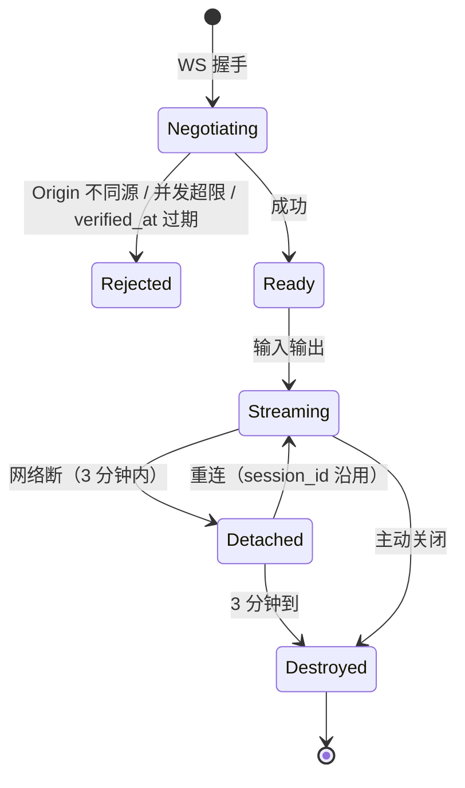

#### 交互稿

```
┌─ 终端 · /media ───────────────────────  [×] ┐
│ ┌─ 渲染区（深色 #1e1e1e）────────────────┐ │
│ │ user@host:/media$ ls                   │ │
│ │ photos  videos                         │ │
│ │ user@host:/media$ █                    │ │
│ └────────────────────────────────────────┘ │
│  [纯净模式重启] [关闭]                     │
└────────────────────────────────────────────┘
```

- 外壳跟随全局主题，渲染区**强制深色**。
- 移动端监听 `window.visualViewport.resize` 重新 `fit()`。
- **v4.4.3 起**（见设计文档 5.4.1）：触屏滚动由 `touchstart/move/end` 自己换算成 `scrollLines`（xterm 6 的虚拟滚动条不认触摸）；快捷键条在文档流里并靠 `useKeyboardInset` 的 `padding-bottom` 随键盘上移；按键用 `pointerdown.prevent` 保住焦点（否则输入法收起）；`pointer: coarse` 下不自动聚焦。
- `Tab` 键拦截，发送 `\t` 并 `return false`。

#### API 契约

```http
WS /api/terminal/ws?mount_id=&path=&cols=80&rows=24&session_id=xxx
Origin 必须与 Host 同源，无 Origin 的非浏览器客户端放行
握手成功后二进制帧：{"type":"data","payload":"..."} 或 raw bytes

超限拒绝：WebSocket close code 4001（并发超限）/ 4003（REAUTH）
```

#### GWT 验收

```gwt
GWT-TERM-01 Given 用户已登录  When 点击终端  Then 建立 WS，cwd 为当前目录
GWT-TERM-02 Given 并发上限 10  When 第 11 个会话  Then 拒绝，前端展示"查看活动会话"入口
GWT-TERM-03 Given 手机横屏  When 高度只剩 400px  Then 行数钳制到 max(5, ...) 不溢出画布
GWT-TERM-04 Given 输入 Tab  When 按 Tab  Then 发送 \t，不切换焦点
GWT-TERM-05 Given 网络断  When 2 分钟内重连  Then 会话沿用，历史保留
GWT-TERM-06 Given 网络断  When 3 分钟后  Then PTY 销毁
GWT-TERM-07 Given Windows  When openpty  Then 立即写 ESC[1;1R，无死锁
GWT-TERM-08 Given 用户在终端执行 `history`  When 命令  Then 不写入宿主机 shell 历史
GWT-TERM-09 Given PowerShell  When 启动  Then `-NoProfile` 可选，纯净模式可用
GWT-TERM-10 Given 活动会话面板  When 强制关闭某条会话  Then 占用它的标签一并关闭，且 5 秒内不再自动新建等价 PTY
GWT-TERM-11 Given 两个独立浏览器窗口各开终端  When 任一窗口执行命令或新建标签  Then 另一边画面与 session_id 不变，且所有会话尺寸不被压到 20×5
GWT-TERM-12 Given 用户在 Linux 上反复开关终端（exit / 强制关闭 / 闲置回收）  When 检查进程表  Then 无 defunct 僵尸项累积（会话结束路径统一 wait 回收，v4.9.20）
GWT-TERM-13 Given 前台进程不读 stdin（`sleep 600`）且用户粘贴大段文本  When 主端缓冲写满  Then 写入阻塞发生在阻塞池里，同会话的 resize / Ping / 其它连接照常响应（v4.9.22）
GWT-TERM-14 Given 刷新页面两次（两个回收定时器在排）  When 最后一次断线后 2 分钟  Then 会话仍在；满 3 分钟才回收（`reap_epoch` 让旧定时器失效，v4.9.22）
GWT-TERM-15 Given 回收定时器恰好与重连同刻唤醒  When 新连接已 `attach`  When 检查  Then 会话不被杀掉（`attach` 与 `take_if_idle` 共用同一把 map 锁，v4.9.22）
```

#### 依赖红线
- 红线 18（环境变量不污染）
- 红线 19（交互登录模式、Nerd Font、ANSI 色板）

---

### 3.13 WebDAV（M3）

#### 范围
- 协议由 `dav-server` 实现，本项目只做认证 + 挂载点路由 + 安全边界。
- URL：`/dav/<mount_id>/<path>`；`/dav` 与 `/dav/` 虚拟根列出挂载点。
- 路由用 `nest("/dav")` + `route("/dav/")`。
- Basic Auth：`token_name` : `asm_xxx`；校验失败回退管理员账号 + 登录密码（全量权限，
  待改密 / 开 2FA 拒绝；Argon2 结果带进程内缓存，改密即时失效）。
- `CleanFs` 装饰层：过滤 `.part` 与系统垃圾、修 Windows 错误映射。

#### GWT 验收

```gwt
GWT-DAV-01 Given 客户端填 http://host/dav/  When PROPFIND  Then 列出挂载点
GWT-DAV-02 Given 令牌限定挂载点  When PROPFIND /dav/  Then 只列该挂载点
GWT-DAV-03 Given 只读令牌  When PUT  Then 403
GWT-DAV-04 Given 只读令牌  When OPTIONS  Then Allow 只列读方法
GWT-DAV-05 Given LOCK 后未持锁写  When PUT  Then 423
GWT-DAV-06 Given MOVE Destination 指向挂载点外  When 执行  Then 403
GWT-DAV-07 Given 目录 PROPFIND  When 返回  Then 目录 href 带尾斜杠
GWT-DAV-08 Given 客户端请求 .DS_Store  When GET  Then 404
GWT-DAV-09 Given 客户端 PUT .DS_Store  When 执行  Then 403
GWT-DAV-10 Given Windows MKCOL 带尾斜杠  When 执行  Then 200（先去掉尾斜杠）
GWT-DAV-11 Given 重复 MKCOL  When 执行  Then 405（不是 500）
GWT-DAV-12 Given 子路径部署 base_url=/asmoday  When PROPFIND  Then href 带前缀，Destination 校验通过
```

---

### 3.14 配置（M3）

#### 范围
- `toml_edit` AST 局部修改，保留注释/空行/顺序。
- 源码模式直接写盘，仅语法校验，禁止格式化。
- 与默认值相同的标量不写盘。
- 热重载：裸 `notify` + 手写 500ms 防抖。
- 危险配置自检：`trust_proxy_headers=true` 且白名单空 → WARN；`proxy_trust.enabled=true` 且白名单空 → ERROR 拒绝启用。

#### 交互稿（设置页，Tab 结构）

```
┌─ 设置 ─────────────────────────────────────┐
│ [通用] [媒体] [安全] [高级]                │
│ ────────────────────────────────────────   │
│  服务监听                                  │
│   地址 [127.0.0.1  ]  端口 [4242]          │
│   提示：0.0.0.0 + 未启用 SSL 有风险 ⚠      │
│                                            │
│  [保存]  [恢复默认]                        │
└────────────────────────────────────────────┘
```

- 表单 **多列 Grid**（`md` 单列），卡片 `p-6`，间距 `gap-6`，输入 `h-10`。
- 危险配置自检结果**就地展示**在对应输入下方，不用 toast。

#### GWT 验收

```gwt
GWT-CFG-01 Given 配置文件含注释  When 保存表单  Then 注释保留
GWT-CFG-02 Given 源码模式  When 保存  Then 仅语法校验，不做格式化/AST 重写
GWT-CFG-03 Given 与默认值相同的标量  When 保存  Then 不写入（避免凭空多行）
GWT-CFG-04 Given 连续两次保存相同内容  When 对比文件  Then 逐字一致（幂等）
GWT-CFG-05 Given 外部修改配置文件  When 保存  Then 500ms 内热重载生效
GWT-CFG-06 Given trust_proxy_headers=true 且 trusted_ips 空  When 保存  Then WARN 但不阻止
GWT-CFG-07 Given proxy_trust.enabled=true 且白名单空  When 保存  Then ERROR 拒绝启用
GWT-CFG-08 Given 恢复默认分区块  When 点击  Then 只重置该区块，不碰 SQLite
```

#### 依赖红线
- 红线 17（toml_edit AST）

---

### 3.15 服务聚合代理（M3）

#### 范围
- 配置驱动，外部服务默认新标签页打开，禁止 iframe。
- 反代模式链接 `/proxy/{service_id}`，Rust `hyper` 代理。
- 剥离路径前缀、重写内部绝对链接、忽略 SSL 证书（高级选项）。
- 转发前摘除 `asmoday_session` Cookie；上游同名 `Set-Cookie` 丢弃。

#### GWT 验收

```gwt
GWT-PROXY-01 Given 服务配置为直连模式  When 点击  Then target_url 新标签页
GWT-PROXY-02 Given 服务配置为反代模式  When 点击  Then /proxy/{id} 经 hyper 代理
GWT-PROXY-03 Given 请求 /proxy/{id}  When 转发  Then Cookie 中 asmoday_session 被摘除
GWT-PROXY-04 Given 上游 Set-Cookie  When 响应  Then 同名 Cookie 被丢弃
GWT-PROXY-05 Given inject_headers 配置  When 转发  Then 注入头生效
GWT-PROXY-06 Given 上游返回绝对链接  When rewrite_internal_links=true  Then 改写为 /proxy/{id}/...
```

#### 依赖红线
- 红线 9（禁止 iframe 第三方）
- §8 服务聚合

---

### 3.16 国际化与文案（M4）

#### 范围
- `vue-i18n` v9+，`createI18n({ legacy: false })`。
- 中英语言包分模块（common / error / files / gallery / terminal / settings / share）。
- 用户选择存 localStorage，首次按 `navigator.language`。
- 后端 `message` 仅英文；前端展示依赖 `code` 映射。

#### 交付物

1. `web/src/locales/zh-CN/{common,error,files,...}.json`
2. `web/src/locales/en-US/{common,error,files,...}.json`
3. `web/src/lib/errors.ts`：`code → i18n key` 映射（**由 §1.3 表格自动生成**）
4. ESLint 规则 `no-hardcoded-text`：`web/src/**/*.vue` 中除 `<i18n>` 块外不允许中文字符串字面量

#### GWT 验收

```gwt
GWT-I18N-01 Given 用户选择 English  When 刷新  Then 保持 English
GWT-I18N-02 Given 首次访问  When navigator.language=zh-CN  Then 默认中文
GWT-I18N-03 Given 未知 error code  When 展示  Then 显示英文 message + trace_id 复制按钮
GWT-I18N-04 Given 任意 .vue 文件  When ESLint  When 含中文字面量  Then 报错
```

---

### 3.17 空/加载/错误态与移动端（M4）

#### 范围
- 所有列表/详情页补齐三态（正常/空/错误）+ 骨架屏。
- 移动端断点：`<768px` 移动布局，长按阈值 500ms，滑动 >10px 取消长按，触发后忽略 click。
- 底部悬浮条 `env(safe-area-inset-bottom)`。
- 软键盘监听 `visualViewport.resize`。
- 禁止原生 `alert/confirm/prompt`（未保存关闭也已改成站内三选一，见 3.4）。
- **系统返回 = 退一层浮层（v4.4.4，见设计文档 4.8）**：编辑器、灯箱、预览、弹窗、抽屉全部经 `useBackClose` 登记，
  按返回先关最上层（编辑器优先），关完才让路由收到返回；浮层一律不进 URL。
- **关浮层不能打断导航（v4.5.7 修）**：抽屉里的导航项**不要**自己 `emit('close')`（只有「点的是当前页」才收），
  否则 `history.back()` 会把还没落地的 `router.push` 一起回滚，手机上表现为「点左侧菜单没反应」；
  `disarm()` 也必须延后一个宏任务并重新判定哨兵是否还在历史当前位置。

#### 交付物

- `web/src/components/EmptyState.vue` / `ErrorState.vue` / `Skeleton*.vue`
- `web/src/composables/useLongPress.ts`（阈值 500ms，滑动取消）
- `web/src/composables/useViewportFit.ts`（terminal/editor 用）

#### GWT 验收

```gwt
GWT-UX-01 Given 任意列表为空  When 渲染  Then 显示空状态（图标 + 标题 + 引导动作）
GWT-UX-02 Given 列表加载中  When 渲染  Then 显示骨架屏（数量与首屏一致）
GWT-UX-03 Given 加载失败  When 渲染  Then 显示错误态 + 重试按钮
GWT-UX-04 Given 移动端长按文件  When 500ms  Then 弹出右键菜单
GWT-UX-05 Given 长按过程中滑动 >10px  When 释放  Then 不触发菜单
GWT-UX-06 Given 长按触发菜单  When 释放  Then 不触发 click（不打开文件）
GWT-UX-07 Given 底部播放条  When iPhone 安全区  Then 有 padding-bottom
GWT-UX-08 Given 任意组件  When 执行 alert/confirm  Then 禁止（用封装 Modal）
GWT-UX-09 Given 浮层里点「下载」  When 关闭浮层  Then 下载仍落盘（iframe 触发，不被 history.back 中止）
GWT-UX-10 Given 多选 N 项（含目录）  When 点下载  Then 只发 1 个 archive 请求，得到含 N 个顶层条目的 zip
GWT-UX-11 Given 窄屏 390px  When 打开文件页  Then 面包屑独占第二行、搜索按钮可展开搜索行、条目有「⋯」
GWT-UX-12 Given 窄屏  When 触发条目菜单  Then 底部动作面板（data-sheet=1，贴底全宽，含取消）
GWT-UX-13 Given 窄屏  When 打开任意弹窗  Then 贴底全宽（顶角 20px、底部安全区），桌面仍居中
GWT-UX-14 Given 窄屏多选  When 操作栏出现  Then 两行：已选 N 项 + 取消，四个动作带文字
GWT-UX-15 Given 触屏  When 渲染工具栏/操作栏  Then 可点区 ≥36px（touch-target/touch-chip）
GWT-UX-16 Given 触屏长按照片/音乐行 500ms  Then 弹出底部动作面板，且不打开大图、不开始播放、面板不被补发的 click 关掉
GWT-UX-17 Given 触屏短按照片  Then 正常打开大图（长按的 click 拦截不能误伤普通点击）
GWT-UX-18 Given 任意密码框（初始化/登录/强制改密/设置/分享提取）  When 未聚焦、为空、失焦  Then 右侧「显示密码」按钮始终可见（40×40）且可点
GWT-UX-19 Given 密码框已聚焦  When 点「显示密码」  Then type 在 password/text 间切换、图标与 aria-label 同步，input 不失焦（移动端小键盘不收起）
GWT-UX-20 Given 浏览器自带的 reveal（Edge `::-ms-reveal` / Chromium 装饰按钮）  Then 一律隐藏，页面上只有自建的那一个眼睛（不会出现双图标）
GWT-UX-21 Given 密码框在 <form> 内  When 点「显示密码」  Then 不触发提交（按钮必须 type="button"）
GWT-UX-22 Given 文件页任意目录  Then 工具栏左区只有「返回上级 + 路径」、右区是动作按钮，两区之间有竖分隔线且路径与上传不相邻（gap ≥ 12px）
GWT-UX-23 Given 多挂载点根目录  When 点「返回上级」  Then 回到挂载点卡片页；单挂载点根目录时该按钮 disabled
GWT-UX-24 Given 路径条  Then 当前目录是 span（不可点，点它只是原地刷新）、祖先段可点回退、分隔符是 `/`；顶栏不再出现「Home > 文件管理」
GWT-UX-25 Given 1024px 窗口  Then 路径完整显示（搜索框 160px、排序只留图标），导航区宽度 ≥ 260px、动作区 ≤ 480px
GWT-UX-26 Given 390px 窄屏  Then 导航在上、动作在下（两行不重叠），动作行内「新建/上传」带文字且不横向溢出（scrollWidth == 390）
GWT-UX-27 Given 照片库相册卡片 / 影视文件夹卡片 / 音乐库分区标题  When 右键（触屏长按）  Then 菜单含打开目录、下载、重命名、移动到、复制到、属性、删除；长按后不会顺带进册
GWT-UX-28 Given 媒体库里的一张照片/一个视频/一首歌  Then 右键菜单在原有播放/下载/分享/收藏之外，必须含重命名…/移动到…/复制到…/属性/删除…
GWT-UX-29 Given 库根（is_root，即挂载点本身）  Then 打开与复制可用；重命名/移动/删除置灰并给出「库根不能改」的原因
GWT-UX-30 Given 只读挂载点  Then 媒体库菜单里的重命名/移动/复制/删除全部置灰，提示「该挂载点为只读，变更操作已禁用」
GWT-UX-31 Given 在册内改名或删除一项  When 操作完成  Then 停留在该册并重拉册内一屏（不回到相册墙），相册清单数量同步
GWT-UX-32 Given 任一变更弹窗打开  When 按 Esc  Then 只关掉最上面那层（相册不会被一起退掉），再按一次才退层
GWT-UX-33 Given 文件管理列表的空白处（含空目录的空状态）  When 右键  Then 弹出目录菜单：新建文件夹…/新建文件…/上传文件…/在终端中打开/刷新/显示隐藏文件/全选，作用对象是当前目录
GWT-UX-34 Given 任意条目  When 右键  Then 只弹条目的那一层菜单（空白菜单不得同时出现），条目高亮随之切换
GWT-UX-35 Given 只读挂载点  Then 空白菜单里的新建文件夹/新建文件/上传文件置灰并给出原因，「在终端中打开」「刷新」仍可用
GWT-UX-36 Given 内部剪贴板有 N 项（Ctrl+C）  Then 空白菜单出现「粘贴 N 项」；粘到别的目录能落盘，粘到同一目录命中同名时回到移动/复制对话框让用户表态
GWT-UX-37 Given 空白菜单  When 点「在终端中打开」  Then 跳到 /terminal 且 path 就是当前目录（v4.6.7 回归：此前浮层关闭的 history.back 会取消这次导航，点了毫无反应）
GWT-UX-38 Given 390px 窄屏  When 右键空白处  Then 底部动作面板标题显示当前目录名，条目完整可见且无横向溢出
GWT-UX-39 Given 音乐库同一行  When 第一次单击  Then 开始播放（悬浮条出现、播放键为暂停态）；再点同一行 Then 暂停；第三次点 Then 从原位置继续
GWT-UX-40 Given 音乐库任一模式（列表循环 / 单曲循环 / 随机）  When 一首自然播完  Then 自动进入下一首（单曲循环则同一首重播）且**不会静音、不会翻成暂停态**，也无需点悬浮条干预
GWT-UX-41 Given 队列只有一首  When 播放模式是列表循环或随机且这首播完  Then 同一首从头重播（`path` 不变也要重播，不能被「换曲」判断漏掉）
GWT-UX-42 Given 播放模式键  Then 单击在 列表循环 → 单曲循环 → 随机 之间轮换，图标与高亮随之变化且写进 localStorage（刷新后保持）
GWT-UX-43 Given 已访问过的文件管理目录 / 图片库 / 影视库  When 再次进入  Then 列表或相册卡片立刻出现，全程不出现 `.skeleton`（列表接口即使慢 1.2s 也一样），随后由后端返回的数据覆盖
GWT-UX-44 Given 单挂载点  When 从侧边栏点「文件管理」（URL 只是 /files）  Then 不出现卡片页骨架与跳转遮罩，直接落在该挂载点根目录的上一帧上
GWT-UX-45 Given 屏幕已有列表  When 点工具栏刷新键  Then 旧内容保持不动、刷新图标旋转，失败只轻提示且不清空列表
GWT-UX-46 Given 桌面端（≥lg）正在播放  When 进入系统终端或文件管理  Then 页面高度与无音乐时完全一致，底部状态条仍贴住窗口底边（不得上浮），播放条浮在内容之上
GWT-UX-47 Given 桌面端正在播放  When 终端有内容  Then 终端最后一行落在播放条上方、不被遮挡；切到极简形态时不预留整块高度（不出现空白带），黑胶只压住右下角
GWT-UX-48 Given 文件管理正在播放  When 滚动到最后一页  Then 最后一行仍能滚到播放条上方，不会被悬浮卡片压住
GWT-UX-49 Given 桌面端经典播放条  Then 条外只有「关闭」一个窗口键；点它立即收起播放条并清空队列（不再有锁定键与置灰态）
GWT-UX-50 Given 极简形态的黑胶唱片  Then 外轮廓是正圆：48×48 的静态外层给底色 + `ring-1 ring-inset`，纹路层 `inset-px` 内缩且**只有它**旋转，任意播放相位下沿圆心量 360 个方向的半径，最大值与最小值相差 < 1px（4 倍像素密度下实测 95.65±0.65px）
GWT-UX-52 Given 64px 胶囊  Then 48px 唱片四边留白都是 8px（`disc.left-capsule.left = capsule.right-disc.right = 8`），不出现一侧 7px、一侧 9px 的偏心
GWT-UX-53 Given 极简形态的黑胶唱片  Then 纹路是 SVG `circle` 正圆（不用 `repeating-radial-gradient`：它在 48px 上按像素格量化，靠边条带相位随角度变化会把圆边啃出缺口），1x 屏上也不出现条纹错乱
GWT-UX-51 Given 窄屏（<lg）经典播放条  Then 它是铺满底部的 dock，正文仍为其预留高度，内容不被压住
```
#### GWT 验收（日志时间口径）

```gwt
GWT-LOG-01 Given [log] format = "text"（默认）  When 任意一行写入控制台或 data/logs/asmoday.log  Then 行首是 `[YYYY-MM-DD HH:MM:SS ±HH:MM]`（服务器本地时间 + 时区偏移，可对照 `date '+%F %T %z'` 验证）
GWT-LOG-02 Given [log] format = "json"  Then 每行 `ts` 是带时区偏移的 RFC 3339（如 `2026-11-01T20:49:35+08:00`），机器解析不丢时区
GWT-LOG-03 Given 同一个事件  Then 控制台、主文件、错误文件三处用的是同一时刻同一时区口径（不会出现一处 UTC 一处本地）
GWT-LOG-04 Given 没有 tzdata 的环境（Android / 静态 musl）  When 启动  Then 偏移由 `date +%z` 兜底，日志时间与系统时间一致；探到的来源写在 DEBUG 的 `log timezone` 行
```

#### GWT 验收（tus 分块上传，v4.6.14）

```
GWT-UP-01 Given 一个大于 upload_chunk_size_mb 的文件  When 前端上传  Then 走 tus：POST 建会话（201+Location）→ 逐片 PATCH（每片 204 + upload-offset 递增）→ 收满自动落位，临时目录清空，内容与源文件逐字节一致
GWT-UP-02 Given 传到一半断开  When 重新上传同一文件（或点「重试」）  Then 先 HEAD 问服务端偏移，从断点继续 PATCH，不重传已落盘字节；服务重启后（会话丢失）HEAD 404，客户端从头 init
GWT-UP-03 Given 会话声明 Upload-Length = N  When PATCH 累计超过 N  Then 400 并销毁会话与临时文件；When 上传同名文件  Then conflict=fail 得 409 E_CONFLICT / overwrite 覆盖 / rename 落 `名称 (n).扩展名`
GWT-UP-04 Given 只读挂载点  When PUT /api/files/upload 或 POST /api/files/upload/tus  Then 403 E_READONLY（v4.6.14 堵住整包上传的只读缺口）
GWT-UP-05 Given 两个并发 PATCH 打同一会话同一 Upload-Offset  When 第二个抢到会话锁  Then 重新读偏移后 409 E_OFFSET_MISMATCH，不产出交错字节（v4.9.20）
GWT-UP-06 Given 整包 PUT 4GiB（upload_max_size_mb=0）  When 传输中  Then 服务端内存占用恒为单帧 chunk，边写边限流（v4.9.20 起 `body: Bytes` 整包缓冲已删）
GWT-UP-07 Given 同名并发整包上传 / 两标签页同时保存同一文本  When 落盘  Then 各自使用带随机后缀的唯一临时文件，不互相覆盖（v4.9.20）
GWT-UP-08 Given 分片总长 5 字节（远小于一个 TCP 段）  When PATCH 收满  Then 204 且 `upload-offset: 5`，立即落位；不得出现 offset 恒为 0、客户端重发同 offset 吃 409 的死循环（v4.9.22）
GWT-UP-09 Given 数据目录与挂载点不同盘（跨设备回退路径）  When 落位  Then 目标目录里是 `原文件名`，不得出现隐藏的 `.asmoday-tus-<name>`；conflict=fail/rename/overwrite 三策略照常生效（v4.9.22）
GWT-UP-10 Given 上传临时文件命名  When 进程被强杀后重启  Then 残留名字匹配 `.asmoday-part.<8位>`，被启动清理回收，且不进列表、不进 ZIP、`/raw` 不可读（v4.9.22）
```

#### GWT 验收（导航 / 过渡 / 灯箱 / 媒体库视图，v4.6.16）

```
GWT-NAV-01 Given /files/m0/a/b  When 浏览器返回键  Then 回 /files/m0/a（上一个目录），再退回挂载点根、再退出门户；history.length 随目录导航增长
GWT-NAV-02 Given 挂载点改指到新路径  When 重新进入 /files  Then 旧位置目录的上一帧被丢弃（快照键带挂载点路径 + 挂载点清单变更即清帧），不出现「旧索引 + 只有转圈」的窗口
GWT-FADE-01 Given 门户 → 文件管理路由切换  Then 过渡为同帧交叉淡入（#app-scroll 内短暂同时挂两个页面），不再有 out-in 的整页空白帧
GWT-LBX-01 Given 灯箱显示一张 contain 后有黑边的图  When 鼠标点在黑边（避开箭头/胶囊控件）  Then 灯箱关闭；点在画面内只切 chrome；Esc 始终可关
GWT-GAL-01 Given 图片库  When 打开  Then 默认落在时间线：按天分段（`YYYY年M月D日 周X`），每段内为等高行，同一行格子等高且行宽贴齐容器（非末行偏差 ≤2px），图片按真实宽高比占宽不裁成方格，末行不拉伸；Given 工具栏切换  Then 可切到文件夹墙（路径升序、同父目录相邻），两边都能进册与 Esc 退回
GWT-GAL-05 Given 图片库「按文件夹」  Then 卡片是封面铺满 + 名称 + 「时间范围 · N 项」（如 2020/4 – 2022/5 · 1030 项），没有文件夹图标/数量角标/模糊底纹，行内卡片等高；同名目录靠 title 悬停看完整路径
GWT-GAL-06 Given 图片库「按文件夹」  When 点排序下拉切「按修改日期」  Then 列表按册内最新图时间重排，游标作废从第一页重取；Given 顶栏  Then 只有视图切换、分组、排序与「更多」，重新扫描/收藏筛选/原生播放器/分页进度都在「更多」里
GWT-GAL-07 Given 库里有 10698 张图  When 打开图片库  Then 首屏只取 120 条（时间线/相册同口径），触底续接；Given 文件管理打开 1030 条的目录  Then 单页 200 条 + has_more，可直接续到底
GWT-GAL-08 Given 两万条媒体的库（v4.7.0）  When 连续翻页/切分区/进文件夹墙  Then 只有第一页走一次目录树，其余请求走 SQLite 索引（`scanned=0`，同页再取 <1s）；When 点「重新扫描」（`refresh=1`）  Then 立刻穿透窗口重扫
GWT-GAL-11 Given 索引里已有 A 挂载点的目录行（v4.8.1）  When 配置改成 B（A 从配置里消失）且后台跑到下一轮  Then A 的 `media_dirs` / `media_assets` / `media_roots` 全部清掉，接口只返回 B；Given 用户改完挂载点回到图片库  Then 相册墙不再贴上一帧的旧库目录（切视图即刷新，快照挂载点指纹不符就作废）；Given 所有挂载点暂时离线  When 后台轮询跑到  Then 不清索引（等网络恢复）
GWT-GAL-09 Given 库里有 17800 图 / 4002 视频 / 96 音频  When 打开图片库首屏  Then `counts` 三类总数与 `total`（当前 kind 之和）一致，时间线按 mtime 倒序、同 mtime 用路径升序，翻到最后一页不重不漏
GWT-GAL-02 Given 时间线  When 切「按文件夹」  Then 分组头为目录名且年份刻度隐藏；When 滚动  Then 右侧年份刻度跟随高亮，点年份跳到该年第一天，窄屏（<md）不显示刻度。Given 影视库  Then 默认落「全部影片」按天分段 + 等高行（16:9），与照片库同一套布局，触底续接走同一条分页流
GWT-GAL-03 Given 照片时间线/相册网格（冷缓存）  When 首屏渲染  Then 缩略图请求按 DOM 行序发出（并发 6），前排先出图，不会「东一块西一块」随机亮；滚到密集日期  Then 下一批请求仍按行序；When 服务端解码队列打满  Then 回 503 + Retry-After，前端退避重试，最终可见格子全部出图（不留永久灰块）
GWT-GAL-04 Given 时间线只有一年照片  When 打开  Then 右侧刻度尺仍然显示该年（不再要求 >1 年）；Given 年份跨 2026..2024 且中间某年没有照片  Then 该年也占一格，点击不跳转
```

#### GWT 验收（挂载点配置与设置页，v4.6.17）

```
GWT-CFG-01 Given [[system.mounts]] 只写 path  When 启动  Then name 由末段派生（/mnt/nas → nas、D:/ → D:、/ → Root、//server/share → share）；两个末段同名的挂载点得到 "电影" 与 "电影 (2)"
GWT-CFG-08 Given Windows 把网络驱动器挂成 Z:（或直接写 \\server\share）  When 读挂载点清单  Then path 是 //server/share（保住 UNC 锚点）；随后拿这个字符串列表根目录与子目录  Then 200，不再 E_PATH_TRAVERSAL / E_NOT_FOUND（v4.6.20）
GWT-CFG-02 Given 两段配置指向同一目录（尾斜杠 / 反斜杠 / Windows 大小写差异）  When 保存或启动  Then 400/启动失败「path 重复」；显式 name 重复同样拒绝；name 留空不报错
GWT-CFG-03 Given 父目录可写、其子目录单独挂载为只读  When WebDAV PUT 到 /dav/{父}/{子}/x  Then 403（按最长前缀判定只读，不再按 URL 段的挂载点放行）；同样的路径走 /dav/{子}/x 也是 403
GWT-CFG-04 Given 启动日志  When 存在嵌套挂载  Then 输出 nested mount 告警（子、父的名称与路径），说明「经父挂载点访问按父的 flags」
GWT-CFG-05 Given 设置页「高级」  When 新增挂载点  Then 名称框为空、placeholder 显示「自动：<末段>」；点只读复选框后保存  Then config.toml 出现 readonly = true，name 留空时不写 name 键
GWT-CFG-06 Given 首次启动生成的 config.toml  Then 注释为英文单语（模板不再随 UI 语言变化），且能被自身解析；已有文件里的中文注释在保存后原样保留
GWT-CFG-07 Given 设置页「安全」  When 视口 ≥1280  Then 两栏（左：改密码/2FA/备份，右：挂载地址/令牌/忘记密码）；<1280 回落单列且密码框不被挤扁、无横向滚动
```

#### GWT 验收（安全收紧，v4.6.13）

```gwt
GWT-SEC-01 Given 手工构造的搜索游标（dir 段含 `..` / 盘符 / UNC）  When GET /api/files/search?recursive=true&cursor=…  Then 逃出的层按「已失效」放弃，响应不含挂载点之外的路径；合法游标续页不受影响
GWT-SEC-02 Given 挂载点内一个指向外部的软链接  When touch / 上传 / WebDAV PUT 到该链接路径  Then 无论 follow_symlinks 取值一律 403 SymlinkEscape；follow_symlinks=true 的「读」行为不变
GWT-SEC-03 Given 已登录但 15 分钟内未验证过密码  When GET /api/system/backup（或 POST 未验证）  Then 403 REVERIFY_REQUIRED；POST /api/auth/verify-password 通过后 15 分钟内下载免再次输入；终端与日常接口不受影响
GWT-SEC-04 Given 挂载点内一个 .html 文件被分享并直开  Then 响应强制 attachment + nosniff；.svg 内联时带 CSP sandbox， 场景不受影响；所有文件内联响应带 nosniff
GWT-SEC-05 Given 跨站页面对 /proxy/{id} 发起 WebSocket 握手  Then 握手被 403 拒绝（与 /api/terminal/ws 同口径）；同源与非浏览器客户端放行
```

---

## 4. Agent 执行协议

### 4.1 一次会话的固定流程

```
1. 读本文档 §0、§1、§3.X
2. 输出本模块 GWT 用例草稿（可微调，但不得删减）
3. Reviewer 确认用例
4. 输出静态页（假数据）截图
5. Reviewer 确认视觉
6. 接 API
7. 自测全部 GWT 通过
8. 录制 demo（happy + error）
9. 输出 PR：代码 + 模块 README（含状态机、用例清单、截图）
```

**禁止**跳过第 2、4、8 步。

### 4.2 Reviewer 走查清单

每次 PR review 必看：

- [ ] GWT 用例是否全部实现（逐条对勾）
- [ ] 三态（正常/空/错误）是否齐全
- [ ] 涉及的 error code 是否都有 i18n 词条
- [ ] 是否有硬编码中文（ESLint 通过）
- [ ] 移动端 375 宽是否可操作
- [ ] 是否有 `console.log` 残留（除 debug 模式）
- [ ] 是否有未使用的 import
- [ ] 是否触发红线（对照 §1.7 执行点清单）
- [ ] Demo 是否覆盖一个错误 path

### 4.3 交付物模板

每个模块交付 PR 时附带：

```markdown
## 模块
§3.X 模块名

## GWT 覆盖
- [x] GWT-XX-01 ...
- [x] GWT-XX-02 ...
- [ ] GWT-XX-03 ...（若未完成，说明原因与后续计划）

## 截图
- 桌面 1440：<link>
- 移动 375：<link>
- 空状态：<link>
- 错误态：<link>

## Demo
- Happy path: <link 1-3 min>
- Error path: <link>

## 红线对照
- 依赖红线：...
- 执行点：...
```

---

## 5. 最终验收走查清单（M4 DoD）

### 5.1 功能走查

```
[ ] 初始化 → 登录 → 强制改密 全流程
[ ] 登录 → 浏览 → 上传 → 重命名 → 移动 → 复制 → 删除 全流程
[ ] 创建分享 → 匿名访问 → 密码验证 → 浏览 → 下载/禁止下载
[ ] 缩略图 → 灯箱 → 键盘切换
[ ] 相册 → 时间线 → 影视 → 音乐播放条
[ ] 终端 → Tab 补全 → 断线重连 → 纯净模式
[ ] WebDAV → 挂载为网络驱动器 → 读写
[ ] 配置 → 可视化修改 → 热重载 → 源码模式
[ ] 代理 → 直连 → 反代
[ ] 令牌 → 创建 → 使用 → 删除 → 会话失效
[ ] 2FA → 开启 → 登录 → 恢复码 → 关闭
[ ] 备份下载（触发 REAUTH）
```

### 5.2 异常走查

```
[ ] 任意页面断网 → 错误提示 → 重连恢复
[ ] 会话过期 → 跳登录 → 登录后回原路径
[ ] REAUTH 触发 → 取消 → 原操作中断
[ ] E_BUSY → 弹窗无"重试"按钮
[ ] E_DIR_CONFLICT → 只能 rename/skip
[ ] 上传中途关闭标签页 → 重启后无 .part 残留
[ ] 跨挂载点移动 500MB → 中途 kill → 重启清理 .part
[ ] 外部修改配置文件 → 热重载生效
[ ] 外部修改正在编辑的文件 → 保存 409 → Modal 三选一
```

### 5.3 移动端走查

```
[ ] 375 宽，所有页面无横向滚动
[ ] 长按弹出菜单，滑动取消
[ ] 软键盘弹出时终端/编辑器重新 fit，按键条整块停在键盘上沿（不被压住半截）
[ ] 终端里手指拖动 / 甩动能翻历史输出，轻点不会误滚
[ ] 连按快捷键条时系统输入法不收起
[ ] 底部安全区 padding
[ ] 顶部安全区（刘海屏）不遮挡
```

### 5.4 i18n 走查

```
[ ] 切换到 English，所有可见文案无残留中文
[ ] 未知 code 兜底英文 message + trace_id
[ ] 任意 .vue 文件 ESLint no-hardcoded-text 通过
```

### 5.5 红线走查（对照 §1.7 逐条）

```
[ ] 不内置转码：cargo tree 无 ffmpeg-sys
[ ] 无 CDN：dist/index.html 无外链
[ ] 无认证关闭开关：schema 无对应字段
[ ] 无回收站：代码无 trash 分支
[ ] 批量阈值：GWT-MUT-01/02/03/04 通过
[ ] 目录 overwrite 拒绝：GWT-MUT-08 通过
[ ] 无 ACME：schema 无对应字段
[ ] iframe 受限：ESLint 自定义规则通过
[ ] 依赖锁定：Cargo.lock + pnpm-lock.yaml 入库
[ ] i18n 强制：ESLint 通过
[ ] 原子落盘：fs_ops 单测通过
[ ] canonicalize 父目录：代码 grep 无裸调用
[ ] 媒体单实例：GWT-MUSIC-05 通过
[ ] ThumbHash 入 SQLite：代码 grep
[ ] EOL 原样写回：GWT-TEXT-01/02/03 通过
[ ] toml_edit AST：代码 grep
[ ] 环境变量不污染：GWT-TERM-08 通过
[ ] 终端登录模式：单测通过
```

---

## 6. 附录：里程碑甘特与依赖

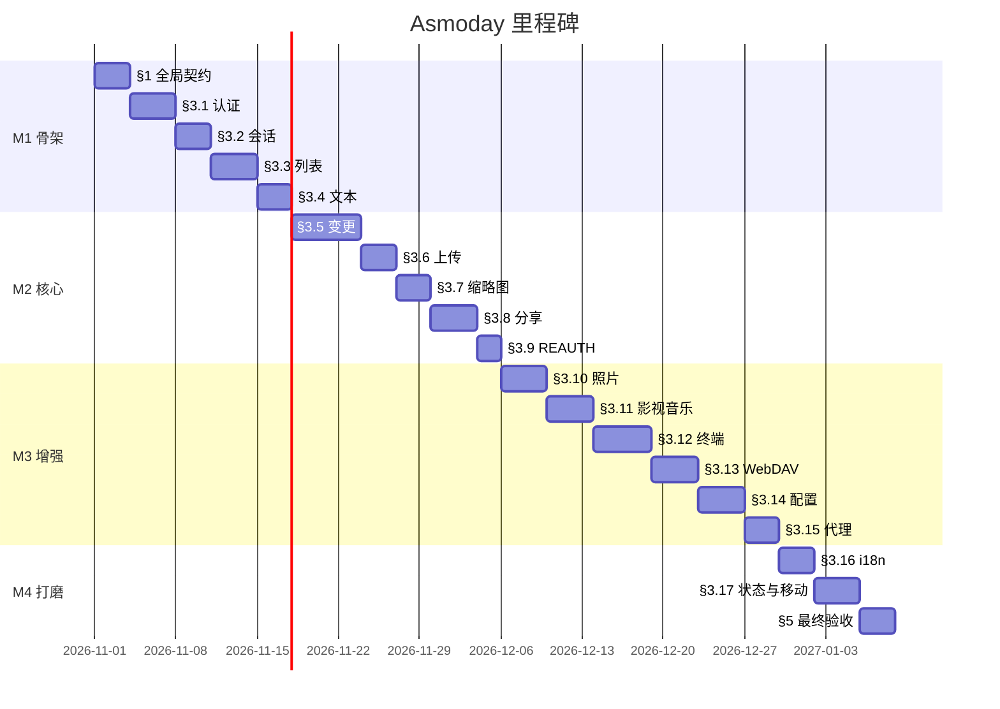

**依赖是硬依赖**：前序模块未 DoD，不允许进入后序模块。允许在 M1 完成后并行开发 M2 内不冲突的模块（如缩略图与上传），但要求**至少一人（或一个 agent 会话）专职按顺序推进主链路**。

---

**文档结束。**

> 使用提醒：本文档的每个 §3.X 都是**可直接复制给 agent 的独立上下文**。喂给 agent 时，请连同 §1 全局契约一起提供，按 §4.1 的流程推进。若 agent 产物与 §5 走查清单有偏差，优先修正本文档（补充规格），而不是让 agent"再多写点"——**规格层的清晰度直接决定产物的可用性**。