# Asmoday 实现规格 · Agent 执行版 v1.0

> **本文档与 `设计文档.md`（v4.2.2 定稿）的关系**
> - `设计文档.md` = **决策层**：定义"为什么这么选"、红线、锁定依赖。人类评审用，agent 可读但不足以执行。
> - **本文档** = **规格层**：定义"具体做什么、怎么验收"。agent 执行用，人类走查用。
> - 冲突时以 `设计文档.md` 的红线为准；规格层的任何内容不得违反红线。若规格层与红线冲突，视为规格层 bug，须提 issue 修正规格而非绕过红线。

---

## 0. 文档定位与使用约定

### 0.1 读者

- **Agent**：按"模块规格"逐块实现，按"验收用例"自检，按"交互稿"还原 UI。
- **Human Reviewer**：按"验收用例"走查，按"DoD"判定通过，按"红线执行点"守门。

### 0.2 一次 agent 会话的输入范围

**一个会话 = 一个模块的一个里程碑切片。** 会话开头喂给 agent 的上下文必须**只包含**：

1. 本文档的 **§1 全局契约**（必读，一次）；
2. 本文档的 **§3.X 对应模块规格**（该模块全文）；
3. 涉及的 `设计文档.md` 红线条目（按模块末尾"依赖红线"清单摘录）；
4. 该模块的交互稿截图（若有）；
5. 前序里程碑已交付的**代码**（而不是它的文档）。

**禁止**：一次会话喂整份 `设计文档.md` 或整份本文档。上下文过大会导致 agent 平均用力。

### 0.3 三条不可协商的执行纪律

1. **UI 先静态后接口**：任何模块先交付带假数据的静态页，通过视觉走查后再接 API。
2. **用例先于实现**：agent 先输出该模块的 Given-When-Then 用例清单（可以是文档草稿），reviewer 确认后才写代码。
3. **一次交付必须能端到端跑通**：不允许"骨架 + TODO"式交付。任一交付物必须能从 UI 点击走到后端再走回来。

### 0.4 术语表

| 术语 | 含义 |
|---|---|
| **envelope** | 统一响应包裹结构，见 §1.1 |
| **code** | 错误码枚举值，如 `E_BUSY`，见 §1.3 |
| **i18n key** | 前端 i18n 词条键，如 `error.E_BUSY.title` |
| **DoD** | Definition of Done，模块完成定义 |
| **GWT** | Given-When-Then 验收用例格式 |
| **REAUTH** | ~~敏感操作二次验证~~ **v4.4.1 已移除**（历史词条，见 §3.9 备注） |

---

## 1. 全局契约（所有模块共享，agent 首个会话必须先落地）

### 1.1 API Envelope

**成功响应**：

```json
{
  "ok": true,
  "data": { ... },
  "trace_id": "01HXYZ..."
}
```

**失败响应**（HTTP 状态码同时反映错误类别）：

```json
{
  "ok": false,
  "code": "E_BUSY",
  "message": "Path is busy",
  "trace_id": "01HXYZ...",
  "details": { "path": "a/b/c.txt" }
}
```

规则：

| 场景 | HTTP | `ok` | 说明 |
|---|---|---|---|
| 读取成功 | 200 | true | `data` 必填 |
| 创建成功 | 200 | true | 返回新建对象，**不用 201** |
| 更新/删除成功 | 200 | true | `data: null` 或返回新状态 |
| 无内容 | 200 | true | 统一 200，**不用 204**（简化前端拦截器） |
| 业务错误 | 4xx/5xx | false | `code` 必填，`message` 纯英文 |
| 参数校验 | 400 | false | `code: E_VALIDATION`，`details` 带字段名 |

- `trace_id` 由后端日志中间件生成，与 `data/logs/` 中记录一致，前端可展示给用户用于报障。
- 前端统一拦截器：`ok:false` → 按 `code` 查 i18n，缺失则显示 `message` + trace_id。

### 1.2 分页契约

所有列表接口（文件、相册、时间线、影视、音乐、分享、令牌、会话）统一：

**请求**：

```
?cursor=<opaque>&limit=<int 1..200, default 100>
```

**响应 `data`**：

```json
{
  "items": [ ... ],
  "next_cursor": "eyJ..." | null,
  "truncated": false
}
```

- `cursor` 是 **base64url(JSON)** 的不透明串，前端**禁止解码**。
- 排序键为 `(name, path)` / `(mtime, path)` / `(size, path)`，序列化进 cursor。
- 切换排序时前端**必须清空列表并丢弃旧 cursor**。
- `truncated: true` 表示后端因扫描上限（10000 项）截断，前端展示"仅显示前 10000 项"提示条。

### 1.3 错误码 → i18n → UI 动作映射表

> agent 拿到这张表可**直接生成** `web/src/lib/errors.ts` 与 `web/src/locales/{zh-CN,en-US}/error.json`。表格中 `actions` 是**按钮文案的 i18n key**，`retry` 表示是否允许"重试"按钮。

| code | HTTP | title (zh / en) | body (zh / en) | actions | retry |
|---|---|---|---|---|---|
| `E_UNAUTHORIZED` | 401 | 未登录 / Not signed in | 请重新登录 / Please sign in again | `action.signIn` | 否（跳登录） |
| `E_FORBIDDEN` | 403 | 无权限 / Forbidden | 当前账户无权执行此操作 / Your account cannot perform this action | `action.close` | 否 |
| `E_READONLY` | 403 | 只读挂载点 / Read-only mount | 该挂载点不允许写入 / This mount is read-only | `action.close` | 否 |
| `E_PASSWORD_CHANGE_REQUIRED` | 403 | 需先修改密码 / Password change required | 首次登录或重置后必须修改密码 / You must change your password | `action.goChangePassword` | 否 |
| `E_NOT_FOUND` | 404 | 资源不存在 / Not found | 目标已被删除或路径错误 / Target missing or invalid path | `action.refresh`, `action.close` | 是（刷新） |
| `E_GONE` | 410 | 分享已失效 / Share expired | 该分享已被删除 / This share has been removed | `action.backHome` | 否 |
| `E_CONFLICT` | 409 | 已存在同名项 / Name exists | 目标位置已有同名文件或文件夹 / An item with the same name exists | `action.rename`, `action.skip`, `action.cancel` | 否 |
| `E_DIR_CONFLICT` | 409 | 目录冲突 / Directory conflict | 目标目录已存在，不能合并覆盖 / Target directory exists; merge is not allowed | `action.rename`, `action.skip`, `action.cancel` | 否 |
| `E_CONFLICT_RETRY_EXHAUSTED` | 409 | 自动命名失败 / Auto-name failed | 已尝试 999 次仍冲突 / Rename attempts exhausted | `action.manualRename`, `action.cancel` | 否 |
| `E_TOO_MANY` | 413 | 选中项过多 / Too many items | 单次操作最多 100 项，请分批 / Max 100 items per operation | `action.close` | 否 |
| `E_TOO_LARGE` | 413 | 数据量过大 / Payload too large | 递归总量超过 2GB，请使用终端 / Exceeds 2GB; use terminal | `action.openTerminalHere`, `action.close` | 否 |
| `E_NO_SPACE` | 507 | 空间不足 / No space | 目标磁盘空间不足 / Not enough disk space | `action.close` | 否 |
| `E_PATH_TRAVERSAL` | 400 | 路径非法 / Invalid path | 路径包含非法字符或越界 / Path traversal detected | `action.close` | 否 |
| `E_SYMLINK_ESCAPE` | 403 | 链接越界 / Symlink escape | 目标链接指向挂载点外 / Symlink points outside mount | `action.close` | 否 |
| `E_BUSY` | 409 | 操作被占用 / Busy | 该路径正在被其他操作使用 / Path is in use by another operation | `action.ignoreAndContinue`, `action.viewDetails`, `action.cancel` | **禁用重试** |
| `E_SOURCE_DELETE_FAILED` | 500 | 源文件删除失败 / Source deletion failed | 复制成功但源未删除，请手动清理 / Copy succeeded but source remains | `action.copyPath`, `action.openTerminalHere`, `action.close` | 否 |
| `E_TOKEN_EXPIRED` | 403 | 令牌已过期 / Token expired | 请重新发起此操作 / Please restart the operation | `action.restart` | 否 |
| `E_TOKEN_MISMATCH` | 403 | 令牌不匹配 / Token mismatch | 操作上下文已变化 / Operation context changed | `action.restart` | 否 |
| `E_NAME_MISMATCH` | 400 | 确认名不符 / Name mismatch | 输入的确认名与目标不一致 / Confirmation name does not match | `action.close` | 否（重输） |
| `E_NOT_TEXT` | 415 | 非文本文件 / Not a text file | 该文件不是可编辑的文本 / Not an editable text file | `action.close` | 否 |
| `E_ENCODING` | 415/422 | 编码问题 / Encoding error | 无法识别或无法按原编码写回 / Cannot detect or write back encoding | `action.pickEncoding`, `action.cancel` | 否 |
| `E_TOO_MANY_REQUESTS` | 429 | 请求过于频繁 / Rate limited | 请稍后再试 / Please try again later | `action.close` | 是（倒计时） |
| `E_VALIDATION` | 400 | 参数无效 / Invalid parameter | 请检查输入 / Please check your input | `action.close` | 否 |
| `E_UNSUPPORTED_PREVIEW` | 400 | 无法预览 / Preview unavailable | 该类型不支持预览 / Preview not supported | `action.download`, `action.close` | 否 |
| `E_INTERNAL` | 500 | 内部错误 / Internal error | 请稍后再试，或参考 trace_id / Try again or report trace_id | `action.copyTraceId`, `action.close` | 是 |

**i18n 词条命名**：

```
error.E_BUSY.title
error.E_BUSY.body
error.E_BUSY.action.ignoreAndContinue
error.E_BUSY.action.viewDetails
error.E_BUSY.action.cancel
```

`action.*` 是全局动作词条，多个 code 复用。

### 1.4 请求头与 CSRF / 认证约定

| 请求类型 | 认证方式 | CSRF 校验 |
|---|---|---|
| 浏览器 SPA 读写 | Cookie `asmoday_session` | 写操作要求 `Origin` 或 `Referer` 至少一个与 Host 同源，**两者均缺失直接 403 `E_FORBIDDEN`** |
| Bearer Token | `Authorization: Bearer asm_...` | 豁免 Origin 校验 |
| WebDAV | Basic Auth（`token_name:asm_xxx`，或管理员账号 + 登录密码直连，v4.4.0） | 不适用 |
| 公开分享 | 分享 Cookie / URL token | 分享写操作（如 verify）按分享池限流 |

### 1.5 前端 store 与 composable 约定

| store / composable | 职责 | 关键约束 |
|---|---|---|
| `stores/auth.ts` | 当前用户与登录态 | ~~`verified_at` 派生状态、REAUTH 弹窗~~ **v4.4.1 已移除** |
| `stores/player.ts` | 全局音频播放条单实例 | 列表循环**禁止**生成 `<audio>`；仅此 store 持有一个 |
| `stores/lightbox.ts` | 全局图片灯箱单实例 | 同上，仅一个 |
| `stores/terminal.ts` | 终端会话池 | 单实例容器 |
| `stores/share.ts` | 公开分享页状态 | 不缓存认证信息到 localStorage |
| `composables/useReauth.ts` | 包裹任意写操作：请求前检查 `verified_at`，过期则弹 Modal 并重放 | 重放**只一次**，避免死循环 |
| `composables/usePagedList.ts` | 通用游标分页 | 排序切换自动清空 |
| `composables/useUpload.ts` | 上传池（默认并发 3） | 支持取消、重试、进度事件 |
| `composables/useBackClose.ts` | 浮层接管系统返回键（v4.4.4） | 一层浮层=一条同 URL 历史；`close()` 被取消必须重新武装；浮层不进 URL |
| `composables/useImageZoom.ts` | 灯箱图片缩放/平移/滑动（v4.4.6） | 变换 = `translate3d` + `scale`；锚点用容器中心换算，禁用 `getBoundingClientRect()` 当参照 |
| `lib/errors.ts` | envelope 拦截、code → i18n key 映射 | 未知 code 兜底 `message` + trace_id 复制按钮 |
| `lib/base.ts` | `base_url` 前缀拼接/剥离 | 路由、Cookie Path、WS URL、静态资源、分享链接统一 |

### 1.6 设计 token（agent 生成组件时强制引用）

```css
/* 间距：4 的倍数 */
--space-1: 4px; --space-2: 8px; --space-3: 12px;
--space-4: 16px; --space-6: 24px; --space-8: 32px;

/* 圆角 */
--radius-sm: 6px; --radius-md: 10px; --radius-lg: 14px;

/* 控件高度 */
--control-h: 40px;
--control-h-sm: 32px;

/* 阅读型内容宽度 */
--content-read: 1024px;    /* max-w-5xl */
```

**阅读型页面**（设置、分享落地、README 预览）居中 `--content-read`；**工作台型页面**（文件列表、终端、画廊、影视）`width: 100%`，禁止限制最大宽度。设置页源码模式同帧移除居中限制。

### 1.7 红色红线的执行点清单

> 每条红线必须落到**至少一处代码断言或 CI 检查**，否则视为规格层缺失。

| 红线（摘自设计文档） | 执行点 | 验收方式 |
|---|---|---|
| 不内置转码 | `core/ffmpeg.rs` 仅调用外部二进制，`Cargo.toml` 无 `ffmpeg-sys` / `libav*` | `cargo tree` grep |
| 不依赖 CDN | `build.rs` 校验 `dist/` 存在且 `web/index.html` 无外链 | 构建期断言 |
| 不提供关闭认证开关 | 配置 schema 无 `auth.enabled` 字段；`toml_edit` 拒绝未知字段 | schema 单测 |
| 无回收站 | `files_mutate.rs` 无 `trash` 分支 | 代码 grep |
| 批量阈值 | `files_mutate.rs` 入口校验选中数 > 100 或递归字节 > 2GB | GWT §3.5 |
| 目录 overwrite 拒绝 | `E_DIR_CONFLICT` 分支存在 | GWT §3.5 |
| 无 ACME | 配置无 ACME 字段 | schema 单测 |
| iframe 受限 | 前端 `iframe` 仅出现在 PDF 预览组件 | ESLint 自定义规则 |
| 依赖锁定 | `Cargo.lock` + `pnpm-lock.yaml` 入库；`package.json` 无 `latest` / `^*` 用于 Video.js | CI `pnpm audit` + 人工 review |
| i18n 强制 | ESLint 规则 `no-hardcoded-text` 覆盖 `web/src/**/*.vue` | CI lint |
| 原子落盘 | `fs_ops.rs` 使用 `.asmoday-part.*` + `renameat2`（或平台等价） | 单测 + GWT |
| canonicalize 父目录 | `fs.rs` 唯一入口，检查无裸 `canonicalize(path)` | 代码 grep |
| 媒体单实例 | `stores/player.ts` / `stores/lightbox.ts` 唯一实例 | 组件测试 |
| ThumbHash 入 SQLite | `thumb_metadata` 表唯一存储 | 代码 grep |
| EOL 原样写回 | `text_codec.rs` 单测覆盖 LF/CRLF/BOM 组合 | 单测 |
| `toml_edit` AST | `api/config.rs` 无 `toml::to_string` | 代码 grep |
| 环境变量不污染宿主机 | `core/terminal.rs` 用 `CommandBuilder.envs` 临时注入 | 单测 |
| 终端登录模式 | `core/terminal.rs` 强制追加 `-l`/`-i`/`-NoExit` | 单测 |

---

## 2. 里程碑与 DoD

### 2.1 里程碑划分

| 里程碑 | 范围 | 交付标准 | 依赖 |
|---|---|---|---|
| **M1 骨架** | 全局契约（§1）+ 初始化登录 + 会话 + 文件列表只读 + raw 下载 | 能从浏览器登录、看到目录、点开图片/视频/文本、下载 | 无 |
| **M2 核心** | 上传 + 变更操作（重命名/移动/复制/删除）+ 缩略图 + 分享 | M1 基础上能做完整文件管理，能分享单文件/文件夹 | M1 |
| **M3 增强** | 媒体画廊 + 影视 + 音乐 + 终端 + WebDAV + 配置可视化 | 三项增强能力端到端可用 | M2 |
| **M4 打磨** | i18n 全量 + 空/加载/错误态 + 移动端 + 二次验证交互 + 设置页 + 生态推荐 | 走查清单全部通过 | M3 |

**严禁跳里程碑**。M2 未 DoD 前不允许进入 M3。

### 2.2 里程碑 DoD（所有模块通用）

每个模块的 DoD 必须包含：

1. **功能**：该模块所有 GWT 用例通过（人工或自动化）；
2. **交互**：三态完整——正常 / 空 / 错误；四态完整——正常 / 加载 / 空 / 错误 / 无权限（权限相关的加一态）；
3. **i18n**：所有用户可见文案来自 `vue-i18n`，无硬编码；
4. **响应**：桌面 1024 宽、移动 375 宽均可操作，无横向滚动；
5. **错误**：该模块涉及的 code 全部有 i18n 词条，UI 有对应动作；
6. **Demo**：录屏 1–3 分钟，覆盖 happy path + 一个错误 path；
7. **文档**：模块 README 更新（输入、状态机、验收用例清单）。

---

## 3. 模块规格

> 每个模块采用固定模板：`范围 / 状态机 / 交互稿 / API 契约 / 错误映射 / GWT 验收 / 依赖红线 / DoD 增量`。
> **模块编号与里程碑对应**：M1（3.1–3.4）、M2（3.5–3.9）、M3（3.10–3.15）、M4（3.16–3.17）。

---

### 3.1 初始化与登录（M1）

#### 范围
- 首次启动生成一次性 init token 打印到控制台，初始化页面必须携带该 token。
- 初始化后进登录页；登录支持密码 + 可选 TOTP。
- `must_change_password=1` 时强制跳改密页。

#### 状态机

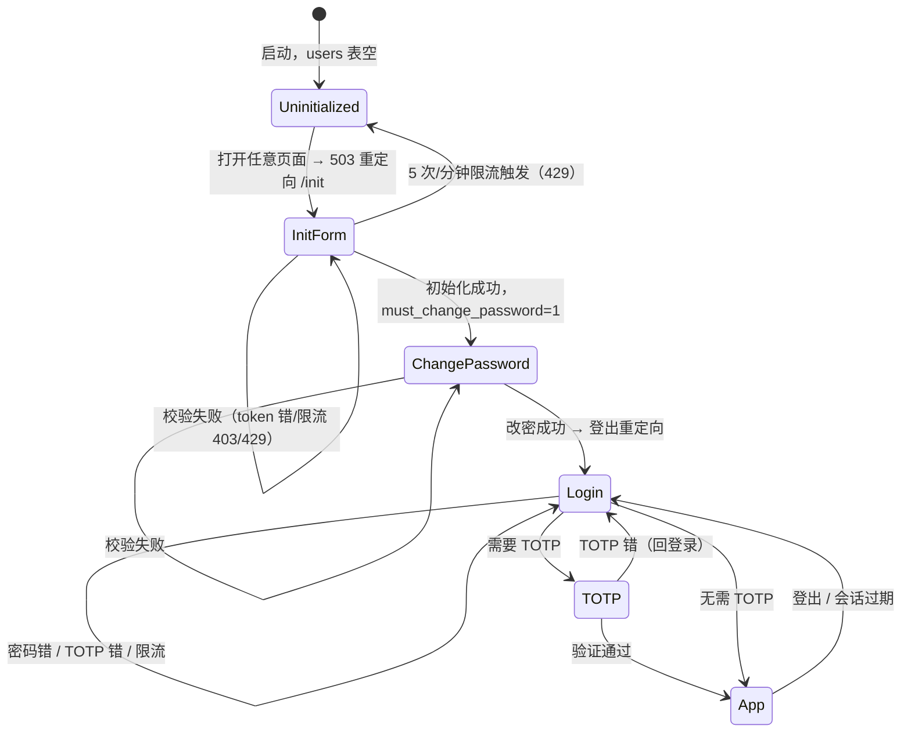

#### 交互稿（移动端 375 优先）

```
┌──────────────────────────────┐
│                              │
│         [ Asmoday ]          │ ← 产品名（i18n: app.name）
│                              │
│    初始化 / Initialize       │ ← h1
│                              │
│  ┌────────────────────────┐  │
│  │ 初始化令牌            │  │ ← 输入，placeholder: 控制台打印的令牌
│  └────────────────────────┘  │
│  ┌────────────────────────┐  │
│  │ 用户名                │  │
│  └────────────────────────┘  │
│  ┌────────────────────────┐  │
│  │ 密码                  │  │ ← 密码可见切换按钮
│  └────────────────────────┘  │
│  ┌────────────────────────┐  │
│  │ 确认密码              │  │
│  └────────────────────────┘  │
│                              │
│  ┌────────────────────────┐  │
│  │     初始化            │  │ ← 主按钮 h-40，loading 态显示 spinner
│  └────────────────────────┘  │
│                              │
│  [查看帮助]                  │ ← 底部次按钮 → 打开 /help#init
└──────────────────────────────┘
```

错误展示：**行内**（输入框下方红色小字），不用 toast。限流 429 → 底部提示条 `"请求过于频繁，请在 {seconds}s 后重试"` 倒计时。

登录页同构，去掉令牌/用户名（或保留用户名用于多用户未来兼容，但表只允许单行）。

#### API 契约

```http
POST /api/auth/init
Content-Type: application/json
{ "init_token": "string", "username": "string", "password": "string" }

200 { ok:true, data: { user: { id, username }, must_change_password: 1 } }
403 E_FORBIDDEN  （token 错）
429 E_TOO_MANY_REQUESTS
```

```http
POST /api/auth/login
{ "username": "string", "password": "string", "totp": "string?" }

200 { ok:true, data: {
  user: { id, username, is_totp_enabled },
  must_change_password: 0 | 1,
  needs_reauth: false
}}
// Set-Cookie: asmoday_session=...; HttpOnly; SameSite=Lax; Path=<base_url>;
401 E_UNAUTHORIZED   （密码错，无具体原因以避免用户名枚举）
429 E_TOO_MANY_REQUESTS
403 E_PASSWORD_CHANGE_REQUIRED  （登录成功但需改密时也返回此 code，前端据 data 判定）
```

```http
POST /api/auth/logout
200 { ok:true, data: null }
```

```http
POST /api/auth/password
{ "old_password": "string", "new_password": "string" }

200 { ok:true, data: null }   // 后端同时删除该用户全部 session，前端跳登录
400 E_VALIDATION               // 弱密码（长度、复杂度）
401 E_REAUTH_FAILED            // 旧密码错
```

#### 错误映射
见 §1.3；本模块涉及 `E_FORBIDDEN`、`E_UNAUTHORIZED`、`E_PASSWORD_CHANGE_REQUIRED`、`E_TOO_MANY_REQUESTS`、`E_VALIDATION`、`E_REAUTH_FAILED`。

#### GWT 验收

```gwt
GWT-AUTH-01 Given 应用首次启动  When 用户访问 /  Then 503 且重定向 /init
GWT-AUTH-02 Given 初始化页面  When 提交错误 init_token  Then 行内错误"令牌无效"，不清空表单
GWT-AUTH-03 Given 初始化页面  When 连续 6 次错误 init_token  Then 第 6 次返回 429 且底部倒计时 60s
GWT-AUTH-04 Given 初始化成功且 must_change_password=1  When 用户登录  Then 强制跳转 /change-password，导航栏隐藏
GWT-AUTH-05 Given 登录页  When 密码错误  Then 行内错误"用户名或密码错误"，不泄露用户是否存在
GWT-AUTH-06 Given 登录页  When 密码正确但 TOTP 开启  Then 弹出 6 位 TOTP 输入，输入错误回登录页
GWT-AUTH-07 Given 已登录  When 密码重置成功（CLI --reset-password）  Then 前端下一个请求返回 401 E_UNAUTHORIZED → 跳登录
GWT-AUTH-08 Given 会话已过期（30 天绝对上限）  When 用户点击任意页面  Then 401 跳登录，返回后回到原路径
```

#### 依赖红线
- 红线 4（不提供关闭认证开关）
- 红线 6（无回收站，与登录无关但本模块不应引入"重置到默认"按钮）
- §3.2 会话（依赖本模块完成）

#### DoD 增量
- 初始化令牌在控制台打印（截图附在 demo 里）
- 5 次/分钟限流在测试中显式验证
- 改密页与登录页共享表单组件（避免两套样式）

---

### 3.2 会话与二次验证（M1）

> **⚠️ v4.4.1 变更**：二次验证（REAUTH）整体移除——`verified_at` 闸门、`/api/auth/reauth`、`/api/auth/verify` 与前端弹窗都不存在了，敏感操作随登录会话直接放行。本节以下内容仅作历史设计记录。

#### 范围
- 自研 `sessions` 表：滑动续期 7 天 + 绝对上限 30 天。
- ~~`verified_at`：敏感操作（终端、令牌增删、配置写、DB 备份下载）要求 5 分钟内。~~（已移除）
- CSRF：Cookie 认证写操作要求 Origin/Referer 至少一个同源。

#### 状态机

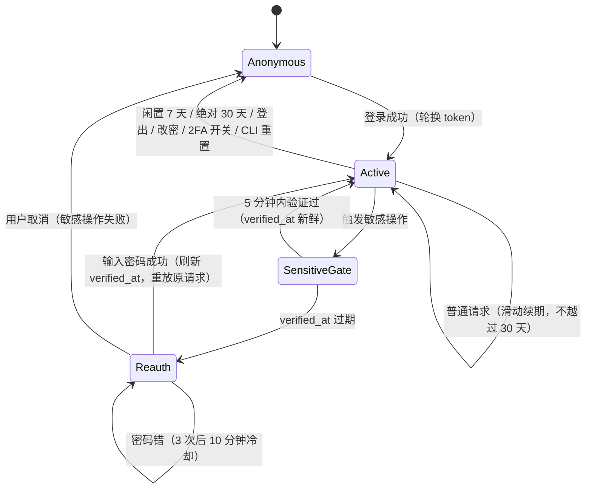

#### 交互稿（REAUTH 弹窗）

```
┌──────────────────────────────────────┐
│  需要验证身份 / Re-authentication    │ ← title
│  ──────────────────────────────────  │
│  此操作需要重新输入密码。            │ ← body
│                                      │
│  ┌────────────────────────────────┐  │
│  │ 密码                          │  │
│  └────────────────────────────────┘  │
│                                      │
│  [取消]                   [验证]     │
└──────────────────────────────────────┘
```

- 弹窗**阻塞**当前操作，取消则原操作中断（不重放）。
- 验证成功后**自动重放原请求且只重放一次**，不再弹窗。
- 密码错 3 次后弹窗内改为 `"尝试次数过多，请 10 分钟后再试或重新登录"`，按钮只剩 `[取消]`。

#### API 契约

```http
GET /api/auth/me
200 { ok:true, data: {
  user: { id, username, is_totp_enabled, must_change_password },
  session: { created_at, expires_at, verified_at, abs_expires_at },
  permissions: { is_admin, is_readonly }
}}
401 E_UNAUTHORIZED
```

```http
POST /api/auth/reauth
{ "password": "string" }
200 { ok:true, data: { verified_at: <unix ms> } }
401 E_REAUTH_FAILED
429 E_TOO_MANY_REQUESTS
```

#### 错误映射
`E_UNAUTHORIZED`、`E_REAUTH_REQUIRED`、`E_REAUTH_FAILED`、`E_TOO_MANY_REQUESTS`。

#### GWT 验收

```gwt
GWT-SESSION-01 Given 活跃会话  When 发送任意读请求  Then 不轮换 token，只更新 expires_at（7 天内滑动）
GWT-SESSION-02 Given 会话 createdAt=29 天前  When 请求  Then 续期不越过 createdAt+30d（响应 expires_at 等于绝对上限）
GWT-SESSION-03 Given 会话已闲置 8 天  When 请求  Then 401
GWT-SESSION-04 Given verified_at=6 分钟前  When 调用 POST /api/config  Then 403 E_REAUTH_REQUIRED
GWT-SESSION-05 Given E_REAUTH_REQUIRED  When 前端弹出 Modal 输入正确密码  Then 后端返回 200 且原请求自动重放（仅一次）
GWT-SESSION-06 Given REAUTH 弹窗  When 连续 3 次密码错  Then 弹窗关闭且 10 分钟内再触发写操作直接 401
GWT-SESSION-07 Given 浏览器发写请求  When Origin 与 Referer 都缺失  Then 403 E_FORBIDDEN
GWT-SESSION-08 Given 写请求带 Bearer Token  When Origin 缺失  Then 放行
GWT-SESSION-09 Given 用户在 A 设备改密  When B 设备发起任意请求  Then 401（全部 session 行已删）
GWT-SESSION-10 Given WebSocket /api/terminal/ws  When Origin 与 Host 不同源  Then 拒绝握手（403）
```

#### 依赖红线
- 红线 4（认证不可关闭）
- 红线 13（canonicalize 父目录在 path_guard 里，但本模块不涉及）

#### DoD 增量
- 会话续期在测试中显式验证 7 天滑动 + 30 天绝对上限两个边界
- REAUTH 弹窗在设置页、终端、令牌、备份四个入口均复现
- `useReauth.ts` 单测覆盖"重放一次"逻辑

---

### 3.3 文件列表与导航（M1）

#### 范围
- 挂载点卡片 → 目录列表 → 面包屑导航。
- 网格 / 列表双视图，偏好写 localStorage。
- 稳定排序 + 游标分页，切换排序清空列表。
- 隐藏垃圾文件（`desktop.ini`、`.DS_Store` 等）由后端过滤，前端不再判断。

#### 状态机

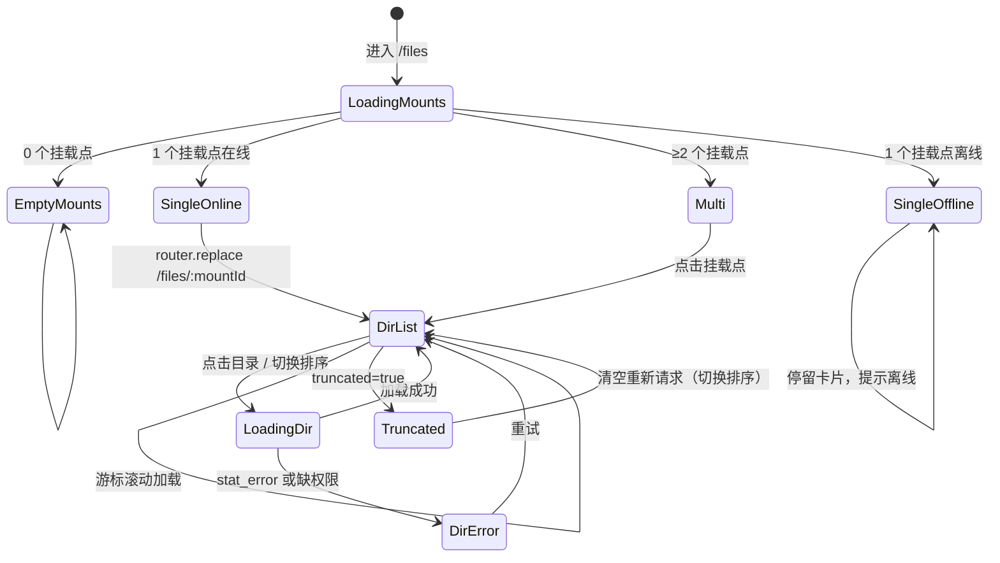

#### 交互稿（网格视图 / 桌面）

```
┌─ 顶栏 ────────────────────────────────────────────────┐
│ [🏠] / media / photos / 2026/                    [👤] │ ← 面包屑 + 用户菜单
├─ 工具栏 ──────────────────────────────────────────────┤
│  [⬆ 上传] [新建] [视图▾] [排序▾] [筛选▾]   [刷新]   │
│  已选 0 项                                            │
├───────────────────────────────────────────────────────┤
│  ┌──────┐ ┌──────┐ ┌──────┐ ┌──────┐ ┌──────┐       │
│  │ [缩略]│ │ [缩略]│ │ [缩略]│ │ [缩略]│ │ [图标]│     │
│  │ a.jpg │ │ b.png │ │ c.mp4 │ │ d.pdf │ │ folder│     │
│  └──────┘ └──────┘ └──────┘ └──────┘ └──────┘       │
│  ...                                                  │
│                                                       │
│                    [加载更多…]                         │
└───────────────────────────────────────────────────────┘
```

**空状态**：

```
┌───────────────────────────────────────┐
│                                       │
│            [空文件夹图标]              │
│         此目录为空                     │ ← i18n: files.empty.title
│         拖拽文件到此处上传              │ ← i18n: files.empty.hint
│                                       │
│         [上传文件]                     │
│                                       │
└───────────────────────────────────────┘
```

**截断态**（页脚提示条，黄色）：

```
⚠ 仅显示前 10000 项。请通过终端或缩小范围查看。
```

**列表视图**（表格）：

```
名称▾ | 大小 | 修改时间▾ | 类型
📁 folder1  |  -   | 2026-10-01 12:00 | 文件夹
📄 a.jpg    | 2.3MB| 2026-10-28 09:31 | JPEG
```

列头点击切换排序，方向用 ▲▼ 标记，**同一时间只有一列有排序箭头**。切换排序 → 清空 items + 丢弃 cursor + 重新请求。

#### API 契约

```http
GET /api/files/mounts
200 { ok:true, data: { items: [{
  id, name, canonical_root, is_readonly, is_online, follow_symlinks
}], next_cursor: null }}
```

```http
GET /api/files/list?mount_id=&path=&cursor=&limit=100&show_hidden=false&sort=name|mtime|size&order=asc|desc
200 { ok:true, data: {
  items: [{
    name, path, is_dir, is_symlink, target_is_dir?,
    size, mtime, type,
    thumb_hash?,        // 若有缩略图
    stat_error?: string // 逐项容错
  }],
  next_cursor: "…" | null,
  truncated: bool,
  sort_applied: { field, order }
}}
400 E_PATH_TRAVERSAL / E_VALIDATION
403 E_READONLY（仅列出时可读，只读不影响列表）
404 E_NOT_FOUND
```

```http
GET /api/files/raw?mount_id=&path=
// 支持 Range, HEAD, ETag, Last-Modified
200 / 206 / 304
404 E_NOT_FOUND
416 直接返回（Range 越界，不加 envelope，标准 HTTP 语义）
```

```http
GET /api/files/thumb?mount_id=&path=
200  （image/webp 或 image/jpeg 二进制，不包裹 envelope）
404  （缩略图未生成，前端回占位）
```

#### 错误映射
`E_PATH_TRAVERSAL`、`E_VALIDATION`、`E_NOT_FOUND`、`E_READONLY`（重命名等写操作时）。

#### GWT 验收

```gwt
GWT-LIST-01 Given 0 个挂载点  When 进入 /files  Then 显示空状态卡片，无路由跳转
GWT-LIST-02 Given 1 个挂载点且在线  When 进入 /files  Then router.replace 到 /files/:mountId/，直接进目录列表
GWT-LIST-03 Given 1 个挂载点但离线  When 进入 /files  Then 停留卡片，显示"离线"标记与"重试"按钮
GWT-LIST-04 Given 目录列表  When 切换排序字段  Then 清空 items，丢弃 cursor，从头请求
GWT-LIST-05 Given 列表滚动到底  When 有 next_cursor  Then 自动请求下一页并追加
GWT-LIST-06 Given 列表 10000 项  When 请求第一页  Then 返回 truncated=true，前端展示截断提示
GWT-LIST-07 Given 目录含 desktop.ini  When 请求列表  Then 该文件不出现
GWT-LIST-08 Given 目录含 .git/config 且 show_hidden=false  When 请求  Then .git 不出现
GWT-LIST-09 Given 目录含 .git/config 且 show_hidden=true  When 请求  Then .git 出现
GWT-LIST-10 Given 单个文件 stat 失败（权限/消失）  When 请求列表  Then 该项 stat_error 被设置，其他项正常
GWT-LIST-11 Given 只读挂载点  When 用户右键  Then "重命名/移动/复制/删除"项置灰 + tooltip "只读挂载点"
GWT-LIST-12 Given 面包屑  When 挂载点数量 ≥2  Then 展示 [🏠] / 挂载点 / 目录…
GWT-LIST-13 Given 面包屑  When 挂载点数量 =1  Then 展示 [🏠 挂载点] / 目录…
```

#### 依赖红线
- 红线 5（无回收站，删除为物理删）
- 红线 13（canonicalize 父目录）
- §4.1 视图与过滤（后端硬编码垃圾名单）

#### DoD 增量
- 空状态、加载骨架、stat_error 单项标记三种态视觉走查通过
- 网格/列表视图切换在移动端 375 宽可操作
- 隐藏文件开关不影响垃圾文件过滤（垃圾永远不可见）

---

### 3.4 文本编辑与预览（M1）

#### 范围
- 文本/代码用 CodeMirror 6 编辑，保存时原样写回 EOL 与 BOM。
- Markdown 默认渲染（`marked` + `DOMPurify`），可切换源码。
- PDF 用 `<iframe src=raw_url>`。
- CSV 超 5MB 或 1000 行截断。
- Office/CAD/压缩包只提示下载。

#### 状态机

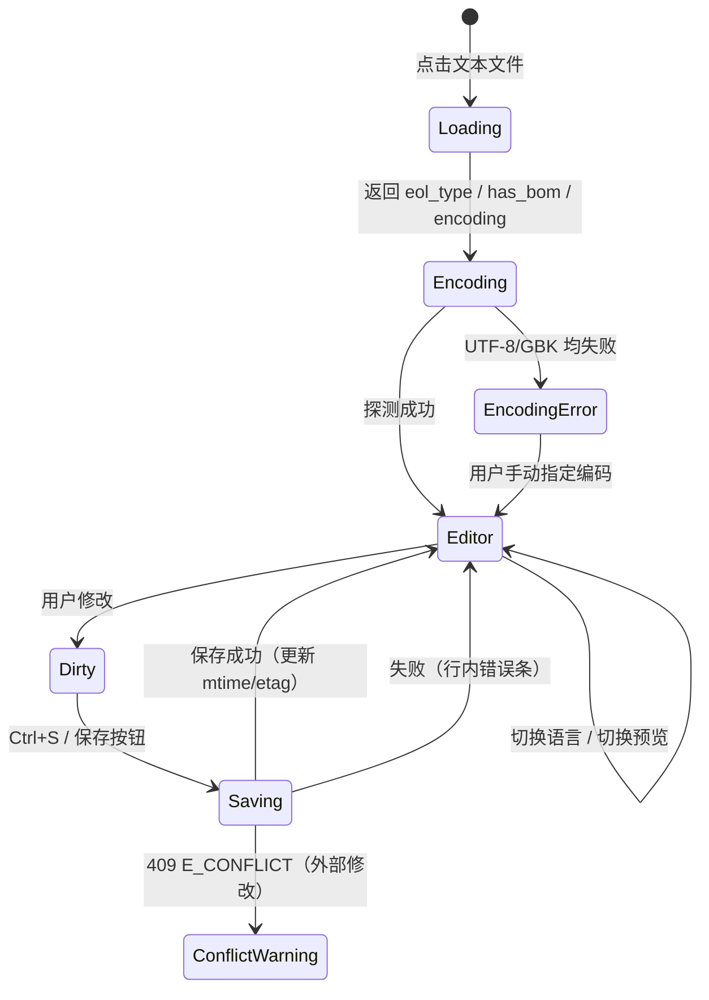

#### 交互稿

```
┌─ 顶栏（铺满整个浏览器，v4.4.5）────────────────────────────┐
│ [×]  a.txt ●          [− 14px +]  [TOML▾]  [保存 Ctrl+S] │
├─ 路径行 ──────────────────────────────────────────────────┤
│ 📁 asmoday › sub › a.txt                                  │
├───────────────────────────────────────────────────────────┤
│  1  # 标题                                                │
│  2                                                        │
│  3  正文...                                               │
│  ...                                                      │
├─ 状态栏 ──────────────────────────────────────────────────┤
│ UTF-8 · LF  |  BOM  |  [只读挂载点]                       │
└───────────────────────────────────────────────────────────┘
```

- 编辑器**整屏接管**（`Teleport` 到 `body` + `fixed inset-0`），侧边栏与顶栏让位；
  用 `Teleport` 而不是就地 `fixed`，因为 `#app-scroll` 祖先在路由过渡期带 `transform`。
- 列表不卸载：关掉编辑器直接回到原目录与滚动位置，不重新拉列表。
- 字号步进器 `− 14px +`（中间那格点一下回默认），值存 `asmoday.editor.fontSize`；
  窄屏隐藏该控件，默认 13px。改字号只重配 CodeMirror 的字号 compartment，不重建实例
  （撤销栈、光标、滚动位置都保住）。
- 未保存关闭一律弹站内三选一：`[取消] [保存更改] [放弃修改]`，**不使用原生 `confirm`**。
  `closeEditor()` 返回 `Promise<boolean>`，调用方 `await` 后再决定是否继续换目录 / 开预览。
- 滚动只在编辑器内部；软键盘遮挡高度补成根容器的 `padding-bottom`，底栏与光标行不被压住。
- 保存失败用**顶部黄色提示条**（不是 toast），可关闭，带"重试"。
- 冲突（`E_CONFLICT`，外部修改）→ Modal 三选一：`[覆盖保存] [另存为副本] [放弃返回]`。

#### API 契约

```http
GET /api/files/text?mount_id=&path=
200 { ok:true, data: {
  content: "string",
  encoding: "utf-8" | "gbk" | "other",
  eol_type: "lf" | "crlf",
  has_bom: bool,
  size: int,
  mtime: int,
  etag: "string"
}}
415 E_NOT_TEXT
415/422 E_ENCODING
```

```http
POST /api/files/text
{ mount_id, path, content, eol_type, has_bom, etag_expected }
200 { ok:true, data: { mtime, etag } }
409 E_CONFLICT          // etag 不匹配（外部修改）
415 E_NOT_TEXT
415/422 E_ENCODING
```

#### 错误映射
`E_NOT_TEXT`、`E_ENCODING`、`E_CONFLICT`。

#### GWT 验收

```gwt
GWT-TEXT-01 Given LF 结尾文件  When 保存  Then 文件仍为 LF
GWT-TEXT-02 Given CRLF 结尾文件  When 保存  Then 文件仍为 CRLF
GWT-TEXT-03 Given UTF-8 BOM 文件  When 打开并保存  Then BOM 保留
GWT-TEXT-04 Given GBK 文件  When 打开  Then 以 GBK 解码展示，保存时按 GBK 写回
GWT-TEXT-05 Given 语言识别为 python  When 打开  Then 语法高亮生效
GWT-TEXT-06 Given 未知扩展名  When 打开  Then 纯文本模式，语言下拉可手动选
GWT-TEXT-07 Given Markdown 文件  When 打开  Then 默认预览模式，顶部可切源码
GWT-TEXT-08 Given 用户已修改文件  When 外部同时修改并保存  Then 用户保存时 409，弹 Modal 三选一
GWT-TEXT-09 Given 二进制文件  When 打开  Then 415 E_NOT_TEXT，UI 提示"无法编辑"
GWT-TEXT-10 Given CSV 6MB  When 打开  Then 提示"超过 5MB 已截断"
GWT-TEXT-11 Given CSV 2000 行  When 打开  Then 提示"超过 1000 行已截断"
GWT-TEXT-12 Given 有未保存修改  When 按系统返回/浏览器后退  Then 弹未保存确认；选取消则留在编辑器且不改变 URL
GWT-TEXT-13 Given 编辑器已打开  When 点侧边栏切走或刷新  Then 有未保存修改必须先确认（`onBeforeRouteLeave` 弹三选一 + `beforeunload`）
GWT-TEXT-14 Given 有未保存修改  When 点顶栏 × 并选「保存更改」  Then 先落盘再关闭，落盘失败则留在编辑器并显示错误条
GWT-TEXT-15 Given 编辑器已打开  When 观察布局  Then 编辑器矩阵等于视口（1440×900 下无侧边栏 / 顶栏残留），列表在下面保持挂载
```

#### 依赖红线
- 红线 16（EOL 原样写回）
- 红线 9（iframe 仅本地 PDF 允许）

#### DoD 增量
- EOL/BOM 组合矩阵单测通过（LF/CRLF × BOM/无BOM）
- 编辑器滚动不泄漏到外层
- Markdown 渲染器 `DOMPurify` 过滤 XSS（用例覆盖 `<script>` 注入）

---

### 3.5 文件变更操作：重命名 / 移动 / 复制 / 删除（M2）

#### 范围
- 单次 copy/move：选中数 > 100 **或** 递归字节 > 2GB（任一超限拒绝）。同挂载点 move 用原子 `rename`，不统计字节。
- 跨挂载点：`.asmoday-part.*` 临时文件 + 大小比对 + 原子改名 + 删源。
- 目录 overwrite 拒绝（`E_DIR_CONFLICT`），只接受 rename/skip。
- 删除：物理硬删；单目录需 `confirm_name`，批量需 `delete-token`。
- per-path 内存锁，冲突立即 `E_BUSY`。
- 软链接：`follow_symlinks` 决定逃逸策略；复制链接本身不跟随；删除只删链接本身。

#### 状态机（跨挂载点移动）

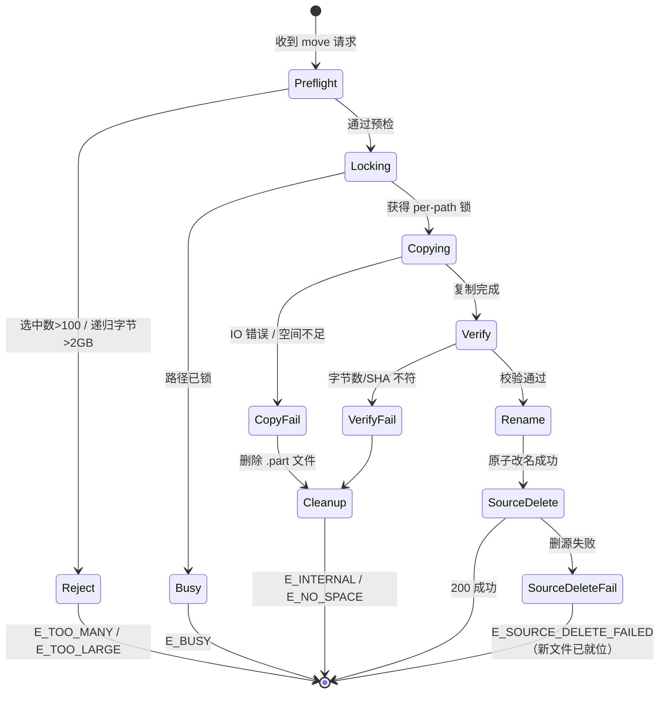

#### 交互稿（批量结果弹窗）

```
┌──────────────────────────────────────────────┐
│  操作结果 / Operation result                 │
│  ────────────────────────────────────────    │
│  成功 8 项，失败 2 项                        │
│                                              │
│  ✗ vacation/2024/a.jpg                       │
│    E_BUSY · 该路径正在被其他操作使用         │
│    [忽略并继续] [查看详情]                    │
│                                              │
│  ✗ b.txt                                     │
│    E_CONFLICT · 目标已存在同名项             │
│    [重命名] [跳过] [取消]                    │
│                                              │
│  ────────────────────────────────────────    │
│  [复制全部错误]                [关闭]        │
└──────────────────────────────────────────────┘
```

- 失败项**优先展示 `error_code` 翻译**，`message` 放在详情折叠区（供报障）。
- `E_BUSY` / `E_CONFLICT` **不出现"重试"按钮**（红线 18.7 精神），只出现"忽略并继续 / 重命名 / 跳过"。

#### API 契约

```http
POST /api/files/rename
{ mount_id, path, new_name }
200 { ok:true, data: { path: "新路径" } }
409 E_CONFLICT
400 E_VALIDATION
403 E_READONLY
```

```http
POST /api/files/move
{ mount_id, paths[], dest_mount_id, dest_path, on_conflict: "rename"|"skip" }
200 { ok:true, data: {
  results: [{
    src: "string",
    ok: bool,
    code?: "E_*",
    dest?: "string"
  }],
  summary: { ok_count, fail_count }
}}
413 E_TOO_MANY / E_TOO_LARGE   // 预检失败（整批拒绝）
409 E_BUSY                     // 任一锁冲突（整批拒绝）
```

```http
POST /api/files/copy    // 同上
```

```http
POST /api/files/delete-token
{ mount_id, paths[] }
200 { ok:true, data: { token: "string", expires_in: 60 } }
```

```http
POST /api/files/delete
{ mount_id, paths[], confirm_name? | confirm_token? }
200 { ok:true, data: {
  results: [{ src, ok, code? }],
  summary
}}
400 E_NAME_MISMATCH
403 E_TOKEN_EXPIRED / E_TOKEN_MISMATCH
```

#### 错误映射
`E_TOO_MANY`、`E_TOO_LARGE`、`E_BUSY`、`E_CONFLICT`、`E_DIR_CONFLICT`、`E_SOURCE_DELETE_FAILED`、`E_NO_SPACE`、`E_NAME_MISMATCH`、`E_TOKEN_EXPIRED`、`E_TOKEN_MISMATCH`、`E_CONFLICT_RETRY_EXHAUSTED`、`E_VALIDATION`、`E_READONLY`、`E_SYMLINK_ESCAPE`。

#### GWT 验收

```gwt
GWT-MUT-01 Given 选中 100 项  When move  Then 允许
GWT-MUT-02 Given 选中 101 项  When move  Then 413 E_TOO_MANY（整批拒绝）
GWT-MUT-03 Given 同挂载点 move 一个 5GB 目录  When move  Then 允许（rename 不统计字节）
GWT-MUT-04 Given 跨挂载点 move 递归 3GB  When move  Then 413 E_TOO_LARGE
GWT-MUT-05 Given 跨挂载点 move 500MB  When 中途断开  Then 下次启动清理 .asmoday-part 文件
GWT-MUT-06 Given 跨挂载点 move 目标已存在同名目录  When on_conflict=rename  Then 自动改名 基础名 (1).扩展名
GWT-MUT-07 Given 跨挂载点 move 目标已存在同名目录  When 自动命名 999 次冲突  Then 409 E_CONFLICT_RETRY_EXHAUSTED
GWT-MUT-08 Given 目标已存在同名文件  When on_conflict=overwrite 且类型为目录  Then 409 E_DIR_CONFLICT
GWT-MUT-09 Given 复制成功但删源失败  When 完成  Then 500 E_SOURCE_DELETE_FAILED，新文件保留，UI 提示手动清理
GWT-MUT-10 Given 同一路径被 A 操作锁住  When B 操作 move  Then 立即 409 E_BUSY，不排队
GWT-MUT-11 Given 删除 1 个目录  When 弹 confirm_name 输入的与目录名不一致  Then 400 E_NAME_MISMATCH
GWT-MUT-12 Given 批量删除 20 项  When 无 delete-token  Then 400 E_VALIDATION
GWT-MUT-13 Given 批量删除 20 项  When delete-token 60s 后使用  Then 403 E_TOKEN_EXPIRED
GWT-MUT-14 Given 复制软链接  When 执行  Then 复制链接本身，不跟随
GWT-MUT-15 Given follow_symlinks=false 且链接指向挂载点外  When 复制  Then 403 E_SYMLINK_ESCAPE
GWT-MUT-16 Given 删除软链接  When 执行  Then 只删链接，不递归删目标
GWT-MUT-17 Given 删除文件  When 成功  Then 级联删除 favorites / play_history 中相关记录
GWT-MUT-18 Given 删除已分享的文件  When 分享访问  Then 410 E_GONE（tombstone 30 天）
GWT-MUT-19 Given 软链接指向挂载点外且 follow_symlinks=true  When 上传到该链接  Then 成功且返回路径以链接路径为前缀（不替换成真实路径）
GWT-MUT-20 Given 直接请求挂载点外绝对路径  When follow_symlinks=true  Then 依然 403（放开的只有链接解析）
```

#### 依赖红线
- 红线 6（阈值）
- 红线 7（目录 overwrite 拒绝）
- 红线 12（原子落盘）
- 红线 13（canonicalize 父目录）
- §4.5 变更操作

#### DoD 增量
- 跨挂载点 `.part` 清理在启动时验证
- 批量结果弹窗在 4 种 code 下视觉走查通过
- 软链接逃逸策略在 `follow_symlinks` 两种取值下各验证一遍

---

### 3.6 上传（M2）

#### 范围
- 流式落盘，单文件上限 `upload_max_size_mb`，上传前检查剩余空间。
- 同名冲突沿用 `on_conflict`（rename / skip / 拒绝 overwrite 目录）。
- 并发池默认 3。
- 支持取消、重试、进度事件。

#### 状态机

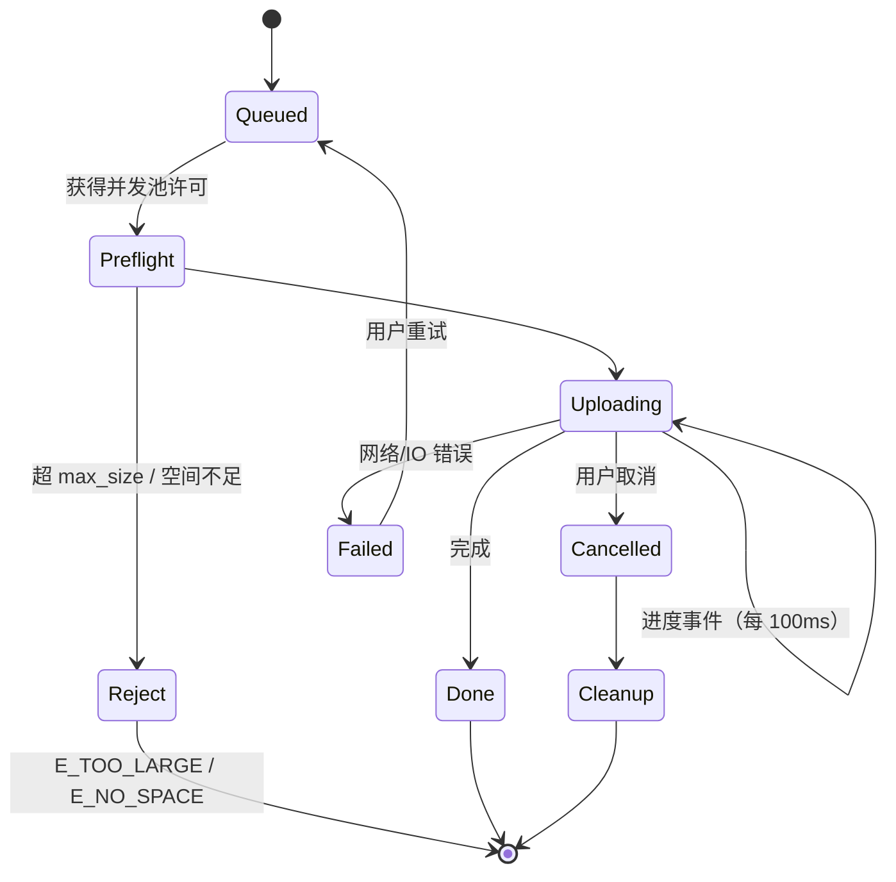

#### 交互稿（上传面板，右下角浮层）

```
┌─ 上传队列（3）───────────────────┐
│ a.jpg           ────●─── 68%     │
│   [取消]                          │
│ b.mp4           ──●───── 32%     │
│   [取消]                          │
│ c.png           ✓ 完成            │
│                                  │
│ 全部上传完成（2/3）              │
└──────────────────────────────────┘
```

- 面板**悬浮在右下角**（移动端全宽底部）。
- 失败项有 `[重试]` 与 `[移除]`。
- 全部完成后 5 秒自动收起，用户可展开。

#### API 契约

```http
POST /api/files/upload
Content-Type: multipart/form-data
fields: mount_id, path, file, on_conflict

200 { ok:true, data: { path, size, mtime } }
413 E_TOO_LARGE
507 E_NO_SPACE
409 E_CONFLICT / E_DIR_CONFLICT
```

> 上传进度用 `fetch` 无法拿到，需用 `XMLHttpRequest.upload.onprogress` 或 `fetch` + `ReadableStream`。**agent 需用 XHR**，禁止用 Axios 默认（Axios 在部分浏览器仍走 XHR，但显式指定更稳）。

#### GWT 验收

```gwt
GWT-UP-01 Given 上传 4 个文件  When 池并发上限 3  Then 第 4 个排队
GWT-UP-02 Given 上传中途取消  When 取消  Then 服务端清理 .part，队列移除
GWT-UP-03 Given 目标磁盘剩余 100MB  When 上传 500MB  Then 前置检查拒绝 507 E_NO_SPACE，不上传
GWT-UP-04 Given 目标已存在同名文件  When on_conflict=rename  Then 自动改名保存
GWT-UP-05 Given 目标已存在同名目录  When on_conflict=rename  Then 自动改名保存
GWT-UP-06 Given 上传进度  When 浏览器网络中断  Then 3 秒内标记失败，提供重试
GWT-UP-07 Given 全部上传完成  When 5 秒  Then 面板自动收起
```

#### 依赖红线
- 红线 6（单文件大小上限）
- 红线 12（原子落盘）

#### DoD 增量
- 进度事件在桌面 Chrome + 移动 Safari 各验证一遍
- 取消后服务端无残留 `.part`

---

### 3.7 缩略图（M2）

#### 范围
- 并发上限 2，拿不到许可 1.5s 内回占位图。
- `mtime` 距今 <1 分钟且 ≥4MiB 跳过生成。
- 优先 WebP，降级 JPEG。
- FFmpeg 路径热重载 + 探活；未配置 404。
- 缓存键 `mount_id + path + mtime + size` 哈希，LRU 淘汰。
- ThumbHash 存 `thumb_metadata` 表。

#### 状态机

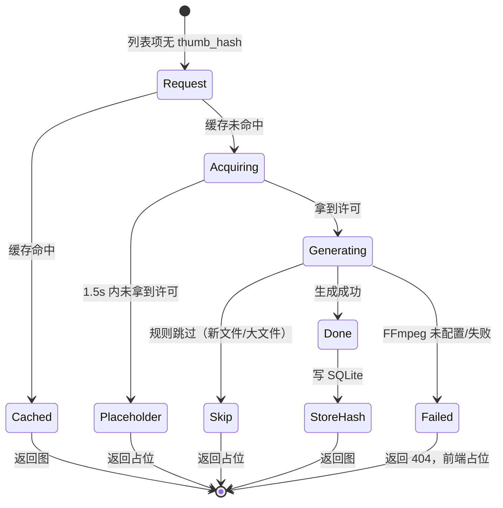

#### 交互稿（占位图视觉）

```
┌──────┐
│ 🖼   │  ← 灰度图标 + 文件名首字母
│  A   │     opacity 0.5
└──────┘
```

- 占位与真图**尺寸一致**（避免布局跳动）。
- 真图加载完成后 `opacity: 0 → 1` 淡入 150ms。

#### API 契约

```http
GET /api/files/thumb?mount_id=&path=
200 (image/webp | image/jpeg)
404 (未生成，前端占位)
```

列表接口返回 `thumb_hash`（若有），前端可用 ThumbHash 直接渲染模糊占位，再替换为真图。

#### GWT 验收

```gwt
GWT-THUMB-01 Given 4 个文件同时请求缩略图  When 并发上限 2  Then 后 2 个 1.5s 内返回占位
GWT-THUMB-02 Given mtime 30s 前且 size 5MiB  When 请求缩略图  Then 跳过生成，返回占位
GWT-THUMB-03 Given FFmpeg 未配置  When 请求视频缩略图  Then 404，前端占位
GWT-THUMB-04 Given 已生成过缩略图  When 再次请求  Then 直接命中缓存，不重新生成
GWT-THUMB-05 Given ThumbHash 存在  When 列表渲染  Then 先显示 ThumbHash 模糊，加载后替换
GWT-THUMB-06 Given 缩略图缓存超 LRU 上限  When 请求  Then 最久未访问的条目被淘汰
```

#### 依赖红线
- 红线 1（不内置转码，只调用外部 FFmpeg）
- 红线 15（ThumbHash 存 SQLite）

---

### 3.8 分享（M2）

#### 范围
- `allow_download=false`：不生成 `attachment` 链接，`raw?download=1` 返回 `E_FORBIDDEN`。
- 分享密码（可选）、过期时间（可选）。
- tombstone：`deleted_at` 超 30 天启动清理。
- 分享访客 API **不返回物理路径字段**。

#### 状态机

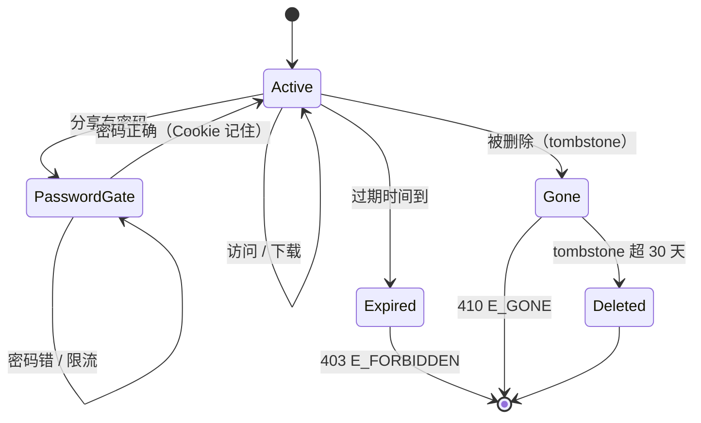

#### 交互稿（公开分享页）

```
┌─ 分享：vacation/2024 ────────────────────────┐
│                                              │
│  ┌──────┐ ┌──────┐ ┌──────┐                 │
│  │[缩略]│ │[缩略]│ │[缩略]│                 │
│  │a.jpg │ │b.jpg │ │c.jpg │                 │
│  └──────┘ └──────┘ └──────┘                 │
│                                              │
│  [Asmoday · 分享]                    [登出]  │ ← 页脚
└──────────────────────────────────────────────┘
```

- `allow_download=false` 时：**不显示下载按钮**，图片禁用右键，视频/音频隐藏原生下载控件。
- 无密码：直接进。有密码：先展示密码表单，验证成功 Set-Cookie（分享会话），再显示内容。

#### API 契约

```http
POST /api/shares
{ mount_id, path, password?, allow_download, expires_at? }
200 { ok:true, data: { token, url, allow_download, expires_at } }
```

```http
GET /api/public/share/{token}
200 { ok:true, data: {
  is_folder, name, size, type,
  allow_download, needs_password, expires_at
}}
403 E_FORBIDDEN（已过期）
410 E_GONE
```

```http
POST /api/public/share/{token}/verify
{ password? }
200 { ok:true, data: null }  // Set-Cookie 分享会话
401 E_UNAUTHORIZED
429 E_TOO_MANY_REQUESTS
```

```http
GET /api/public/share/{token}/list?cursor=
200 { ok:true, data: { items: [{ name, size, is_dir, is_previewable }], next_cursor } }
```

```http
GET /api/public/share/{token}/raw?path=&download=0|1
200/206
403 E_FORBIDDEN（allow_download=false 且 download=1）
```

#### GWT 验收

```gwt
GWT-SHARE-01 Given allow_download=false 分享单图片  When 访客访问  Then 显示图片，无下载按钮
GWT-SHARE-02 Given allow_download=false 分享单图片  When 访客请求 raw?download=1  Then 403 E_FORBIDDEN
GWT-SHARE-03 Given allow_download=false 分享文件夹含压缩包  When 访客打开  Then 列表返回该文件但置灰，点击提示"不支持预览"
GWT-SHARE-04 Given allow_download=false 分享不支持预览的单文件  When 创建分享  Then 400 E_UNSUPPORTED_PREVIEW
GWT-SHARE-05 Given 分享有密码  When 首次访问  Then 显示密码表单
GWT-SHARE-06 Given 分享密码  When 密码错 5 次/分钟  Then 429
GWT-SHARE-07 Given 分享已过期  When 访问  Then 403 E_FORBIDDEN
GWT-SHARE-08 Given 分享被删除  When 访问  Then 410 E_GONE
GWT-SHARE-09 Given 分享被删除超 30 天  When 启动  Then 该行被物理删除
GWT-SHARE-10 Given 分享访问  When 请求任意接口  Then 响应中无物理路径字段
```

#### 依赖红线
- 红线 5（无回收站，tombstone 仅服务分享）
- §11 分享

---

### 3.9 二次验证（REAUTH）与终端、令牌、配置、备份的交互（M2）

> **⚠️ v4.4.1 变更**：本节所述的 REAUTH 交互已整体移除，四个入口均随登录会话直接放行，不再弹窗。以下仅作历史设计记录。

> 本章节是横切关注点，与 §3.2 会话共用同一 `useReauth.ts`，验证以下 4 个入口均正确触发：

| 入口 | 触发条件 | 验证后行为 |
|---|---|---|
| 终端 WebSocket 建立 | `verified_at` 超 5 分钟 | 重放 WS 握手 |
| 令牌增删 | `POST/DELETE /api/auth/tokens` | 重放原请求 |
| 配置写入 | `POST /api/config` | 重放原请求 |
| 备份下载 | `GET /api/system/backup` | 重放原请求 |

#### GWT 验收

```gwt
GWT-REAUTH-01 Given verified_at=6 分钟前  When 点击终端  Then REAUTH Modal，验证成功后 WS 握手成功
GWT-REAUTH-02 Given verified_at=6 分钟前  When 创建令牌  Then REAUTH Modal，验证成功后令牌创建成功
GWT-REAUTH-03 Given verified_at=6 分钟前  When 保存配置  Then REAUTH Modal，验证成功后配置写入成功
GWT-REAUTH-04 Given verified_at=6 分钟前  When 下载备份  Then REAUTH Modal，验证成功后下载开始
```

---

### 3.10 媒体画廊：照片（M3）

#### 范围
- 双视图：相册（卡片网格）+ 时间线（按年月分组吸顶）。
- 相册：只数第一层，封面取该目录最新图片缩略图。
- 时间线：穿透所有子目录，按时间倒序。
- 点击触发全局 `MediaLightbox`（单实例）。

#### 状态机

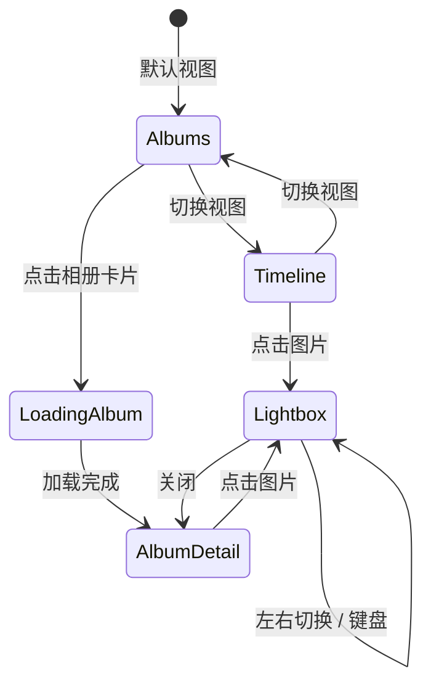

#### 交互稿（时间线）

```
┌─ 2026 年 10 月 ────────── 吸顶 ─┐
│ ┌────┐ ┌────┐ ┌────┐ ┌────┐ │
│ │[缩]│ │[缩]│ │[缩]│ │[缩]│ │
│ └────┘ └────┘ └────┘ └────┘ │
├─ 2026 年 9 月 ─────────── 吸顶 ─┤
│ ┌────┐ ┌────┐                │
│ │[缩]│ │[缩]│                │
└──────────────────────────────┘
```

- 相册卡片：封面 + 目录名 + 图片数量。
- 空状态：`"尚未发现照片"` + 引导链接到设置页配置挂载点。

#### API 契约

```http
GET /api/media/photos/albums?mount_id=&cursor=
200 { ok:true, data: {
  items: [{ path, name, count, cover_thumb_hash?, cover_mtime }],
  next_cursor
}}
```

```http
GET /api/media/photos/timeline?mount_id=&cursor=
200 { ok:true, data: {
  items: [{ path, name, mtime, thumb_hash? }],
  next_cursor
}}
```

#### GWT 验收

```gwt
GWT-PHOTO-01 Given 挂载点含 3 个一级目录  When 进入相册  Then 只显示含图片的目录卡片，无图目录剔除
GWT-PHOTO-02 Given 目录内图片  When 进入相册  Then count 只数第一层
GWT-PHOTO-03 Given 时间线  When 滚动  Then 年月标题吸顶，穿透所有子目录
GWT-PHOTO-04 Given 灯箱打开  When 点击左右箭头  Then 在同目录同类型数组内切换
GWT-PHOTO-05 Given 灯箱  When 键盘 ← →  Then 同上
GWT-PHOTO-06 Given 灯箱  When 关闭  Then 遮罩消失，页面滚动恢复
GWT-PHOTO-07 Given 灯箱打开  When 闲置 2.6 秒  Then 顶栏与缩略图条隐去，鼠标一动立即回来
GWT-PHOTO-08 Given 灯箱图片  When 滚轮放大到 200%  Then 光标下那一点不动；拖动可平移；双击回到 100%
GWT-PHOTO-09 Given 手机灯箱  When 左滑  Then 下一张；When 下滑  Then 关闭灯箱（位移跟手，未到阈值回弹）
GWT-PHOTO-10 Given 灯箱视频  When 按 →  Then 快进 5 秒且不切条目；视频铺满视口且只有顶栏一个关闭按钮
GWT-PHOTO-11 Given 灯箱打开  When 点击左右箭头或缩放胶囊  Then 正常生效且灯箱不关（onTap 按 closest('button, a') 豁免 stage 内控件）
GWT-PHOTO-12 Given 图片模式  When 看底部  Then 缩放胶囊常驻显示百分比，未放大淡显、放大变亮，点击复位
GWT-PHOTO-13 Given 快速连按翻页  When 旧图 load 晚到  Then 不污染新图 ready，无空白闪帧；打底图与原图均已预载
GWT-PHOTO-14 Given 打开预览小图  When 打底图与原始图交替  Then 可见图尺寸全程不变（不得先大后小；两层同为 size-full+object-contain，缩略图 URL 带 r 与 v）
GWT-PHOTO-15 Given 灯箱  When 连点两次左右箭头  Then 正常翻两页且缩放仍是 100%（dblclick 在控件上不触发缩放）
GWT-PHOTO-16 Given 灯箱  When 长按 +/−  Then 只放大一档；When 长按 ←/→  Then 每次 ≥110ms 才翻一张
GWT-THUMB-01 Given 缩略图 URL 带 v=<mtime>  When 服务端指纹与 mtime 一致  Then 回 immutable 长缓存；不带 v 则 private, no-cache + ETag，条件请求回 304
GWT-THUMB-02 Given 320×213 的原图  When 请求 w=960  Then 返回仍是 320×213（绝不放大），缓存文件名前缀是 v3-<长度>-<mtime>
GWT-THUMB-03 Given 源文件被改  When 再次请求缩略图  Then 指纹变、落新文件名、旧指纹文件被 prune_stale 删掉（目录不随时间增长）
GWT-DL-01 Given 任意文件  When 请求 raw?download=1  Then Content-Disposition 为 attachment 且含 filename*=UTF-8''…，类型 octet-stream + nosniff
GWT-DL-02 Given 文本文件  When 请求 raw（不带 download）  Then Content-Type 带 charset=utf-8（不得让浏览器按 GBK 猜成乱码）
GWT-DL-03 Given 目录  When 请求 archive  Then 返回合法 zip（PK\x03\x04 开头，目录条目以 / 结尾），Windows 资源管理器可直接解压
GWT-MENU-01 Given 文件或目录  When 右键  Then 有「下载」且没有「复制相对路径/绝对路径」；目录下载走 zip
```

#### 依赖红线
- 红线 14（媒体单实例）

---

### 3.11 媒体画廊：影视与音乐（M3）

#### 范围
- 影视库 16:9，无图占位。
- 动态 `import()` Video.js 10（`@videojs/html` Web Components）。
- `<video>` `object-fit: contain`，`loadedmetadata` 调整容器比例。
- 关闭时 `pause(); src=''; load();`。
- 音乐库解析 ID3v2/FLAC/MP4/Ogg（`lofty`，关 `read_properties`）+ LRC。
- 底部全局悬浮播放条（不播放不显示）。

#### 交互稿（影视）

```
┌──────────────────────────────┐
│  16:9 容器                    │
│  [视频]                      │
│                              │
│  ▶ ────●─── 12:34 / 45:00   │
└──────────────────────────────┘
```

音乐播放条：

```
┌──────────────────────────────────────────────┐
│ [封面] 歌名 - 歌手    ◀ ⏸ ▶    ──●──  3:20  │
└──────────────────────────────────────────────┘
```

#### GWT 验收

```gwt
GWT-CINEMA-01 Given 影视库  When 进入  Then 卡片 16:9，无图显示占位
GWT-CINEMA-05 Given 影视库  When 进入  Then 先出文件夹卡片（封面+数量），与图片库相册同源（albums?kind=video）
GWT-CINEMA-06 Given 影视文件夹  When 点开  Then 只列本层影片（depth=0），返回/Esc/系统返回都能退回卡片列表
GWT-CINEMA-02 Given 打开视频  When loadedmetadata  Then 容器比例按视频调整
GWT-CINEMA-03 Given 关闭视频  When 执行关闭  Then pause + src='' + load，释放资源
GWT-CINEMA-04 Given 多个视频  When 切换  Then 旧视频销毁，新视频创建（不并存在 DOM）
GWT-MUSIC-01 Given 音乐库  When 进入  Then 列表解析标签展示
GWT-MUSIC-02 Given 点击播放  When 播放  Then 底部播放条出现
GWT-MUSIC-03 Given 未播放  When 进入  Then 播放条不显示
GWT-MUSIC-04 Given 音量调整  When 关闭后重开  Then 从 localStorage 恢复（默认 35%）
GWT-MUSIC-05 Given 列表含 100 首  When 加载  Then 只有播放条一个 `<audio>` 元素（禁用列表循环生成）
GWT-MUSIC-06 Given 桌面窗口  When 播放条出现  Then 宽度≈70%（min 660 / max 1180）且水平居中，播放键落在条几何中心
GWT-MUSIC-07 Given 移动端  When 播放条出现  Then 铺满底部、单行、无圆角，进度用顶端 2px 线表示
```

#### 依赖红线
- 红线 2（不内置刮削）
- 红线 14（媒体单实例）
- §2.2 `lofty` 必须关 `read_properties`

---

### 3.12 终端（M3）

#### 范围
- PTY WebSocket，单用户并发上限 10。
- Windows ConPTY 死锁缓解：`openpty()` 后立即写 `ESC[1;1R`。
- 尺寸钳制：列 `max(20, min(val, 500))`，行 `max(5, min(val, 200))`。
- 断线 3 分钟后销毁，环形缓冲 1MB。
- xterm.js 深色渲染区 + Nerd Font。
- 历史写入 `data/terminal_history/`，禁止污染宿主机历史。
- 纯净模式逃生舱。

#### 状态机

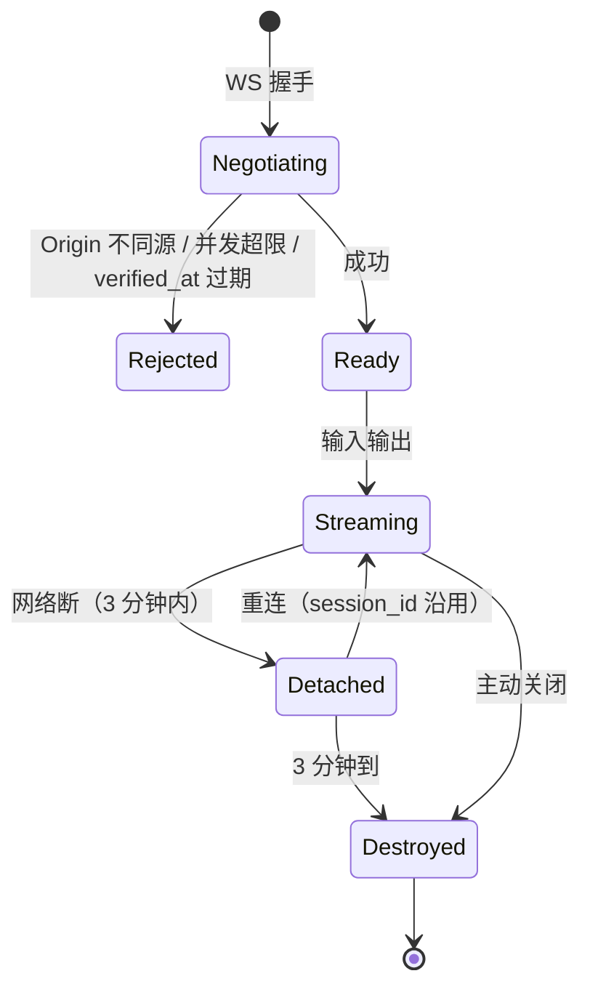

#### 交互稿

```
┌─ 终端 · /media ───────────────────────  [×] ┐
│ ┌─ 渲染区（深色 #1e1e1e）────────────────┐ │
│ │ user@host:/media$ ls                   │ │
│ │ photos  videos                         │ │
│ │ user@host:/media$ █                    │ │
│ └────────────────────────────────────────┘ │
│  [纯净模式重启] [关闭]                     │
└────────────────────────────────────────────┘
```

- 外壳跟随全局主题，渲染区**强制深色**。
- 移动端监听 `window.visualViewport.resize` 重新 `fit()`。
- **v4.4.3 起**（见设计文档 5.4.1）：触屏滚动由 `touchstart/move/end` 自己换算成 `scrollLines`（xterm 6 的虚拟滚动条不认触摸）；快捷键条在文档流里并靠 `useKeyboardInset` 的 `padding-bottom` 随键盘上移；按键用 `pointerdown.prevent` 保住焦点（否则输入法收起）；`pointer: coarse` 下不自动聚焦。
- `Tab` 键拦截，发送 `\t` 并 `return false`。

#### API 契约

```http
WS /api/terminal/ws?mount_id=&path=&cols=80&rows=24&session_id=xxx
Origin 必须与 Host 同源，无 Origin 的非浏览器客户端放行
握手成功后二进制帧：{"type":"data","payload":"..."} 或 raw bytes

超限拒绝：WebSocket close code 4001（并发超限）/ 4003（REAUTH）
```

#### GWT 验收

```gwt
GWT-TERM-01 Given 用户已登录  When 点击终端  Then 建立 WS，cwd 为当前目录
GWT-TERM-02 Given 并发上限 10  When 第 11 个会话  Then 拒绝，前端展示"查看活动会话"入口
GWT-TERM-03 Given 手机横屏  When 高度只剩 400px  Then 行数钳制到 max(5, ...) 不溢出画布
GWT-TERM-04 Given 输入 Tab  When 按 Tab  Then 发送 \t，不切换焦点
GWT-TERM-05 Given 网络断  When 2 分钟内重连  Then 会话沿用，历史保留
GWT-TERM-06 Given 网络断  When 3 分钟后  Then PTY 销毁
GWT-TERM-07 Given Windows  When openpty  Then 立即写 ESC[1;1R，无死锁
GWT-TERM-08 Given 用户在终端执行 `history`  When 命令  Then 不写入宿主机 shell 历史
GWT-TERM-09 Given PowerShell  When 启动  Then `-NoProfile` 可选，纯净模式可用
```

#### 依赖红线
- 红线 18（环境变量不污染）
- 红线 19（交互登录模式、Nerd Font、ANSI 色板）

---

### 3.13 WebDAV（M3）

#### 范围
- 协议由 `dav-server` 实现，本项目只做认证 + 挂载点路由 + 安全边界。
- URL：`/dav/<mount_id>/<path>`；`/dav` 与 `/dav/` 虚拟根列出挂载点。
- 路由用 `nest("/dav")` + `route("/dav/")`。
- Basic Auth：`token_name` : `asm_xxx`；校验失败回退管理员账号 + 登录密码（全量权限，
  待改密 / 开 2FA 拒绝；Argon2 结果带进程内缓存，改密即时失效）。
- `CleanFs` 装饰层：过滤 `.part` 与系统垃圾、修 Windows 错误映射。

#### GWT 验收

```gwt
GWT-DAV-01 Given 客户端填 http://host/dav/  When PROPFIND  Then 列出挂载点
GWT-DAV-02 Given 令牌限定挂载点  When PROPFIND /dav/  Then 只列该挂载点
GWT-DAV-03 Given 只读令牌  When PUT  Then 403
GWT-DAV-04 Given 只读令牌  When OPTIONS  Then Allow 只列读方法
GWT-DAV-05 Given LOCK 后未持锁写  When PUT  Then 423
GWT-DAV-06 Given MOVE Destination 指向挂载点外  When 执行  Then 403
GWT-DAV-07 Given 目录 PROPFIND  When 返回  Then 目录 href 带尾斜杠
GWT-DAV-08 Given 客户端请求 .DS_Store  When GET  Then 404
GWT-DAV-09 Given 客户端 PUT .DS_Store  When 执行  Then 403
GWT-DAV-10 Given Windows MKCOL 带尾斜杠  When 执行  Then 200（先去掉尾斜杠）
GWT-DAV-11 Given 重复 MKCOL  When 执行  Then 405（不是 500）
GWT-DAV-12 Given 子路径部署 base_url=/asmoday  When PROPFIND  Then href 带前缀，Destination 校验通过
```

---

### 3.14 配置（M3）

#### 范围
- `toml_edit` AST 局部修改，保留注释/空行/顺序。
- 源码模式直接写盘，仅语法校验，禁止格式化。
- 与默认值相同的标量不写盘。
- 热重载：裸 `notify` + 手写 500ms 防抖。
- 危险配置自检：`trust_proxy_headers=true` 且白名单空 → WARN；`proxy_trust.enabled=true` 且白名单空 → ERROR 拒绝启用。

#### 交互稿（设置页，Tab 结构）

```
┌─ 设置 ─────────────────────────────────────┐
│ [通用] [媒体] [安全] [高级]                │
│ ────────────────────────────────────────   │
│  服务监听                                  │
│   地址 [0.0.0.0    ]  端口 [8080]          │
│   提示：0.0.0.0 + 未启用 SSL 有风险 ⚠      │
│                                            │
│  [保存]  [恢复默认]                        │
└────────────────────────────────────────────┘
```

- 表单 **多列 Grid**（`md` 单列），卡片 `p-6`，间距 `gap-6`，输入 `h-10`。
- 危险配置自检结果**就地展示**在对应输入下方，不用 toast。

#### GWT 验收

```gwt
GWT-CFG-01 Given 配置文件含注释  When 保存表单  Then 注释保留
GWT-CFG-02 Given 源码模式  When 保存  Then 仅语法校验，不做格式化/AST 重写
GWT-CFG-03 Given 与默认值相同的标量  When 保存  Then 不写入（避免凭空多行）
GWT-CFG-04 Given 连续两次保存相同内容  When 对比文件  Then 逐字一致（幂等）
GWT-CFG-05 Given 外部修改配置文件  When 保存  Then 500ms 内热重载生效
GWT-CFG-06 Given trust_proxy_headers=true 且 trusted_ips 空  When 保存  Then WARN 但不阻止
GWT-CFG-07 Given proxy_trust.enabled=true 且白名单空  When 保存  Then ERROR 拒绝启用
GWT-CFG-08 Given 恢复默认分区块  When 点击  Then 只重置该区块，不碰 SQLite
```

#### 依赖红线
- 红线 17（toml_edit AST）

---

### 3.15 服务聚合代理（M3）

#### 范围
- 配置驱动，外部服务默认新标签页打开，禁止 iframe。
- 反代模式链接 `/proxy/{service_id}`，Rust `hyper` 代理。
- 剥离路径前缀、重写内部绝对链接、忽略 SSL 证书（高级选项）。
- 转发前摘除 `asmoday_session` Cookie；上游同名 `Set-Cookie` 丢弃。

#### GWT 验收

```gwt
GWT-PROXY-01 Given 服务配置为直连模式  When 点击  Then target_url 新标签页
GWT-PROXY-02 Given 服务配置为反代模式  When 点击  Then /proxy/{id} 经 hyper 代理
GWT-PROXY-03 Given 请求 /proxy/{id}  When 转发  Then Cookie 中 asmoday_session 被摘除
GWT-PROXY-04 Given 上游 Set-Cookie  When 响应  Then 同名 Cookie 被丢弃
GWT-PROXY-05 Given inject_headers 配置  When 转发  Then 注入头生效
GWT-PROXY-06 Given 上游返回绝对链接  When rewrite_internal_links=true  Then 改写为 /proxy/{id}/...
```

#### 依赖红线
- 红线 9（禁止 iframe 第三方）
- §8 服务聚合

---

### 3.16 国际化与文案（M4）

#### 范围
- `vue-i18n` v9+，`createI18n({ legacy: false })`。
- 中英语言包分模块（common / error / files / gallery / terminal / settings / share）。
- 用户选择存 localStorage，首次按 `navigator.language`。
- 后端 `message` 仅英文；前端展示依赖 `code` 映射。

#### 交付物

1. `web/src/locales/zh-CN/{common,error,files,...}.json`
2. `web/src/locales/en-US/{common,error,files,...}.json`
3. `web/src/lib/errors.ts`：`code → i18n key` 映射（**由 §1.3 表格自动生成**）
4. ESLint 规则 `no-hardcoded-text`：`web/src/**/*.vue` 中除 `<i18n>` 块外不允许中文字符串字面量

#### GWT 验收

```gwt
GWT-I18N-01 Given 用户选择 English  When 刷新  Then 保持 English
GWT-I18N-02 Given 首次访问  When navigator.language=zh-CN  Then 默认中文
GWT-I18N-03 Given 未知 error code  When 展示  Then 显示英文 message + trace_id 复制按钮
GWT-I18N-04 Given 任意 .vue 文件  When ESLint  When 含中文字面量  Then 报错
```

---

### 3.17 空/加载/错误态与移动端（M4）

#### 范围
- 所有列表/详情页补齐三态（正常/空/错误）+ 骨架屏。
- 移动端断点：`<768px` 移动布局，长按阈值 500ms，滑动 >10px 取消长按，触发后忽略 click。
- 底部悬浮条 `env(safe-area-inset-bottom)`。
- 软键盘监听 `visualViewport.resize`。
- 禁止原生 `alert/confirm/prompt`（未保存关闭也已改成站内三选一，见 3.4）。
- **系统返回 = 退一层浮层（v4.4.4，见设计文档 4.8）**：编辑器、灯箱、预览、弹窗、抽屉全部经 `useBackClose` 登记，
  按返回先关最上层（编辑器优先），关完才让路由收到返回；浮层一律不进 URL。

#### 交付物

- `web/src/components/EmptyState.vue` / `ErrorState.vue` / `Skeleton*.vue`
- `web/src/composables/useLongPress.ts`（阈值 500ms，滑动取消）
- `web/src/composables/useViewportFit.ts`（terminal/editor 用）

#### GWT 验收

```gwt
GWT-UX-01 Given 任意列表为空  When 渲染  Then 显示空状态（图标 + 标题 + 引导动作）
GWT-UX-02 Given 列表加载中  When 渲染  Then 显示骨架屏（数量与首屏一致）
GWT-UX-03 Given 加载失败  When 渲染  Then 显示错误态 + 重试按钮
GWT-UX-04 Given 移动端长按文件  When 500ms  Then 弹出右键菜单
GWT-UX-05 Given 长按过程中滑动 >10px  When 释放  Then 不触发菜单
GWT-UX-06 Given 长按触发菜单  When 释放  Then 不触发 click（不打开文件）
GWT-UX-07 Given 底部播放条  When iPhone 安全区  Then 有 padding-bottom
GWT-UX-08 Given 任意组件  When 执行 alert/confirm  Then 禁止（用封装 Modal）
```

---

## 4. Agent 执行协议

### 4.1 一次会话的固定流程

```
1. 读本文档 §0、§1、§3.X
2. 输出本模块 GWT 用例草稿（可微调，但不得删减）
3. Reviewer 确认用例
4. 输出静态页（假数据）截图
5. Reviewer 确认视觉
6. 接 API
7. 自测全部 GWT 通过
8. 录制 demo（happy + error）
9. 输出 PR：代码 + 模块 README（含状态机、用例清单、截图）
```

**禁止**跳过第 2、4、8 步。

### 4.2 Reviewer 走查清单

每次 PR review 必看：

- [ ] GWT 用例是否全部实现（逐条对勾）
- [ ] 三态（正常/空/错误）是否齐全
- [ ] 涉及的 error code 是否都有 i18n 词条
- [ ] 是否有硬编码中文（ESLint 通过）
- [ ] 移动端 375 宽是否可操作
- [ ] 是否有 `console.log` 残留（除 debug 模式）
- [ ] 是否有未使用的 import
- [ ] 是否触发红线（对照 §1.7 执行点清单）
- [ ] Demo 是否覆盖一个错误 path

### 4.3 交付物模板

每个模块交付 PR 时附带：

```markdown
## 模块
§3.X 模块名

## GWT 覆盖
- [x] GWT-XX-01 ...
- [x] GWT-XX-02 ...
- [ ] GWT-XX-03 ...（若未完成，说明原因与后续计划）

## 截图
- 桌面 1440：<link>
- 移动 375：<link>
- 空状态：<link>
- 错误态：<link>

## Demo
- Happy path: <link 1-3 min>
- Error path: <link>

## 红线对照
- 依赖红线：...
- 执行点：...
```

---

## 5. 最终验收走查清单（M4 DoD）

### 5.1 功能走查

```
[ ] 初始化 → 登录 → 强制改密 全流程
[ ] 登录 → 浏览 → 上传 → 重命名 → 移动 → 复制 → 删除 全流程
[ ] 创建分享 → 匿名访问 → 密码验证 → 浏览 → 下载/禁止下载
[ ] 缩略图 → 灯箱 → 键盘切换
[ ] 相册 → 时间线 → 影视 → 音乐播放条
[ ] 终端 → Tab 补全 → 断线重连 → 纯净模式
[ ] WebDAV → 挂载为网络驱动器 → 读写
[ ] 配置 → 可视化修改 → 热重载 → 源码模式
[ ] 代理 → 直连 → 反代
[ ] 令牌 → 创建 → 使用 → 删除 → 会话失效
[ ] 2FA → 开启 → 登录 → 恢复码 → 关闭
[ ] 备份下载（触发 REAUTH）
```

### 5.2 异常走查

```
[ ] 任意页面断网 → 错误提示 → 重连恢复
[ ] 会话过期 → 跳登录 → 登录后回原路径
[ ] REAUTH 触发 → 取消 → 原操作中断
[ ] E_BUSY → 弹窗无"重试"按钮
[ ] E_DIR_CONFLICT → 只能 rename/skip
[ ] 上传中途关闭标签页 → 重启后无 .part 残留
[ ] 跨挂载点移动 500MB → 中途 kill → 重启清理 .part
[ ] 外部修改配置文件 → 热重载生效
[ ] 外部修改正在编辑的文件 → 保存 409 → Modal 三选一
```

### 5.3 移动端走查

```
[ ] 375 宽，所有页面无横向滚动
[ ] 长按弹出菜单，滑动取消
[ ] 软键盘弹出时终端/编辑器重新 fit，按键条整块停在键盘上沿（不被压住半截）
[ ] 终端里手指拖动 / 甩动能翻历史输出，轻点不会误滚
[ ] 连按快捷键条时系统输入法不收起
[ ] 底部安全区 padding
[ ] 顶部安全区（刘海屏）不遮挡
```

### 5.4 i18n 走查

```
[ ] 切换到 English，所有可见文案无残留中文
[ ] 未知 code 兜底英文 message + trace_id
[ ] 任意 .vue 文件 ESLint no-hardcoded-text 通过
```

### 5.5 红线走查（对照 §1.7 逐条）

```
[ ] 不内置转码：cargo tree 无 ffmpeg-sys
[ ] 无 CDN：dist/index.html 无外链
[ ] 无认证关闭开关：schema 无对应字段
[ ] 无回收站：代码无 trash 分支
[ ] 批量阈值：GWT-MUT-01/02/03/04 通过
[ ] 目录 overwrite 拒绝：GWT-MUT-08 通过
[ ] 无 ACME：schema 无对应字段
[ ] iframe 受限：ESLint 自定义规则通过
[ ] 依赖锁定：Cargo.lock + pnpm-lock.yaml 入库
[ ] i18n 强制：ESLint 通过
[ ] 原子落盘：fs_ops 单测通过
[ ] canonicalize 父目录：代码 grep 无裸调用
[ ] 媒体单实例：GWT-MUSIC-05 通过
[ ] ThumbHash 入 SQLite：代码 grep
[ ] EOL 原样写回：GWT-TEXT-01/02/03 通过
[ ] toml_edit AST：代码 grep
[ ] 环境变量不污染：GWT-TERM-08 通过
[ ] 终端登录模式：单测通过
```

---

## 6. 附录：里程碑甘特与依赖

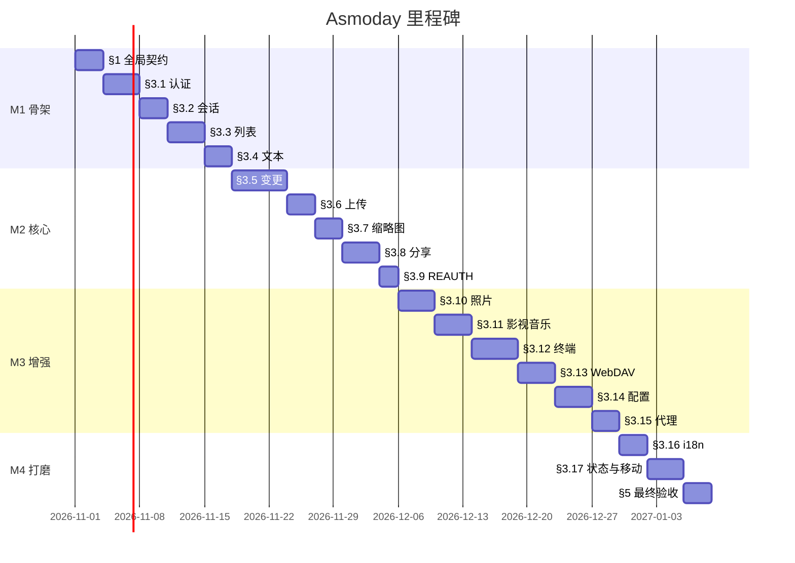

**依赖是硬依赖**：前序模块未 DoD，不允许进入后序模块。允许在 M1 完成后并行开发 M2 内不冲突的模块（如缩略图与上传），但要求**至少一人（或一个 agent 会话）专职按顺序推进主链路**。

---

**文档结束。**

> 使用提醒：本文档的每个 §3.X 都是**可直接复制给 agent 的独立上下文**。喂给 agent 时，请连同 §1 全局契约一起提供，按 §4.1 的流程推进。若 agent 产物与 §5 走查清单有偏差，优先修正本文档（补充规格），而不是让 agent"再多写点"——**规格层的清晰度直接决定产物的可用性**。